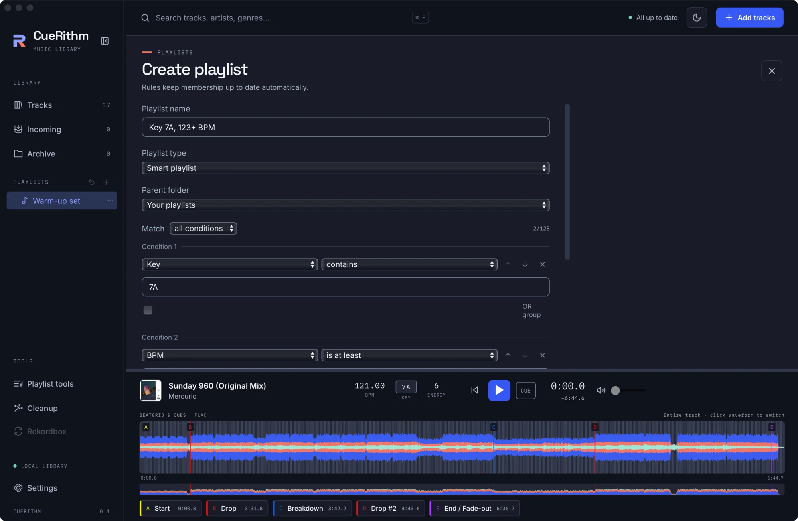
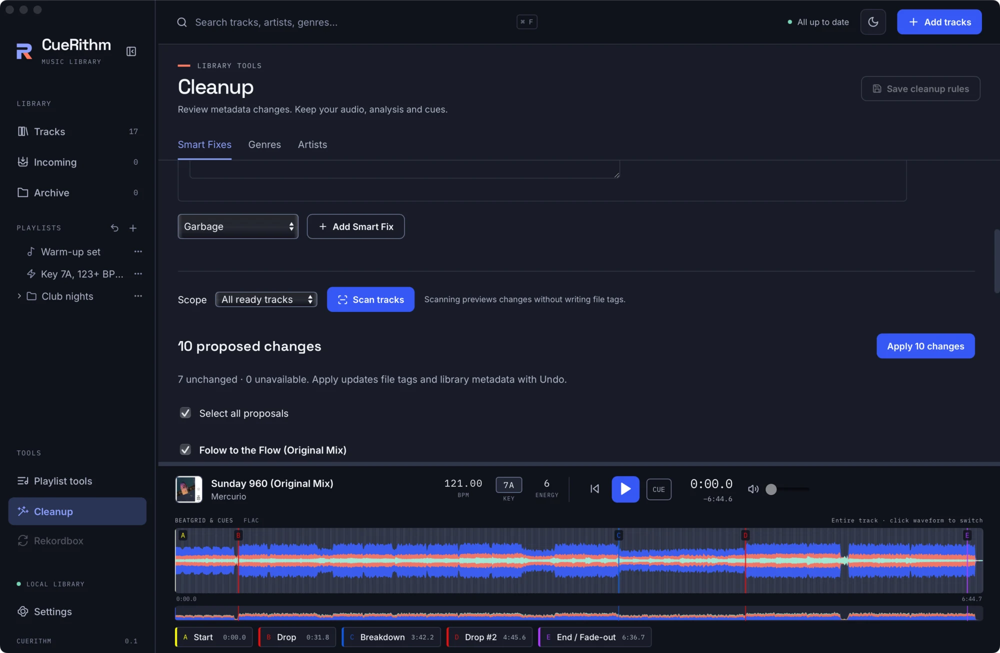
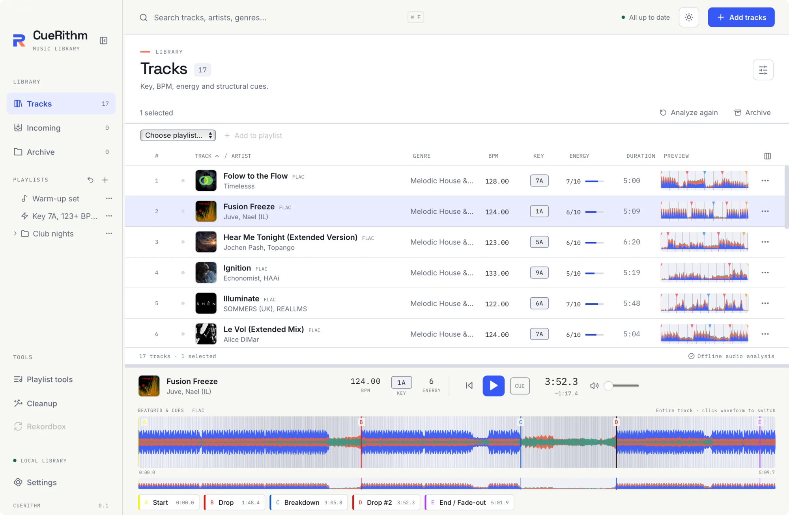

<p align="center">
  <picture>
    <source media="(prefers-color-scheme: dark)" srcset="docs/assets/brand/readme-dark.png">
    
  </picture>
</p>

<p align="center">
  <a href="https://github.com/johnneerdael/CueRithm/releases/latest"></a>
  <a href="https://github.com/johnneerdael/CueRithm/actions/workflows/desktop.yml"></a>
  <a href="https://github.com/johnneerdael/CueRithm/actions/workflows/ci.yml"></a>
  <a href="https://johnneerdael.github.io/CueRithm/"></a>
  
</p>

CueRithm is a desktop library app for DJs. It analyses tracks offline, computing musical key, BPM and beatgrid, one whole-track energy rating, structural cues and a colour waveform. You can tag and clean up the library, create playlists, and set up smart playlists that update automatically.

Your music stays where it is. Nothing is uploaded. There is no account.

<p align="center">
  <a href="https://github.com/johnneerdael/CueRithm/releases/latest"><b>Download</b></a> &nbsp;·&nbsp;
  <a href="https://johnneerdael.github.io/CueRithm/get-started/"><b>Get started</b></a> &nbsp;·&nbsp;
  <a href="https://johnneerdael.github.io/CueRithm/"><b>User guide</b></a> &nbsp;·&nbsp;
  <a href="https://johnneerdael.github.io/CueRithm/technical/"><b>How it works</b></a>
</p>

<p align="center">
  
</p>

## What you get

| | |
| --- | --- |
| **Key** | A neural network inside the app analyses the whole track and returns a Camelot key such as `7A`. |
| **BPM and beatgrid** | One tempo and one first beat per track, shown to two decimals, with beat lines in the player. |
| **Energy** | One rating from 1 to 10 for the whole track. |
| **Cues** | Start, Drop, Breakdown, a second Drop, a second Breakdown and End / Fade-out, plus an optional emergency loop. Click a cue to jump there. |
| **Waveform** | Three frequency bands in six colour palettes, with a default 32-second zoom for checking the grid. |
| **Incoming** | Watch folders, drag and drop or **Add tracks**. Every track is decoded, analysed and moved into your library automatically. |
| **Tagging** | Optional DJ-store and public-catalog providers, private account setup, match review and staged writes that verify your audio is unchanged. |
| **Cleanup** | Eleven Smart Fixes plus genre and artist mappings: scan, review, apply, and **Undo**. |
| **Playlists** | Ordinary playlists, folders and smart playlists with rules over BPM, key, energy, genre, dates and cues. |
| **DJ sync** | Send prepared tracks, cues, grids and playlists to VirtualDJ, Engine DJ, djay Pro, Serato DJ Pro 4 or Pioneer USB, with a preview and recoverable backups. See the [Sync guide](docs/user-guide/guides/sync.md). |
| **Formats** | MP3, AAC (ADTS and M4A), ALAC, FLAC, WAV, AIFF, Ogg Vorbis, Opus and WMA. The decoder is bundled, so you do not need to install anything else. |

## See it work

<table>
  <tr>
    <td width="50%"><br><sub><b>Incoming.</b> Drop tracks in and watch each one move through decoding and analysis.</sub></td>
    <td width="50%"><br><sub><b>Smart playlists.</b> Rules over key, BPM, energy and more, previewed before you save.</sub></td>
  </tr>
  <tr>
    <td width="50%"><br><sub><b>Cleanup.</b> Review every proposed change before anything is written, and undo it later.</sub></td>
    <td width="50%"><br><sub><b>Light and dark.</b> Follows your system, with labelled data that never relies on colour alone.</sub></td>
  </tr>
</table>

## Analysis and file handling

Key, tempo, energy and cues are computed on your computer from the decoded audio. Optional catalog tagging and consented recording identification use the network. Identification sends an audio fingerprint; raw audio recognition uploads are not enabled.

CueRithm never moves your audio. Tagging and cleanup write to a staged copy, then decode it again to verify that the playable audio is identical. The original is kept, and an atomic swap with a journal allows recovery after a crash.

The bundled FFmpeg decodes every format into the same 44.1 kHz stream, so analysis, the waveform and playback use the same cue positions. Analysis agreement is measured against reference tools on my own library; it does not establish musical accuracy. Read [How accurate is it?](https://johnneerdael.github.io/CueRithm/technical/accuracy/).

## Install

Download the latest build from the [releases page](https://github.com/johnneerdael/CueRithm/releases/latest).

| System | File | Notes |
| --- | --- | --- |
| **macOS** (Apple Silicon) | `.dmg` | Signed with a Developer ID and notarized by Apple. There is no Intel Mac build. |
| **Windows** (x86-64) | `.zip` | Portable app. Keep the `media` folder next to the program. Unsigned, so SmartScreen may warn on first launch. |
| **Linux** (x86-64) | `.deb` | Unsigned. |

Every release includes the matching application source, the FFmpeg source and `THIRD_PARTY_NOTICES.md`. For installation steps, see [Install](https://johnneerdael.github.io/CueRithm/get-started/install/).

You can check an installation at any time:

```sh
/Applications/CueRithm.app/Contents/MacOS/cuerithm-desktop --diagnostics
```

## Current limits

CueRithm is early software. Current source includes maintenance screens, manual cue/loop/grid corrections and templates, compatible-track search, playlist flow, text/CSV tracklist matching and local library backup. Direct rekordbox sync supports the tested macOS builds 6.8.7.0303 and 7.2.19.0342; other builds and Windows remain read-only. Playback uses the system default output. Check a download’s release notes for its included features; native application/device acceptance is separate from implementation tests. See [Not available yet](https://johnneerdael.github.io/CueRithm/about/roadmap/).

## Documentation

The [user guide](https://johnneerdael.github.io/CueRithm/) covers:

- [Get started](https://johnneerdael.github.io/CueRithm/get-started/): install, the window, adding music and keyboard shortcuts.
- [Learn](https://johnneerdael.github.io/CueRithm/learn/): nine hands-on tutorials, from your first tracks to smart playlists, cleanup and tagging.
- [Guides](https://johnneerdael.github.io/CueRithm/guides/): every control and setting.
- [Under the hood](https://johnneerdael.github.io/CueRithm/technical/): the analysis pipeline, decoding, key detection, tempo and beatgrid, energy, the cue engine, waveforms, the library database, safe tag writing, catalog matching and the smart playlist engine.
- [About](https://johnneerdael.github.io/CueRithm/about/): credits, provenance and an FAQ.

## Credits

CueRithm uses [OneTagger](https://github.com/Marekkon5/onetagger) by Marekkon5 for selected metadata providers, matching and tag writing (GPL v3), [OpenKeyScan](https://github.com/rekordcloud/openkeyscan-analyzer) for the key network (MIT), and FFmpeg for decoding (LGPL). Other components include TagLib, libsoxr, Tauri and React. The full list with licences is in [Credits and open source](https://johnneerdael.github.io/CueRithm/about/credits/) and [`THIRD_PARTY_NOTICES.md`](THIRD_PARTY_NOTICES.md).

Mixed In Key and Lexicon DJ shaped how CueRithm behaves. I studied them using copies I own, and CueRithm is my own independent implementation written in Rust. No original code, models or assets are included. See [How CueRithm was made](https://johnneerdael.github.io/CueRithm/about/provenance/).

CueRithm is not affiliated with, endorsed by or sponsored by Mixed In Key, Lexicon, Beatport, Traxsource, rekordbox, OneTagger or any other product named here.

## For developers

The analysis engine is a set of Rust crates (`camelot-core`, `camelot-cli` and others) with a Tauri 2 and React desktop app on top. The engineering reference, with build, test and validation commands, is in [`docs/development/engine-and-cli.md`](docs/development/engine-and-cli.md). Desktop setup and platform prerequisites are in [`docs/development/desktop.md`](docs/development/desktop.md), and the pull request and release workflow is in [`docs/development/pr-workflow.md`](docs/development/pr-workflow.md).

```sh
cargo test --workspace
cargo build -p camelot-cli --release
```

Pull requests need a completed `@codex review` and the checks in the [pull request template](.github/PULL_REQUEST_TEMPLATE.md). Releases are published automatically from `main`.

## Licence

The independent analysis engine is MIT licensed ([`LICENSE`](LICENSE)). The desktop application and the OneTagger integration are GPL-3.0-only ([`apps/desktop/LICENSE`](apps/desktop/LICENSE)). See [third-party notices](THIRD_PARTY_NOTICES.md).

Developer automation: [headless library commands](docs/automation.md). Provider evidence: [PR5 acceptance and remaining limits](docs/research/pr5-provider-acceptance.md).
