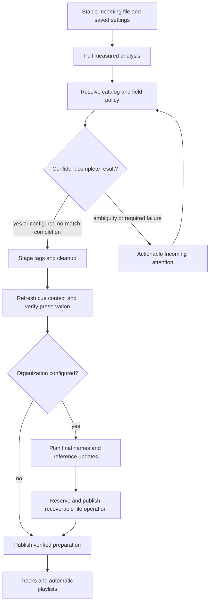
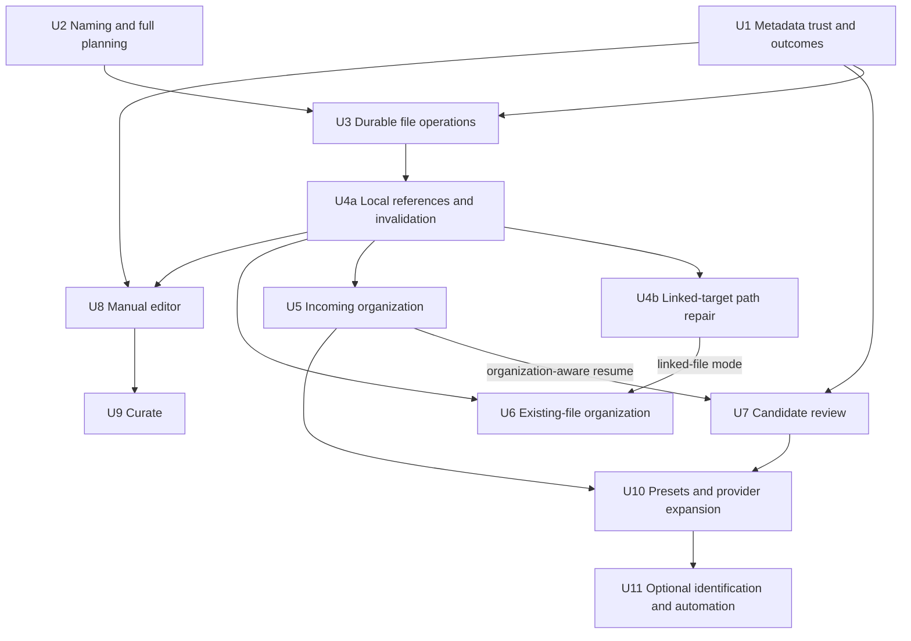

# Extend CueRithm preparation with safe organization and library tagging

## Recommendation

Build one coherent library workflow on CueRithm's existing preparation, metadata and recovery services. The first new workflow should be **automatic naming and organization after successful Incoming preparation**, paired with understandable exception handling. Follow with **Review match**, a **common metadata editor** and a **Curate inspector** that retains the table and persistent player. Expand providers individually after their access and data contracts pass acceptance.

Keep the existing global settings as the first configuration surface. Named presets are useful later; they are not a prerequisite for shipping organization. The default still leaves source files in place. Once organization is explicitly configured, successful Incoming tracks finish without a review wizard.

The user approved the selected feature scope. The [five-PR delivery plan](2026-10-20-002-feat-library-preparation-five-pr-delivery-plan.md) now governs sequence, selected providers and PR boundaries; this document retains the detailed technical contracts. U0–U11 are internal work packages, not an additional twelve PRs. No proposed feature is implemented by a planning document. U0 follows the later user instruction to preserve main's optional solver integration and show Traxsource with detected-source availability; this supersedes the initial blanket UI restriction.

## Evidence and requirements trace

Baseline: CueRithm `e80a44214418d7c59e7620a00bfdb868bcd6407e`; OneTagger `36523f71f2d9a5947912f3cb930f1a31fcb2e3ee`; installed OneTagger 1.7.0. The [feature evaluation](../research/onetagger-feature-evaluation.md) covers 28 feature groups and all twelve built-in adapters. The [issue audit](../research/onetagger-issue-audit.md) covers every fetched issue and discussion, including closed reports. Neither source inspection nor an issue's state proves runtime health.

| Requirement from the origin | Delivery and evidence |
|---|---|
| R1 complete app/source evaluation | Feature matrix F01–F28, artifact identity/offsets, source-versus-installed distinction |
| R2 useful additions, no duplicate application | Priority table; existing-service reuse in every unit; explicit deferred/rejected features |
| R3 automatic Incoming | U1–U5; same saved settings and job snapshot, exception-only review |
| R4 renaming/organization | U2–U6; templates, full plans, collisions, copy/move recovery, references, batch preview/Undo |
| R5 current design system | Surface contracts and prototype; U5–U9 frontend acceptance |
| R6 all relevant issues and broken reuse | Complete audit ledger; issue families and tests mapped below; reported versus confirmed evidence retained |
| R7 preserve Traxsource code and honest detected-source availability | U0 and provider availability policy throughout U10 |
| R8 concrete plan and visuals | This plan, research/ledger companions, `docs/design/onetagger-preparation/` |
| R9 current alternatives and large DJ data | Alternatives/source matrix; U10/U11 access, rights and capability gates; no broken upstream endpoint is treated as a required dependency |
| R10 MusicBrainz/SonoVault, private user keys, no Musicfetch | PR5 of the canonical delivery plan; meaningful release-version User-Agent, native credential storage, free-key signup link and individually accepted service capabilities |
| R11 approved scope in five PRs | Canonical PR1–PR5 mapping covers every U0–U11 contract, with independent source activation gates |
| R12 user-suggested recognition APIs | PR5 compares Music Identify, Tipsters Shazam Core, API Dojo and AudD against the fingerprint-only path; keys stay private, quotas and descriptor/identity differences remain explicit |

## Current foundation and actual gaps

Already built: immutable preparation settings; watch/add ingestion; bundled decoding; full measured analysis and validated cues; Beatport/Traxsource matching; field/overwrite/routing/artwork settings; staged tag writes and recovery; cleanup; categorized-tag storage; customizable table; persistent waveform/player; playlists and DJ sync foundations. See `crates/cuerithm-library/src/prepare.rs`, `tagging.rs`, `settings.rs`, `store.rs`, `crates/cuerithm-autotag/src/`, and `apps/desktop/src/views/TaggingSettings.tsx`.

Actually missing: source-audio organization; complete candidate/field review UI; common manual tag editor; Quick Tag/Curate assignment UI; named preparation presets; broader provider adapters. The existing **Filename template** parses metadata from input names. It does not rename audio. The vendored template parser is currently used for cover filenames only.

Retain the current-version target boundaries from the [DJ sync specification](../superpowers/specs/2026-10-20-dj-software-sync.md). Lexicon's older-version compatibility is explicitly out of scope. Organization must cooperate with existing native/USB sync identities without expanding that compatibility matrix.

## Priorities and scope decisions

| Priority | Delivery | Why / release condition |
|---|---|---|
| Now | Retain visible Traxsource/config and main's shared solver controls | Direct access is allowed initially and after reset; persist detected Cloudflare restrictions and require a configured compatible solver for blocked sources |
| First feature delivery | Naming/organization for configured Incoming and unlinked existing tracks | Removes repetitive preparation work; requires complete path/recovery contracts, not a thin wrapper around `rename` |
| First feature delivery | Match/field trust, outcomes and recovery visibility | Extra automation is only useful if wrong editions, failed fields and incomplete moves are visible |
| Next | Match review, manual common fields/artwork, Curate | Resolves exceptions and adds human DJ knowledge without changing analysis or leaving the library workspace |
| Next | Named presets, per-folder assignment and portable non-secret export | Avoids repeated configuration for different collections; builds on a working single configuration |
| Selected expansion | MusicBrainz and optional SonoVault in PR5; other catalogs individually accepted later | Only users choosing SonoVault enter their personal key; no application-wide requirement; Musicfetch is excluded |
| Conditional later | Recognition, advanced raw records, headless library commands/report export | Useful specialized workflows; explicit contracts prevent a second application inside CueRithm |
| Defer / do not import | Spotify Audio Features, arbitrary post-scripts, downloadable native plugins, legacy web server/player/shell | Broken/currently disabled service or poor fit with safety/maintenance/product value |

No normalization/gain processing, WavPack/stem/ChromeOS support, cloud streaming library, full binary tag editor or extra local affective-analysis model is added by this plan. Those are separate decisions, not hidden requirements for adopting useful OneTagger ideas. Lyrics/LRC remain a low-priority optional enrichment, not an Incoming dependency.

## Design contract

**Visual thesis:** extend CueRithm's dense, calm cobalt/coral library surfaces with the same light/dark tokens, typography, 8px controls and 12px panels. Do not introduce OneTagger's navigation or another theme.

**Content:** retain the sidebar, primary track table and resizable persistent player. Add selection-aware Edit/Curate/Review panels; add File organization to the existing Settings pages; expose manual Organize files through Tools and selection actions. Put provenance, mixed values, actual stage and before/after paths where the decision is made.

**Interaction:** use the existing short focus/selection transitions; preserve player identity while editing another selection; retain scroll/filter/selection across inspector changes. Debounced example naming is explicitly an example, while actual apply requires a complete frozen plan. Reduced-motion and keyboard behavior follow current tokens.

| Surface | Proposed behavior |
|---|---|
| Settings → File organization | Off by default; Rename in place / Move to folder / Copy to folder; simple token insertion and advanced pattern; missing-value/collision policy; example filenames; Save settings uses the existing draft/save model |
| Incoming | Show matching, writing, organizing and attention states; successful configured work stays unattended; errors show the failing provider/field/path and next action |
| Incoming → Review match | Recording/version/album/ID/duration evidence; current versus proposed fields/artwork; keep/replace/append decisions; accepting a choice resumes the same logical preparation operation through a freshly claimed attempt after revalidation |
| Tracks → Edit | Common typed fields and cover first; explicit mixed/keep/set/clear/append behavior; preview/commit/Undo; advanced native records expand separately |
| Tracks → Curate | Configurable mood/vibe/occasion/instrument groups, rating and notes; keyboard-first toggles and next/previous; saved/pending/error state; measured energy stays read-only |
| Tools → Organize files | Selected tracks, playlist/folder or all eligible tracks; full before/after plan, collisions/missing values/external-link impacts; apply/history/guarded Undo |

The prototype is a proposal using invented data, not proof that these product flows exist. No Apply control in the prototype performs library mutations.

**Editing/commit recommendation:** common metadata editing uses explicit Save/Cmd-or-Ctrl+S and reviewed batch publication. Curate category/rating toggles persist a local outbox immediately, coalesce edits per stable track/draft revision, then publish through a serialized safe autosave queue. Notes join that queue after a short idle debounce or explicit Save. Next/selection/panel navigation may proceed once the draft/outbox is durable; it does not wait for network/file I/O or drop the last track's edits. Application close preserves unfinished outbox/journal work for restart. Show Pending/Saving/Error against the actual revision; show Saved only after required native and library publication acknowledge it. Failed drafts stay discoverable with Retry and Discard, while Undo handles already published changes. A newer draft must never receive an older write's Saved acknowledgment.

**Accessible layout acceptance:** support the current 980×680 minimum window and enlarged text/200% zoom. When the table and inspector cannot remain usable side by side, let Details replace the center table above the persistent player, with a clear Back to tracks action and retained selection/filter/scroll. Use independent inspector scrolling and a reachable action bar; long paths remain readable/copyable. Opening an inspector moves focus to its heading/first relevant field; closing restores the initiating row/action. Preserve durable dirty drafts on Escape/navigation. Expose selected/mixed states semantically, associate errors with fields, announce pending/saved/partial outcomes nonintrusively, and never rely on color or global shortcuts while typing.

## Key technical decisions

| Decision | Rationale and boundary |
|---|---|
| Shared library services for automatic and manual paths | A recipe, manual organize and editor must use the same validation/publication rules, not three direct-file implementations |
| Measured analysis remains independent | Catalog/manual key/BPM output is a file-field policy. Stable canonical DSP, grid, cue timing and one whole-track energy rating survive text edits and byte-identical path changes |
| Final effective metadata determines the filename | Stage catalog/manual field policies, cleanup and derived cue context first. A later accepted version/artist change cannot leave a stale proposed filename |
| No overwrite mode | A collision blocks or receives a deterministic configured suffix. A same-file no-op is identified explicitly. No skipped move is counted as success |
| Per-track recoverability, explicit batch partial outcomes | A cross-volume batch is not globally atomic. Completed tracks, blocked tracks and interrupted tracks retain individual evidence and can be retried or undone deliberately |
| Stable track IDs with explicit content/path revisions | Path changes update all local references/caches and invalidate stale plans without creating duplicate tracks or unnecessary DSP jobs |
| Existing external references are a separate publication boundary | A local rename cannot magically update every DJ application. Known linked tracks need supported reference repair; unsupported or inaccessible targets block that operation instead of silently breaking paths |
| Structured taxonomy before export strings | Category IDs/values are independent of comment separators and named COMM records. Destination mappings are explicit and collision-checked |
| Provider contract acceptance before enablement | Current endpoints, access, paging, field semantics, artwork and failure behavior must pass per-adapter fixtures and permitted live checks. More providers is not inherently better matching |
| Traxsource remains visible with detected-source availability | Preserve code/schema, saved order and custom options. Initial/reset access may try direct requests. After a detected Cloudflare challenge, persist the requirement and disable new selection without a configured compatible solver; keep existing selection deselectable. Endpoint presence is not solver health proof; runtime solver failures remain unavailable, never no-match |

## Intended preparation flow

> This illustrates the intended approach and is directional guidance for review, not implementation specification. The implementing agent should treat it as context, not code to reproduce.

Organization consumes a staged verified tagged file, not an already promoted track followed by an untracked filesystem rename. Keep one preparation operation identity across tag, sidecar, path and database publication. If an operation partially publishes and cleanup fails, retain an explicit unfinished/attention state and evidence; do not claim Ready merely because the destination exists.

## Delivery dependencies

U0 is independent and reconciles main's solver integration with the later user instruction. U7/U8 UI work can progress alongside the organization backend; mutation/path-sensitive invalidation requires U3/U4a, and organization-aware review resume requires U5. U4b gates linked-file mode specifically, not first delivery for files with no known managed external references. U10 contains separately gated adapters; it is not one bulk provider-import PR.

## Implementation units

### U0 — Detected-source availability and optional solver

**Status:** the later user instruction supersedes blanket hiding. Preserve main's global FlareSolverr-compatible solver integration; this records current source policy, not a claim that a configured service is reachable or healthy.

**Files:** `apps/desktop/src/views/{Settings,TaggingSettings}.tsx`, bridge types/API and `App.tsx` catalog-revision wiring; `crates/cuerithm-library/src/catalog_access.rs`; tests `apps/desktop/src/test/tagging-settings.test.tsx` and `crates/cuerithm-library/tests/catalog_access.rs`.

**Behavior:** show Traxsource selection, options and capabilities. Keep shared solver URL/timeout controls and catalogRevision refresh without replacing unsaved settings. Allow initial/reset direct access; persist detected Cloudflare restrictions across restart. Without a configured compatible solver, a detected blocked source is visibly unavailable and cannot be newly selected. Existing selected sources remain deselectable; unrelated saves retain order, custom values and required-field policies. Retry direct source access clears detected restrictions. A configured endpoint is not health/capability proof; unreachable or unsupported solver responses surface provider-unavailable outcomes, distinct from no match.

**Verification:** cover initial/direct and reset attempts, detected-block persistence/reopen, no-solver disabled selection, selected-source deselection, solver/timeout persistence, mounted catalog refresh, unrelated-save preservation and explicit reset failure. Fixture tests cover unsupported/unreachable solver behavior without live providers. Frontend checks do not establish live solver or provider health.

### U1 — Field policy, identity evidence and truthful outcomes

**Requirements:** R2, R3, R6. **Dependencies:** existing autotag/preparation services.

**Files:** modify `crates/cuerithm-autotag/src/lib.rs`, `providers.rs`, `write.rs`, `config.rs`; `crates/cuerithm-library/src/prepare.rs`, `tagging.rs`, `metadata.rs`; extend `crates/cuerithm-autotag/tests/matching.rs`, `settings_writes.rs`, `writing.rs`, `artwork_write.rs`; `crates/cuerithm-library/tests/autotag_preparation.rs`.

**Approach:** distinguish recording identity, similarity, ambiguity and provider/field availability. Persist bounded candidate/provenance snapshots with source hash, configuration/query identity and adapter version. Keep existing duration repairs. Add explicit edition constraints and deterministic candidate tie handling. Model selected field writes as keep/fill/replace/append/clear with capability checks; repair Explicit overwrite before a new provider can populate it. Required artwork/field failure must not become undifferentiated success. Add bounded retry/deadlines and cancellable backoff spanning all analysis workers.

**Patterns:** current `TagMatchOutcome`, `TagWritePlan`, immutable job settings and source/PCM proofs. Characterize inherited normalization before changing it; do not replace the validated DSP/cue implementation.

**Test scenarios:**
- Club/Dub/Extended/Radio/Instrumental variants with similar titles retain distinct edition evidence; neither a 0.95 nor a cleaned 1.0 score bypasses a conflict.
- Equal title/artist with wrong album/release/ISRC/duration becomes ambiguous or rejected according to configured identity policy; unknown duration is represented explicitly.
- `overwrite=false` with Genre replacement changes Genre and fills genuinely empty permitted fields, while protected title/artwork/Explicit remain intact.
- Artwork transport failure, 403, 429, timeout, parse error and genuine empty results produce distinct outcomes; retries have a total budget and cancellation interrupts waits.
- Malformed tags fail without rebuilding a fresh tag. Synthetic opaque GEOB/PRIV/COMM, Serato/native frames, unknown chunks and unrelated values survive each supported field operation, in addition to PCM/frame/timeline equality.
- Local-only metadata changes do not rerun full analysis; required genre-dependent cue refresh uses the accepted final metadata under the existing cue policy.

**Verification:** deterministic synthetic fixtures and independent native readers prove field preservation and recording decisions. Permitted provider checks demonstrate current transport separately; no automatic user-library writes are used as a benchmark.

### U2 — Safe naming language and full-scope planning

**Requirements:** R4, R6. **Dependencies:** final effective metadata model from U1; pure planning may start in parallel.

**Files:** create `crates/cuerithm-organize/src/{lib.rs,template.rs,plan.rs,paths.rs}` and `tests/{templates.rs,plans.rs}`; workspace manifest/lockfile; reuse `crates/cuerithm-dj-sync/src/path_serde.rs` semantics through a deliberately placed shared path representation rather than dependency on a DJ adapter.

**Approach:** support Leave in place, Rename in place, Move to managed root and Copy to managed root. Begin with documented typed metadata/original-name/parent/version/date/key tokens, optional segments, case and padding; add bounded advanced functions only with a clear compatibility specification. Missing values have explicit skip/block/omit behavior. Do not implement arbitrary code execution. Sanitize values and validate the final resolved path, including literal template text. Never let a pattern escape its authorized root.

| Missing-value policy | Terminal behavior |
|---|---|
| Needs attention / Block (default) | Retain Incoming attention; no path change or Ready promotion. |
| Omit declared optional segment | Remove only that segment; continue only if the resulting filename/path remains valid and collision-free. |
| Skip organization when explicitly optional | Preserve the original valid path and finish with a recorded skipped-organization reason/count. Do not silently skip a required managed-destination operation. |

Skip is not a catch-all for invalid syntax, traversal, unsafe paths or empty final names. Those always block. Settings help, operation history and progress must use the same outcome meanings.

Plan every eligible file in the selected scope. Return totals plus paged rows, not a three-file sample. Freeze source identity/content/path revision, final metadata/configuration, all destination reservations, sidecars and required reference updates. Changed inputs invalidate the plan. Same-file and identical-existing-copy no-ops must be proved, not inferred from a filename. A preview must finish successfully before any manual Apply is offered.

**Test scenarios:** missing/blank/multivalue metadata; plural/singular token semantics; mix names; Unicode composed/decomposed/case-only collisions; raw Unix bytes and Windows UTF16; reserved Windows names/namespaces; long components; absolute/path-traversal literals; same-file/hard-link/symlink aliases; two selected and one unselected track targeting the same destination; mixed-release `cover.jpg`; 100k-row paged planning with cancellation and no partial apply token; source/config changes between example/full preview/apply.

**Verification:** pure planner is deterministic, platform-aware, read-only and independently testable. Document compatible syntax and rejected upstream aliases instead of claiming exact OneTagger grammar parity.

### U3 — Durable file organization and recovery

**Requirements:** R3, R4, R6. **Dependencies:** U1/U2.

**Files:** create `crates/cuerithm-library/src/organization/{mod.rs,journal.rs,publish.rs,recovery.rs}`; modify `store.rs`, `tagging.rs`, `jobs.rs`; add `crates/cuerithm-library/tests/{organization_recovery.rs,organization_publication.rs}`. Extend metadata schema through the repository's existing migration path.

**Approach:** reuse verified staging/backups and ownership reservations, but model file-path changes explicitly. Persist intent before filesystem changes. Same-volume case renames and cross-volume moves have different transitions. For cross-volume moves, verify and durably publish the destination before removing the original. Persist the library path transition and keep the job unfinished until required cleanup completes. Crash recovery chooses a documented, hash-bound roll-forward or restore path; it never deletes a newly edited source or an unrelated destination.

Bind filesystem authority at execution, not only preview: retain/revalidate native identities for the authorized root, traversed parents and captured source object at each mutation and recovery boundary. Enforce an explicit no-follow/symlink/reparse-point policy. Use exclusive no-replace publication, not check-then-rename. Source cleanup and Undo require the captured object and bytes still to match. If parent/source identity changes after planning or staging, stop safely with retryable evidence rather than following a new path outside the authorized root.

Copy mode leaves the original intentionally and promotes one stable track identity at the selected managed copy. Persist an alternate-source record with native path, captured original hash, logical track/operation identity and lifecycle state. Suppress rediscovery only while those owned bytes still match. Changed/replaced original bytes invalidate suppression and create an actionable Incoming source-conflict item tied to that operation, rather than silently ignoring them or manufacturing a second Ready track. Reapply this rule after restart, manual enqueue and Undo; retire/rebind the alternate record when ownership changes. A destination inside a watched folder is recognized as CueRithm's own publication, including after restart. Automatic deletion of recovery backups is not part of successful organization.

Changed-alternate resolution preserves both files by default. Offer **Keep managed track and ignore this original revision** (persist the explicit ignored path/hash revision; a later change resurfaces) or **Add changed original as new Incoming** (retire old alternate suppression and enqueue a new identity). Persist the resolution so watch/restart does not loop. Changed audio requires fresh analysis; do not replace a managed recording or attach its cues/native references to divergent audio silently. Ordinary Retry alone is not a conflict resolution.

Expose storage accounting and discoverable recovery/history. Per-track results distinguish complete, unchanged, blocked, failed and recovery-required. Manual batch cancellation stops before the next safe transition, retaining completed operations for guarded Undo; it does not claim an all-or-nothing cross-volume batch.

**Test scenarios:** crash/fault after each journal, stage, fsync, publish, DB-path switch, source cleanup and Ready transition; disk full/permission/read-only/offline device; destination races; original modified after copy; interrupted case-only rename; source-delete failure; DB failure; sidecar ownership collisions; concurrent watcher/retry/undo; partial batch/cancel/restart; Undo when original path is occupied or metadata changed. Assert original/staged/new bytes and opaque metadata, not just database rows.

Add explicit parent/source replacement faults between preview, staging, publication, cleanup and Undo, including Unix symlinks and Windows reparse points. A leaf no-replace test alone does not prove the parent hierarchy stayed authorized.

**Verification:** restart from persisted evidence at every boundary without lost/overwritten content, duplicate library IDs or falsely Ready jobs. Platform-native filesystem tests are required; macOS-only tests do not prove Windows semantics.

### U4 — Local references, playback and DJ-library path repair

**Requirements:** R3, R4, R5, R6. **Dependencies:** U3.

**Files:** modify `crates/cuerithm-library/src/{store.rs,prepare.rs,playback.rs,waveform.rs,native_sync.rs,dj_sync.rs,dj_sync_service.rs}` and ownership/reference modules; `crates/cuerithm-dj-sync/src/` adapter path handling only where needed; add `crates/cuerithm-library/tests/{organization_references.rs,organization_sync.rs}`; extend `tests/{native_import.rs,playback.rs,tagging.rs}` and `apps/desktop/src/test/{completion-race.test.tsx,sync.test.tsx}`.

**Approach:** stable track IDs preserve playlist membership and selection. Rebind canonical source path, metadata/art/waveform caches, job ownership and imported/native identities consistently; update content/path revisions without unnecessary DSP. Invalidate existing metadata/organize/sync previews when their captured path evidence changes.

Deliver two explicit milestones: **U4a** covers local reference/revision/playback/watcher coherence; **U4b** covers supported linked-target repair and its recovery. Absence of CueRithm export history means no known managed reference, not proof that no external application refers to the file. Preview/settings must make that boundary clear.

Known exported desktop/native references appear in the plan before a move. Update supported native references through the existing closed-application/stale-target-checked adapters and reversible journals. Keep original paths until required reference repair has committed. When a target is offline, open, externally changed, untracked or lacks a supported repair path, block linked-track organization with an actionable explanation. Never claim that a local rename updates arbitrary external playlists/libraries. Device exports with independent copied media and in-place desktop references need different treatment.

Ordinary Sync currently projects Ready tracks and freezes their current paths. U4b therefore needs an explicit prospective/path-repair projection for this coordinator, not a call that filters out unfinished tracks or temporarily marks them Ready. Same-volume moves must also preserve the original reference path until required repair commits; a premature direct rename is not a valid optimization.

The first Incoming organization release may handle never-exported tracks before linked-track repair is ready. U6 must not enable moving linked existing tracks until this unit's repair contract passes. That is a rollout gate; the linked-track capability remains explicit planned work.

**Test scenarios:** selected/playing/archived/unselected and imported tracks; playlist/smart-list membership; source aliases and cached artwork; a byte-identical move retains analysis and cue revisions; pending sync preview is rejected/discarded; changed-only sync recognizes path changes; native app open/offline/replaced library blocks; reference repair fails after destination publication and recovers/undoes safely; independent device copy remains valid; unknown external references receive no false assurance.

**Verification:** local IDs and references remain coherent; every known supported external reference is repaired or the operation is visibly blocked. Playback handles are released/rebound safely without unexpected autoplay or lost transport position.

### U5 — Incoming organization settings and automatic stage

**Requirements:** R3–R5, R7. **Dependencies:** U1–U4 for the enabled modes.

**Files:** modify `crates/cuerithm-library/src/{settings.rs,prepare.rs,jobs.rs}`, Tauri command registration and frontend `types.ts`, `api.ts`; create `apps/desktop/src/views/OrganizationSettings.tsx`; extend `Settings.tsx`, `TrackTable.tsx`; test `crates/cuerithm-library/tests/{organization_preparation.rs,autotag_preparation.rs}`, `apps/desktop/src/test/{organization-settings.test.tsx,settings-pages.test.tsx,workspace.test.tsx}`.

**Approach:** add opt-in organization to existing preparation settings and immutable snapshots. File organization comes after accepted tags/cleanup and preservation checks but before Ready. No fresh per-import dialog. Save settings validates the complete configuration and explains missing fields/collision policy. Keep sample preview labeled Example; actual Incoming planning checks every track. Update the current "Original audio files stay in place" promise to reflect the enabled mode accurately. Preserve shared detected-source availability and solver settings without removing Traxsource support.

**Test scenarios:** default Off preserves names/paths; configured rename uses final artist/title/version/cleanup and analysis tokens; required match/art/organization failure stays Incoming with actual partial state; provider outage is not success/no-match; settings change during a job does not silently change its captured rule; analysis retry reuses valid DSP; folder watches and copy mode do not reingest owned outputs; configured successful input reaches Tracks/automatic playlists unattended; all supported analysis/playback formats follow the same lifecycle.

**Verification:** actual native integration demonstrates add/watch → configured tagging/cleanup → naming/organization → Ready, plus recoverable failures. Settings retain their current navigation/draft/save behavior and both themes.

### U6 — Existing-file Organize workspace, history and Undo

**Requirements:** R4–R6. **Dependencies:** U2–U4.

**Files:** create `apps/desktop/src/views/Organize.tsx`, organization request/result types and shared selection actions; extend sidebar/TrackTable/App/bridge; expose library preview/apply/cancel/history/restore commands; tests `apps/desktop/src/test/{organize.test.tsx,organization-history.test.tsx}`, `crates/cuerithm-library/tests/{organization_scope.rs,organization_recovery.rs}`.

**Approach:** use selected tracks, playlist/folder or all eligible library scope; retain active search/selection context. Present full plan totals and paged before/after paths, no-ops, required reference updates and blockers. Show completion/partial/error details and guarded Undo, following Cleanup/Sync history conventions. Discarding a preview frees temporary data while retaining required recovery evidence. Do not expose overwrite.

**Test scenarios:** select-all-across-pages versus visible subset; stale source/metadata/settings; blocked collision is never applied; cancellation/unmount/late response disposes unused plans; applying survives navigation safely; partial batch results match actual files; linked targets obey U4 gates; Undo/redo conflicts retain evidence and never overwrite a new file; keyboard/focus and light/dark layouts remain usable with long paths.

**Verification:** the UI operates the same service as Incoming; displayed result counts and history correspond to native files, stable track IDs and reference journals.

### U7 — Review match and resume preparation

**Requirements:** R2, R3, R5, R6. **Dependencies:** U1; U5 for organization-aware resume.

**Files:** add candidate snapshot/query/selection service under `crates/cuerithm-library/src/`; modify `jobs.rs`, autotag result retention, preparation attention actions and bridge; create `apps/desktop/src/components/MatchReview.tsx`; tests `crates/cuerithm-library/tests/{match_review.rs,autotag_preparation.rs}` and `apps/desktop/src/test/match-review.test.tsx`.

**Approach:** retain bounded candidates or requery explicitly against a captured source/config/query identity. Show source URL, release/recording identifiers, mix/edition, duration and field/art differences. User choice can keep existing, choose a different candidate, select fields or retry. A requery must invalidate the previous selection token. Persist protected user decisions so automatic retries do not overwrite them. Resume into the same verified preparation/organization contract; do not write native tags directly from a candidate card.

The logical operation survives review, but execution ownership does not: accepting a decision queues work for a newly claimed attempt under the existing job lifecycle. Invalidate old attempt tokens/staged ownership and revalidate source/config/candidate evidence. Reuse valid DSP evidence independently; do not bypass the current running-attempt publication guard.

**Keep existing once** is a protected manual resolution for this source/configuration-bound operation, even when the automatic no-match policy is Attention. It does not change global settings or fabricate a catalog match. Feed the explicit decision into effective write/preparation policy, preserve its provenance, and claim a fresh attempt. If a separately required field/naming operation still cannot complete, show that specific blocker and an explicit valid resolution rather than repeating the same no-match failure.

**Test scenarios:** no candidates versus unavailable provider; similar Club/Dub candidates; multi-source scalar conflict; stale candidate after source/tag/config edit; archived/requeued job; pagination/lazy artwork errors; cancel/selection race; chosen candidate with partial metadata; keep-existing no-match completes only under its configured policy; rematch on ready tracks preserves DSP and requires explicit write review.

**Verification:** successful unambiguous automatic work remains uninterrupted, while every review action has clear provenance and a resumable/revalidated result.

### U8 — Common metadata editor and advanced native records

**Requirements:** R2, R5, R6. **Dependencies:** U1; U4 for path-sensitive invalidation.

**Files:** create metadata edit service/model under `crates/cuerithm-library/src/`; extend typed metadata/edit operations in `crates/cuerithm-autotag/src/write.rs` and appropriate container adapters; create `apps/desktop/src/components/MetadataEditor.tsx`, `ArtworkEditor.tsx`; test `crates/cuerithm-library/tests/metadata_edits.rs`, autotag `tests/{settings_writes.rs,transfers.rs,artwork_write.rs}`, frontend `test/{metadata-editor.test.tsx,artwork-editor.test.tsx}`.

**Approach:** common artist/title/version, album/album artist, genre/style, label, dates/original date, catalog/ISRC, track/disc totals, rating, comments and cover first. Extend cleanup's limited text-field model deliberately for typed dates/numbers/images. Multiselection represents mixed/keep/set/clear/append explicitly. Retain drafts by stable IDs/revisions across search/selection/navigation and show pending/saved/error state. Batch preview/Undo uses existing staged publication, not an autosave race on track navigation.

Advanced raw fields are a later expansion of this unit, not a general binary inspector. Use structured identities for comments/lyrics/POPM and preserve all untouched records. Do not route a multi-comment editor through inherited generic `set_raw(COMM)`. Expose measured analysis read-only and file-tag overrides distinctly; never silently alter canonical beat timing.

**Test scenarios:** mixed multi-edit, untouched/empty versus clear, multivalue ordering/dedup, artist contributors, release versus original date, zero/range/invalid typed values; artwork types and bad images; named COMM/USLT/POPM and opaque DJ records; unsupported native field fails visibly without clearing data; dirty draft across folder/search/close/restart; external source edits; partial write/Undo; metadata-only changes preserve analysis and playback.

**Verification:** independently read each supported container after field edits, with original audio/timeline and unrelated native data preserved. All required formats remain analyzable/playable; a field lacking native support must be explicitly library-only or blocked, not silently claimed written.

### U9 — Curate inspector, taxonomy and shortcuts

**Requirements:** R2, R5, R6. **Dependencies:** U8 and current categorized-tag/smart-playlist model.

**Files:** extend `crates/cuerithm-cleanup/src/model.rs` only as needed for stable taxonomy IDs; library category storage/smart catalog and manual edit services; add `apps/desktop/src/components/{CuratePanel.tsx,CategoryEditor.tsx}` and shortcut integration; tests `crates/cuerithm-library/tests/{curation.rs,smart_playlists.rs}`, frontend `test/{curate.test.tsx,curate-shortcuts.test.tsx}`.

**Approach:** reuse one category catalog for mood, vibe, occasion, instruments and user-defined groups. Define single/multiple selection per group, explicit rename/delete migration, user rating and notes. Internal categories work in filters/smart playlists independently of native encoding. Optional file/export mappings are per-container/destination and reject accidental shared-frame collisions. Export to native DJ categories only where a tested adapter contract exists; do not use rekordbox XML.

Keyboard actions respect text-input focus, OS shortcuts, selection versus playback identity and next/previous behavior. Queue safe writes with visible saved/error state and Undo; do not lose a just-edited track when its new tags remove it from the current filter.

Follow the design contract's commit model: durable local outbox first, coalesced autosave by track/draft revision, then acknowledgment of the corresponding publication. Keep failed/pending edits accessible even after filtering or navigation. Tests must include the final edited track, newer edits arriving during an older native write, close/restart with pending work, Retry/Discard versus Undo, and screen-reader/focus behavior at minimum size/zoom.

**Test scenarios:** multiple moods versus single mode; mixed batch toggles preserve unrelated values; two groups mapped to the same scalar/comment identity are blocked or explicitly merged; taxonomy rename/delete updates filters and smart definitions; native multivalue roundtrip; hidden filtered item retains its draft; keyboard shortcuts while typing do not toggle tags; track navigation preserves playback unless explicitly requested; rating and measured energy remain independent.

**Verification:** common listening/curation requires no app switching or hidden save gesture, and categories retain stable meaning across edits, restart and destination mapping.

### U10 — Named presets and individually accepted providers

**Requirements:** R2, R3, R6, R7, R10, R11. **Dependencies:** working U1/U5/U7; presets ship in PR4 and providers in PR5, with independent activation gates.

**Files:** preset model/storage under library settings, assignment in `prepare.rs`, existing Settings frontend; provider adapters under `crates/cuerithm-autotag/src/providers/`; catalog/config validation and OneTagger provenance manifests. Tests `crates/cuerithm-library/tests/preparation_presets.rs`, `crates/cuerithm-autotag/tests/{provider_contracts.rs,matching.rs,settings_writes.rs}`, frontend `test/{preparation-presets.test.tsx,tagging-settings.test.tsx}`.

**Approach:** save/load/duplicate/export/import named preparation presets using current settings snapshots; optional per-watch-folder assignment with deterministic precedence and explicit captured preset revision. Secret references are excluded from portable exports, stored using an appropriate platform credential facility, and never embedded into logs or shared presets. The shared solver URL/timeout and detected-source restrictions remain application-wide, outside preset application/import/export; newly captured jobs resolve current transport settings without rewriting existing recovery evidence. Unsupported/imported fields are surfaced rather than silently ignored.

Provider sequence: maintain Beatport; retain visible Traxsource with persisted detected-source restrictions and optional compatible solver support; implement MusicBrainz, optional personal-key SonoVault and optional-auth Discogs in PR5. Exclude Musicfetch. Bandcamp, Juno/Beatsource and other catalogs remain individually accepted candidates rather than promised adapters. Define a separate adapter enablement checklist covering access, authentication, field mappings, paging, IDs, rate/cancel/deadline behavior, malformed responses, artwork and native-write preservation. MusicBrainz uses the canonical desktop-release/contact User-Agent and shared request-start pacing across all jobs. Repair Discogs disc/track indexing before any later enablement. Spotify remains a separate access/model/auth project.

The user selected MusicBrainz and optional SonoVault; a SonoVault-versus-Musicfetch trial is no longer planned. Only users choosing SonoVault enter a key through its masked input, native secure storage and free-key signup link. After the section 9 concern was raised, the user explicitly approved proceeding with this optional personal-account interpretation; do not add a vendor-approval hold or substitute a hosted broker/shared key. Compare exact-edition coverage, useful fields and source persistence/export capabilities in bounded acceptance. No paid subscription or hosted billing service is introduced by this plan; source dependencies must not delay local organization/editor/Curate delivery.

Accept provider artwork/API URLs under a per-adapter production policy: permitted schemes and approved API/CDN origins, redirect revalidation, inappropriate local/private-address rejection and no credential forwarding to unrelated origins. Keep loopback test fixtures separate. Retain existing response-byte, decoded-dimension/allocation and timeout limits; lazy candidate artwork and manual URL input cannot bypass them.

Carry verified source permissions as adapter capabilities for transient candidates, durable library/provenance data, file tags, necessary recovery evidence and native exports. Check the relevant channel before storing or publishing fields. Separate expirable caches from user-owned metadata and mandatory recovery journals; define refresh/termination behavior without silently deleting music or recovery evidence. If a source agreement cannot permit the necessary retained evidence, leave that integration disabled. An API transport test or a permitted audio-tag field does not imply all other persistence/export rights.

**Test scenarios:** default/global/per-folder precedence, overlapping roots, unavailable preset, import across OS with path remapping, migration/unknown settings, no secret export, settings changes do not mutate claimed jobs; per-provider fixture/API drift, zero/multidisc numbering, language/date/explicit capabilities, auth/403/429/retry, request coalescing and cancellation; no providers or unavailable-only configurations have clear validation and preserve standalone offline analysis.

**Verification:** a new adapter is exposed only after its own contract and permitted current-service acceptance pass. Traxsource availability follows the shared detected-restriction/solver contract independently of new provider adoption. A configured URL or historical source fix is not proof of live health.

The 2026-10-21 Discogs decision is part of PR5: retain accountless public-resource lookups, optional verified authentication, and shared 25/60 request-per-minute ceilings. Support anonymous database search and public lookups rather than copying OneTagger's blanket account requirement; one bounded anonymous public search returned HTTP 200 with a 25-request limit on 2026-10-21. Personal-account operations remain separate. The private `.discogs` development input follows the same no-copy/no-echo/no-automatic-import rule as other provider credentials. The [credential matrix](../research/onetagger-provider-credentials.md) records app-key, personal-authentication and public-endpoint distinctions for all twelve pinned adapters.

### U11 — Optional identification, reports and headless reuse

**Requirements:** R2, R3, R6. **Dependencies:** U1/U7/U10; shares U2–U4 for organization commands.

**Files:** optional identification adapter under autotag and library jobs; library command interface and CLI integration; playlist/report serializers; tests `crates/cuerithm-library/tests/{identification.rs,headless_preparation.rs}`, `crates/cuerithm-autotag/tests/identification.rs`, CLI/report tests and frontend settings/attention tests.

**Approach:** only add recognition after a maintainable service/backend and privacy/access contract is established. Explicit triggers cover readable missing tags and unresolved matching, with provenance and bounded work; do not copy the metadata-load-error-only fallback. Use bundled decoding, never OneTagger's old player as a decoder dependency.

Later headless operations call the same library services for dry-run/preview/apply/recovery, return structured truthful outcomes and use the same locks/revisions. Export selected/failed/review scopes as explicit reports or portable M3U8 where useful; do not let report paths redefine successful source identity. Do not add arbitrary shell post-commands, downloadable native plugins, legacy server/expose mode or Spotify Audio Features as a shortcut.

**Test scenarios:** readable untagged file, corrupt optional metadata, failed fingerprint/no match/rate limit, consent disabled/no network, cancellation and decode support for required formats; CLI/UI identical selected scope and stale-plan rejection; exit status reflects partial failure; playlist encoding/relative paths/Unicode and report counts match actual operations.

**Verification:** this unit is conditional scope. An unresolved recognition service is reported as deferred, not used to block already working analysis/organization. Headless and UI actions maintain the same invariants.

## Issue-driven release gates

The complete audit retains individual dispositions and evidence levels. These cross-cutting gates must be traceable to acceptance fixtures, including historical fixed reports:

| Issue family / examples | Required gate | Units |
|---|---|---|
| Edition/release mismatch, fuzzy/duration behavior: #15, #170, #199, #305, #529 | Known recording/version evidence, ambiguity and disc-aware identities; no magic similarity guarantee | U1, U7, U10 |
| Native metadata/audio damage: #121, #131, #315, #379 | Opaque/native record preservation, malformed-tag refusal and PCM/timeline invariance | U1, U3, U8 |
| Rename/move/sidecar/collision: #153, #168, #191, #250, #268, #474, #475, #480 | Full-scope plans, final-path containment, no overwrite, actual result accounting, crash recovery | U2–U6 |
| Dirty edits and category/comment loss: #22, #128, #353, #356, #400, #490, #501, #506 | Durable drafts, explicit field operations, structured identities and collision-safe mappings | U8, U9 |
| Provider/API drift and misleading completion: #240, #345, #363, #398, #486, #518, #520, #528, #534 | Provider-level availability/errors, bounded retry, selective patches, current-service acceptance | U1, U10, U11 |
| Formats, paths, scale, playback/runtime: #77, #134, #272, #307, #367, #407, #469, #499, #509 | Native OS/container fixtures, large paged scopes, malformed optional metadata, maintained bundled runtime | All relevant units |

An issue marked source-addressed means a specific code path or existing test addresses that concern; it is not a universal runtime-fix claim. Reports without reproducible evidence remain acceptance scenarios, not invented confirmed defects.

## System-wide impact and rollout

- **State:** preparation settings, job attempts, track content/path revisions, native metadata, taxonomy, write/organization history and recovery backups must use compatible migrations. Reopen older libraries/presets without silently enabling organization or changing saved provider selections.
- **Events:** watcher, playback, metadata editor, smart evaluation and Sync need one coherent revision/event after each committed logical change. Observe in-progress/recovery states without treating owned filesystem events as new input.
- **Failure propagation:** distinguish no-match, provider unavailable, partial enrichment, source conflict, destination conflict and recovery-required. Keep actual file state discoverable; never collapse them into "done".
- **Resource usage:** bounded candidate/artwork caches, paged previews, interruptible scopes, global provider budgets, visible retained backup storage and guarded disposal. Do not delete original/recovery material to make a successful run appear smaller.
- **Rollout:** default Off for file organization and new network enrichments. Enable unlinked Incoming first after full path/recovery gates; enable existing linked-file moves only after U4. Ship editor/Curate with preservation fixtures before advanced native mapping. Each provider is an independent opt-in.
- **Interface parity:** library-native commands back UI and later CLI; no second policy engine. Preserve Tauri/React, existing settings, bundled decoder and engine independence.
- **Licensing/provenance:** record any newly selected upstream modules, exact commit and local changes in the existing vendor/third-party records; corresponding-source packaging must include additions. Do not import proprietary app assets, music or issue attachments.

## Resolved choices and implementation-time unknowns

Resolved: extend current services; keep original paths by default; use final metadata for naming; no destination overwrite; exception-only review; structured categories; measured analysis separation; Traxsource code retained/visible with detected-source availability; no legacy Spotify Audio Features/native plugin/server transplant.

Implementation-time work: exact journal schema and API names; native per-target reference repair details; per-container preservation edge cases; current provider access/live health; OS-specific path/handle behavior; measured scale/memory budgets and final recipe migration shape. These require code and acceptance experiments. They are explicit gates, not evidence that an adapter or mode already works.

The user approved the feature program and continuing with the canonical five-PR implementation sequence. Optional personal-key SonoVault proceeds under the user's clarified interpretation; recognition retains individual service/build acceptance. No new scope-approval checkpoint blocks local organization/editor/Curate work.

## Documentation and acceptance deliverables

Update `docs/automatic-tagging.md`, `docs/release-readiness.md`, relevant user-guide Incoming/settings/tagging/library sections, native command documentation and vendor provenance when implementation changes those contracts. Add an organization/recovery guide and screenshots of both themes using invented data. Preserve original music and identifiers in private evidence only.

The first organization delivery is complete only when saved configuration → Incoming tagging/cleanup → final naming/path publication → correct local references → Ready/automatic playlists works on all supported OSes, and every tested interruption is recoverable. Later units have their own explicit gates; a green build does not replace native-format, provider or external-reference acceptance.

## References

- [Origin requirements](../brainstorms/2026-10-20-onetagger-library-preparation-requirements.md).
- [Complete feature evaluation](../research/onetagger-feature-evaluation.md) and [all-issue audit](../research/onetagger-issue-audit.md).
- [Current alternatives and DJ data sources](../research/onetagger-alternatives-and-data-sources.md).
- [Visual concepts](../design/onetagger-preparation/index.html).
- Existing design: `docs/superpowers/specs/2026-10-18-cuerithm-library-workspace-design.md`, `2026-10-18-cleanup-workspace.md`; current `apps/desktop/src/brand/tokens.css` and Settings tests take precedence over older color literals.
- Existing safety: `crates/cuerithm-library/tests/{tagging.rs,autotag_preparation.rs,native_import.rs,unused_removal.rs}`, `crates/cuerithm-autotag/tests/transfers.rs`; native DJ sync transaction/source evidence and ownership tests.
- [Rust rename semantics](https://doc.rust-lang.org/std/fs/fn.rename.html); [Windows path rules](https://learn.microsoft.com/en-us/windows/win32/fileio/naming-a-file); [MusicBrainz API contract](https://musicbrainz.org/doc/MusicBrainz_API).
- [Spotify access restrictions](https://developer.spotify.com/blog/2024-11-27-changes-to-the-web-api) and [2026 migration guide](https://developer.spotify.com/documentation/web-api/tutorials/february-2026-migration-guide); do not interpret optional popularity parsing as restored Audio Features access.
