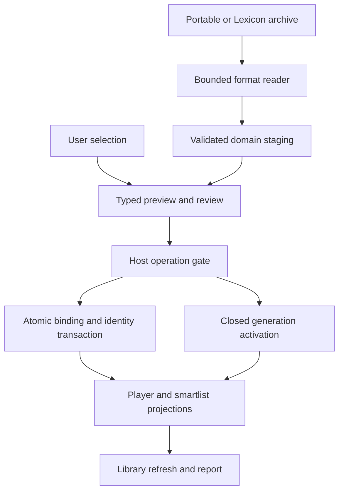
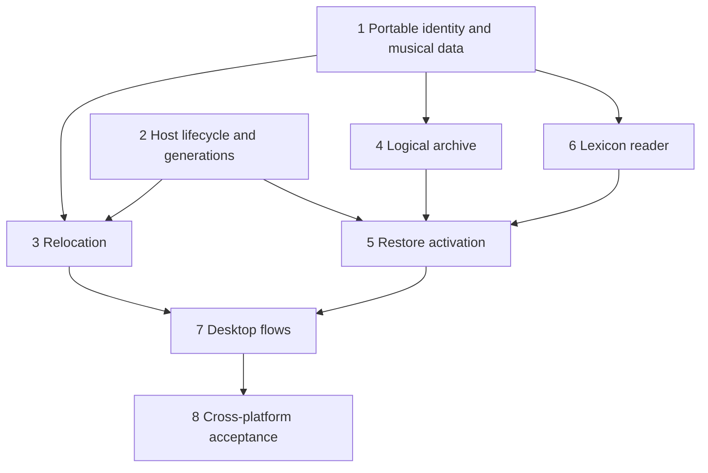

# Relocate tracks and restore portable library backups

## Problem and delivery boundary

DJs move music outside the library application and migrate computers. CueRithm
must reconnect existing entries without losing their work, produce a compact
portable `.cuerithm`, restore on macOS/Windows/Linux, and import the supplied
Lexicon backup. This plan originated in the research handover. Implementation now uses schema
29 on the current application baseline; the implementation record and measured
acceptance scope are in [the verification record](../development/relocation-portable-backups.md).

The complete behavioral contracts are in
[the engineering handover](../research/relocation-backup-handover/README.md).
Read it with [portable-format.md](../research/relocation-backup-handover/portable-format.md),
[lexicon-import.md](../research/relocation-backup-handover/lexicon-import.md),
[evidence.md](../research/relocation-backup-handover/evidence.md) and
[acceptance.md](../research/relocation-backup-handover/acceptance.md).
Those documents describe the requested behavior and format. Implementation
choices and current verification limits are recorded separately below.

## Requirements trace

- R1–R3: one-file, recursive selection and root/extension relocation; stable IDs,
  reviewed candidate evidence, consistent collision and undo behavior.
- R4–R5: logical metadata-only `.cuerithm` v1, portable roots, closed-generation
  replacement with rollback and all three destination operating systems.
- R6: profile `lexicon-main-db-v26` for the user-selected backup; complete table
  mapping, signed cue times, lossless tempo maps and sample smart operators.
- R7: no automatic preparation, tag writing, audio mutation or DJ sync; explicit
  losses, inactive machine bindings and retained current library.
- R8: vendor-independent contracts and synthetic tests; no shipped vendor code.

Merge, cloud storage, bundled music, new DSP algorithms and broader unverified
Lexicon versions are excluded. Relocation itself does not move audio.

## Context and decisions

Original research baseline: `673c017`. Implementation baseline: `fdf99d4`
(schema 28 before migration 29). The following paragraph describes the older
research baseline: `Library::open` in
`crates/cuerithm-library/src/store.rs` owns WAL/schema 11 startup and journal
recovery. `jobs.rs` deduplicates by path and starts Incoming preparation; it is
not a relocation/import API. `model.rs` rejects foreign native path blobs.
The missing scanner in `maintenance/broken.rs` already distinguishes missing
from unavailable storage and uses guarded persisted review results.

Follow existing scan/review/apply patterns documented in
`docs/superpowers/plans/2026-10-19-library-maintenance.md`, stable playlist
semantics in `docs/research/playlist-storage.md` and recovery concepts in
`docs/development/maintenance-api.md`. Existing audio-original recovery is a
different feature from this portable snapshot.

| Decision | Why / dependent consequence |
|---|---|
| Native path becomes an optional binding to a portable locator | Foreign/offline entries must survive without fake host paths. |
| Accepted musical data independent of FileAnalysis | Imported cues and variable tempo must work without claiming DSP completeness. |
| Filename compatibility plus review safeguards | Same relocation capability while avoiding first-candidate ambiguity and unanchored path replacement. |
| Logical JSONL archive | Explicit cross-platform contract and controlled inclusion; no raw operational journals or credentials. |
| Replace via retained generations | Old library remains recoverable; open SQLite handles never silently target the wrong DB. |
| Profile-based Lexicon reader | Actual sample support is known; version claims remain bounded. |

Alternative raw-DB ZIP backup was rejected because it carries OS-specific paths,
operational recovery state and internal-schema coupling. Ordinary file enqueue
was rejected because it changes identity and can replace imported cues/tags.
An automatic fuzzy audio matcher is unnecessary for the requested parity.

## High-level design

This illustrates the intended approach and is directional guidance for review,
not implementation code. The linked data contracts define the required behavior.

## Implementation units

- [x] **Unit 1: Portable identity, accepted musical data and imported readiness**

**Goal/requirements:** R1, R5–R7. Represent unresolved foreign files, imported cues
and variable-tempo maps without fake DSP data or job IDs.

**Dependencies:** none. Characterize current path, watcher and player behavior first.

**Files:** new library migration after the actual latest schema; new
`crates/cuerithm-library/src/portable.rs` and `src/musical.rs`; modify
`src/model.rs`, `src/store.rs`, `src/jobs.rs`, `src/publication.rs`,
`src/playlists/snapshot.rs`, `src/playlists/queries.rs`; extend
`apps/desktop/src/published-analysis.ts`, detail types and player consumers.
Tests: new `crates/cuerithm-library/tests/portable_identity.rs` and
`tests/imported_musical_data.rs`; extend `apps/desktop/src/test/player.test.tsx`.

**Approach:** optional local binding and content hash, immutable source locator,
origin/analysis status, selected accepted musical revision, full tempo markers,
explicit memory/slot cue representation, ID-based tag taxonomy. Retain ready/
incoming states and migrate all mandatory-path readers. Preserve real FileAnalysis
as a distinct optional result. Update native export to refuse unsupported timing
with a loss report rather than flattening. Keep DSP calculations unchanged.

**Patterns:** nullable job ID in `008_maintenance_writes.sql`, accepted cue history,
source observations in native import. Do not reuse provider='rekordbox' for Lexicon.

**Tests:** Unix byte/Windows UTF-16/UNC locator round trips; unresolved library
listing; null-analysis player cues and smart BPM/energy; known/unknown hash checks;
multiple tempo anchors; signed cue start; watcher ready/no-job dedupe; explicit
Prepare replaces only under its declared policy. Existing analyzed tracks retain
their published values. Migration failure rolls back all structural changes.

**Verification:** existing native/playlist/job tests pass and imported entries
work in table, player, smartlist and backup projection without an analysis job.

- [x] **Unit 2: Host operation gate and library generations**

**Goal/requirements:** R5, R7. Establish reliable quiescence and closed DB switching.

**Dependencies:** independent of domain parsing; integrate with Unit 1 bindings.

**Files:** new `crates/cuerithm-library/src/generations.rs`; modify
`apps/desktop/src-tauri/src/host.rs`, `src/lib.rs`, library `src/store.rs`,
`src/prepare.rs` and worker lifecycle; inspect actual smart worker ownership.
Tests: new `crates/cuerithm-library/tests/library_generations.rs` and Host tests
for shutdown/reopen; extend Tauri `maintenance.rs` lifecycle tests.

**Approach:** one operation gate, deterministic lock ordering, drain writers,
watcher pause, affected-player unload, owned handle shutdown/reopen, validated
active pointer and activation journal. Adopt legacy storage without deleting it.
Implement durable pointer replacement on each OS and explicit startup recovery.

**Tests:** concurrent enqueue/tag writer drain; busy worker abort before switch;
stale handle detection; legacy adoption; file-lock/permission/full-disk failures;
kill before/after every pointer phase; invalid pointer/new DB opens old generation;
rollback selection; no two active generations. No recovered vendor journal runs.

**Verification:** deterministic injected-failure tests always reopen old or fully
validated new library; no mutation occurs after a shutdown acknowledgement.

- [x] **Unit 3: Relocation service and reversible survivor operations**

**Goal/requirements:** R1–R3, R7. Implement the relocation contract in the handover.

**Dependencies:** Units 1–2; preflight backup connects when Unit 4 is available.

**Files:** new `crates/cuerithm-library/src/maintenance/relocate.rs`; extend
`maintenance/model.rs`, `maintenance/mod.rs`, existing file proof helpers and
playlist rewiring; tests new `tests/relocation.rs`, extend
`tests/maintenance_files.rs`, `tests/playlists.rs`, `tests/native_import.rs`.

**Approach:** external candidate index, bounded no-follow traversal, two exact
signatures plus reviewed hash/size confidence, source-flavor root transforms,
proof/revision guarded plans, one atomic selected-set transaction, persisted undo.
Never route through enqueue or move audio. Refresh technical metadata by probe;
mark changed replacement analysis stale. Keep native baselines historical.

**Tests:** every relocation row in `acceptance.md`, particularly `_pn`, ambiguities,
component boundaries, Unicode/case/aliases, both survivor choices, duplicate
playlist collapse, unavailable media, extension changes, pre/postcommit cancel,
stale files/entities and guarded undo after restart. Instrument file writes to
prove no tag/audio mutation. Race player load and watcher discovery against apply.

**Verification:** IDs/cues/memberships survive a real controlled external file
move; no candidate ambiguity is applied implicitly; transaction failure changes none.

- [x] **Unit 4: Logical `.cuerithm` snapshot writer and bounded reader**

**Goal/requirements:** R4–R5, R7. Implement the specified versioned archive contract.

**Dependencies:** Unit 1; snapshot gate from Unit 2.

**Files:** new `crates/cuerithm-library/src/backup/{mod,format,export,validate}.rs`
(split only where useful); extend dependency manifests for selected archive and
SQLite backup support; tests new `tests/portable_backup.rs` and synthetic fixtures
under `tests/fixtures/portable-backup/`.

**Approach:** logical domain DTOs, explicit selected history, online SQLite snapshot,
portable settings allowlist, inert sanitized external observations, JSONL hashes,
streamed archive writing, readback verification and no-clobber publication.
Reject unfinished filesystem journals; never include runnable operations/secrets.

**Tests:** WAL commit included, coherent concurrent export, empty/full library,
every included/excluded domain, historical selection, output cancellation/full
disk/permissions/existing file, unknown future features, malformed/hostile archive,
checksum/count/duplicate-key/type/reference failures and every size ceiling.

**Verification:** independent reader validates generated archive; snapshot semantic
comparison passes without requiring any music files. Record real file-size results.

- [x] **Unit 5: Restore staging, root mapping and activation**

**Goal/requirements:** R5, R7. Restore logical data onto a new or existing machine.

**Dependencies:** Units 1, 2, 4; Unit 6 later supplies another staged input.

**Files:** new `backup/restore.rs` and root-resolution module as appropriate;
modify Host activation manager; tests new `tests/portable_restore.rs` plus Unit 2
failure-injection fixtures.

**Approach:** validate all streams, build current schema in staging, map roots,
retain unrepresentable/unavailable records, check FK/integrity, then quiesce and
switch generations. Reset operational pointers/jobs, build fresh local settings
with writes/watchers disabled, recompute indexes/smart results. Preserve logical
library IDs and source observations; new generation identity.

**Tests:** all nine OS pairs, source/destination case collisions, opaque paths,
UNC/drive roots, unresolved media, no source credential activation, no auto-enqueue,
stale preview and input-digest change, cancellation/staging cleanup, each activation
fault and reopening rollback. Corrupt required data cannot partly replace a library.

**Verification:** restored media binds and plays on each OS; old library remains
recoverable and there are no active external write targets.

- [x] **Unit 6: Lexicon v26 parser and domain adapter**

**Goal/requirements:** R6–R8. Import actual backup data independently of vendor code.

**Dependencies:** Unit 1 plus Unit 4 validation/staging types; publication uses Unit 5.

**Files:** new `backup/lexicon.rs` (or focused import crate if justified by parser
size); tests new `tests/lexicon_backup_import.rs` and hand-authored schema/fixtures
under `tests/fixtures/lexicon-backup-v26/`. Extend smartlist characterization tests
and ID-based tag/playlist projection where needed.

**Approach:** exact profile validation, read-only explicit queries, complete column
mapping, deterministic source namespaces, full cues/tempo maps, six sample smart
operators, unsupported-definition preservation and explicit report. Never activate
Setting.data wholesale or open a vendor DB with CueRithm Library::open.

**Tests:** all Lexicon rows in `acceptance.md`; selected private archive aggregate
counts; malicious schema/views/triggers; numeric storage-class quirks; negative
cues; timezone handling; imported player/smartlists with null DSP; unknown enums;
disabled unsupported rules; duplicate memberships/taxonomy labels; no source mutation.

**Verification:** profile 26 import restores every supported domain and reports
every excluded/lossy projection; implementation needs no Lexicon runtime/library.

- [x] **Unit 7: Desktop review, progress and recovery flows**

**Goal/requirements:** R1–R7. Make the services usable and outcomes inspectable.

**Dependencies:** Units 3–6.

**Files:** extend `apps/desktop/src/views/maintenance/BrokenTab.tsx`, track context
menu, library navigation, frontend API/types/task hook; new backup/restore/import
views following existing design. Register Tauri commands in `src-tauri/src/lib.rs`
and typed handlers. Tests: extend `src/test/maintenance.test.tsx`, new
`src/test/library-backup.test.tsx`, extend `completion-race.test.tsx`.

**Approach:** expose all three relocation modes; evidence/collision review; library
backup area separate from audio recovery; format auto-detection, root mapping,
loss acknowledgement, explicit library replacement, progress/cancel and retained
generation selection. Keep selected IDs stable through sort/filter refresh.

**Tests:** one versus several missing records; unavailable warning scope; chosen
survivor; preview stale response; source file unsupported; metadata-only wording;
restore confirmation targets correct generation; task cancellation retains slot;
post-switch full UI refresh; retry permission failures; keyboard/accessibility
and screenshots on all three OSs. New UI must not expose internal table names.

**Verification:** a user can move controlled files, reconnect them, export, restore
on another machine and import Lexicon without using a CLI or vendor application.

- [ ] **Unit 8: Cross-platform and scale acceptance**

**Goal/requirements:** all. Establish recorded implementation proof.

**Dependencies:** all previous units.

**Files:** new `tests/portable_cross_platform.rs` or equivalent integration harness,
controlled fixture manifest, platform CI definitions where supported, and update
`docs/development/desktop.md` / user backup documentation. Never package sample
music/private backup. Add fixtures only when licenses permit redistribution.

**Approach:** exercise acceptance matrix, actual app playback and crash recovery;
report OS/build/fixture/archive identities, source-DB/tag-write monitoring, scale
RSS/disk/progress measurements and any unsupported formats/profiles explicitly.

**Tests:** nine OS migration pairs, all required media formats, 100k-track and 1m-
candidate workload, resource ceilings, service races and failure injection.
Workspace validation and frontend tests/build are required after implementation.

**Verification:** recorded evidence meets acceptance; remaining untested cases are
listed rather than passed by inference. No release/version bump in this work.

## Implementation decisions and acceptance status

Units 1–7 are implemented and covered by focused backend/desktop tests. Restore
stages and seals a new generation, then performs a controlled application restart
to close every existing Host/database handle. Cancelling the normal exit guard
cancels activation. Large archives use a private SQLite spool and bounded JSON
records; relocation uses a streamed directory queue and indexed candidate lookup.

Unit 8 has recorded macOS scale, archive/media and failure-injection evidence.
The CI matrix runs the same synthetic source-OS fixtures on all three destination
operating systems. Actual private Lexicon sample validation remains unavailable
because the referenced backup was not supplied with this handover. See the
verification record for precise measured workloads and limitations.

## System-wide impact and risks

Paths affect nearly every track consumer: enqueue, preparation, playback, artwork,
metadata/tagging, maintenance, smart evaluation and native sync. Audit each for
optional unresolved bindings and unknown hashes. A migration alone is insufficient.

The greatest lifecycle risk is replacing a DB pathname while Host clones or
workers still hold old handles. Unit 2 precedes any activation. Imported readiness
also changes watcher assumptions; explicit no-job dedupe is mandatory. Imported
tempo maps require player/smart projections and guarded export; no fake fixed grid.

Errors propagate as typed failed tasks with a local diagnostic report. Archive
validation failures never change the active generation. DB-only relocation is
atomic but cannot prevent the filesystem changing immediately afterward; availability
remains separately verified. Native baseline history survives inactive, with no
restoration-implied authorization for external writes.

## Planning-owned conclusions and deferred execution facts

Resolved: replacement semantics, archive version/encoding, locator model, snapshot
boundary, no auto-preparation, candidate/collision policy, imported timing model,
Lexicon profile, warning behavior and crash publication strategy.

Deferred to implementation: final migration number on the engineering branch,
exact API/module naming, chosen Rust ZIP crate/version and OS replacement API
adapter, measured performance/archive size, real OS permission behavior and GUI
layout. These do not require vendor source or further product decisions. Select
dependencies against their current official docs during implementation and record
the versions used. No current library version recommendation is inferred here.

Research limitations are explicit in `evidence.md`: vendor behavior is static,
profile data comes from one selected backup, and cross-platform behavior requires
the tests above. Completion of this plan is not completion of implementation.
