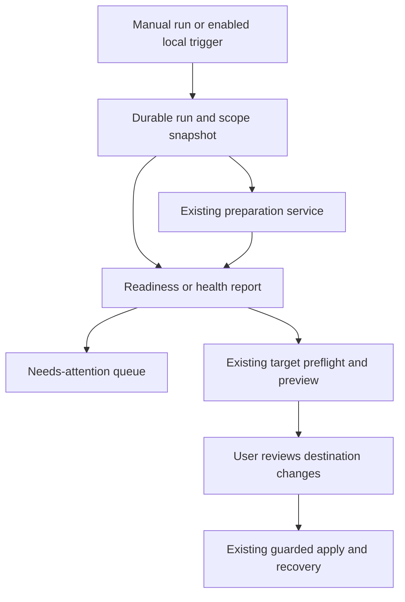

# Home-DJ automation tools

## Problem and scope

CueRithm already prepares Incoming music automatically and maintains smart
playlists. The next useful automation should reduce the work around that
pipeline: understanding failures, applying a named preparation configuration,
checking a practice crate, detecting library problems and preparing a reviewed
sync to a remembered destination.

This is a proposed automation plan requested after approval of the separate
home-DJ roadmap. It does not authorize or claim an implemented automation engine.
Keep each phase independently useful and reviewable; deliver the approved
home-DJ work before implementing this proposal.

Origin: `docs/superpowers/specs/2026-10-21-home-dj-roadmap.md` and the user's
request to plan additional powerful automation tools for home DJs.

## Tools and priorities

| Order | Tool | Example result | Automatic effect |
| --- | --- | --- | --- |
| 1 | Needs-attention queue | These eight purchases need a different catalog match; these three failed temporarily. | Organize existing durable outcomes; optional bounded transient retry. |
| 2 | Crate readiness check | This practice crate has two missing files and one unfinished preparation job. | Read-only report refreshed for relevant changes. |
| 3 | Named preparation recipes | Apply my new-purchases settings to this selection without changing every global setting. | Run only on explicit invocation or a separately enabled folder rule. |
| 4 | Local health-check schedule | Check my library weekly for duplicate and missing-file findings. | Scans and reports while CueRithm is running; no automatic removal or merge. |
| 5 | Ready-to-sync workflow | Check this crate, then prepare a preview for my home DJ library. | Preflight and preview; publication stays a reviewed action. |

Scheduled backups can build on the separate library-backup API, preserving its
same-installation and source/resource consistency restrictions. They are not
included in the first automation implementation. Portable migration needs a
separate design; the current backup does not provide it.

## Requirements

- **R1:** Surface current job outcomes with accurate actions, attempt history and
  selected retry. A successful analysis cache remains reusable on provider retry.
- **R2:** Evaluate readiness from explicit personal requirements and current
  source/target facts. Preserve mandatory preparation validation. Missing data
  and unavailable sources remain unknown or actionable, not silently ready.
- **R3:** Store named preparation configurations as immutable snapshots. Invoking
  one captures its version and scope; later edits never change a running job.
- **R4:** Make every automatic trigger disabled by default. Saving and enabling
  must say precisely what future work it permits. Manual Run remains available
  without enabling future triggers; pausing blocks new dispatches.
- **R5:** Persist trigger identities, scope, definition version, run state and
  step outcomes. Restart and duplicate notifications cannot repeat completed
  actions. Correctness must not depend on receiving every UI event.
- **R6:** Bound background work, cancellation and retries. Respect current
  preparation, maintenance and publication concurrency contracts.
- **R7:** Automate maintenance discovery only. Keep donor merge, archive/removal,
  restore, backup disposal and destination publication in their existing reviewed
  flows. A completed scan does not authorize a mutation.
- **R8:** Bind a sync workflow to target identity and saved options; a reused
  mount path cannot select another device. Busy/unavailable targets remain
  pending/actionable rather than being modified.
- **R9:** Show local activity and partial-run results. Never promise whole-run
  Undo when the component operations have independent recovery histories.
- **R10:** Reuse existing preparation, smart playlists, maintenance and five
  external-player adapters. Direct rekordbox depends on its separate completion.

## Product decisions

Use a small set of typed local tools, not arbitrary user scripts or a generic
visual workflow language. Start with manual invocation and durable preparation
completion; add explicit interval scheduling only for read-only health scans.
No shell hooks, arbitrary network requests or provider-credential fields.

Recipes initially capture the complete relevant preparation settings snapshot;
they do not infer analysis from tags, filenames or reference labels. A manual
preview identifies affected tracks and configured tag/cleanup/cue effects before
starting. A folder rule explicitly enables the same effects for future arrivals.
If multiple folder rules qualify without a unique configured precedence, hold
the track for review rather than choosing an arbitrary profile. Existing jobs
retain the settings snapshot they were created with.

Readiness initially checks preparation state, observed file availability,
explicit required metadata and destination compatibility. Do not invent a key,
grid or cue confidence score. Optional human-reviewed cues/grid checks depend on
the manual editor providing a versioned review state; omit those checks until
that delivery exists. A playlist that passes the report may still sound poor:
technical readiness is not a musical judgment.

Default transient retry is off. When enabled, allow at most three automatic
retries for one unchanged source/settings job identity, at 1, 5 and 15 minutes.
Retry only failures with a structured transient classification. Unclassified
provider messages, permission failures, missing credentials, no-match results
and changed sources require attention. Persist retry budgets and due times;
restart cannot reset the budget. Respect a provider's longer retry-after value.
Manual retry starts the existing guarded retry path; it does not force analysis
again or silently reset the automatic budget.

Scheduling runs only while the desktop application is open. On startup, one
overdue scheduled scan becomes eligible; missed intervals do not generate a
backlog. If the requested maintenance worker is busy, keep one pending run.
Preserve each existing scan's supported scope: duplicate scans use library or
playlist scope, broken-file scans use the library, and unused-file scans use an
explicitly selected root and extension filters. Remember root identity where
applicable.
An offline drive is unavailable, not empty or corrupt. A result is complete,
partial, stale or failed according to the underlying scan.

Sync workflows never auto-apply in this proposal. They save a fresh preview for
review after readiness and process checks. Multiple destinations are independent
steps with independent journal histories: one successful target does not make
the others successful or permit automatic reversal of that first target.

## Existing contracts to follow

- `crates/cuerithm-library/src/settings.rs` and `store.rs`: content-addressed
  immutable settings snapshots. Existing save selects a snapshot; it is not an
  optimistic workflow-definition update API.
- `crates/cuerithm-library/src/jobs.rs`, `prepare.rs`, `analysis_cache.rs`:
  source/settings/attempt ownership, durable jobs and cache-preserving retry.
- `crates/cuerithm-library/src/playlists/preferences.rs`, `automatic.rs` and
  `service.rs`: default-off behavior, separate optimistic preference revision,
  atomic/idempotent reconciliation and shutdown ownership. Do not conflate
  smart-list preference changes with preparation settings changes.
- `apps/desktop/src-tauri/src/maintenance.rs` and
  `docs/development/maintenance-api.md`: one active operation, cancellation until
  worker settlement, report completeness and guarded review/publication.
- `crates/cuerithm-library/src/dj_sync_service.rs`,
  `dj_sync_service/ownership.rs` and `registration.rs`: exact target identity,
  staged previews, stale guards, acknowledged baselines and recovery.
- `apps/desktop/src/sync-preferences.ts`: already remembers per-target choices.
  Named backend workflow definitions and run history are the new capability.

## Technical design

The diagram is directional guidance for review; it does not prescribe code.

Use backend-owned stable IDs for definitions and runs. Definition edits have an
optimistic expected revision; each run records an immutable definition snapshot,
selected source/playlist identities and applicable settings/target proofs. Do not
store just a mutable playlist name or a frontend selection.

Record a unique cause identity for each eligible trigger and recipe version.
Persist discovery and eligibility in backend state, using polling/reconciliation
of durable preparation outcomes rather than frontend event delivery. Derived
reports and activity updates must not retrigger their own input workflows.

Persist pending/running/waiting-for-review/succeeded/partial/failed/cancelled
states with per-step operation IDs and outcomes. After restart, consult the
underlying preparation/maintenance/sync operation before resuming; no second
writer starts while its predecessor still owns recovery. Workflow cancellation
stops future dispatches and requests worker cancellation, then waits for the
worker to settle. It does not silently undo completed steps.

## Implementation units

- [ ] **Unit 1: Needs-attention queue and bounded retry**

  **Requirements:** R1, R4, R6, R9.

  **Files:** Create `crates/cuerithm-library/src/preparation_attention.rs`,
  `crates/cuerithm-library/tests/preparation_attention.rs`,
  `apps/desktop/src/views/PreparationAttention.tsx` and
  `apps/desktop/src/test/preparation-attention.test.tsx`. Extend existing jobs,
  preparation, typed bridge and Tauri command surfaces only as needed.

  **Approach:** Derive actionable groups from durable current attempts, retain
  the original error and structured reason, and reuse selected guarded retry.
  Add explicit transient error classification and persisted due/budget state
  before enabling optional retries. Do not classify by searching error text.

  **Tests:** Offline folder remains unavailable; no-match never auto-retries;
  transient attempt uses the 1/5/15-minute policy; longer retry-after is honored;
  restart retains due time/budget; superseded attempts cannot publish; provider
  retry reuses valid analysis; manual retry does not force reanalysis. UI groups
  reflect current durable state after restart and ignore superseded events.

  **Verification:** Selected retries settle through existing job ownership and
  failed required stages never become ready merely because a budget is exhausted.

- [ ] **Unit 2: Read-only crate readiness reports**

  **Requirements:** R2, R7, R9, R10. Depends on Unit 1 for actionable links.

  **Files:** Create `crates/cuerithm-library/src/readiness.rs`,
  `crates/cuerithm-library/tests/readiness.rs`,
  `apps/desktop/src/views/CrateReadiness.tsx` and
  `apps/desktop/src/test/crate-readiness.test.tsx`. Follow playlist snapshot and
  target validation patterns in existing modules.

  **Approach:** Capture playlist membership and explicit policy revision, then
  report passed/needs-attention/unknown checks with source proofs. Recheck before
  passing a report into a target preview. Keep mandatory job validation intact.

  **Tests:** Missing versus offline source; partial scan; changed playlist;
  archived/Incoming selection intent; missing key/BPM/energy where required;
  unsupported target audio; superseded source; metadata policy disabled; unknown
  human-review state. A report creates no preparation jobs or file writes.

  **Verification:** Reports are repeatable for the captured inputs and visibly
  stale after relevant changes; no unknown value satisfies a required check.

- [ ] **Unit 3: Named recipes and immutable run records**

  **Requirements:** R3, R4, R5, R6, R9. Depends on Units 1 and 2.

  **Files:** Create `crates/cuerithm-library/src/automation/mod.rs`,
  `automation/model.rs`, `automation/store.rs`,
  `crates/cuerithm-library/tests/automation_runs.rs`,
  `apps/desktop/src/views/PreparationRecipes.tsx` and
  `apps/desktop/src/test/preparation-recipes.test.tsx`. Add a new numbered
  migration at the then-current schema head and typed bridge/command methods.

  **Approach:** Implement manual named recipe invocation first, with explicit
  scope/effect preview and optimistic definition revisions. Store a settings
  snapshot and selected IDs with each run; avoid changing global settings just
  to apply a recipe. Reuse preparation job creation and cache identity.

  **Tests:** Renamed playlist retains identity; deleted ID never matches another
  same-named list; concurrent recipe edit conflicts; edited definition does not
  alter a running job; two Run clicks do not duplicate one accepted invocation;
  restart resumes known work without replay; partial results retain step history.

  **Verification:** Manual recipes work with automatic triggers disabled, and
  recipe persistence cannot change existing preparation jobs retroactively.

- [ ] **Unit 4: Enabled completion rules and read-only health scheduling**

  **Requirements:** R4, R5, R6, R7, R9. Depends on Unit 3.

  **Files:** Create `crates/cuerithm-library/src/automation/service.rs`,
  `automation/schedule.rs`, `crates/cuerithm-library/tests/automation_service.rs`,
  `apps/desktop/src/views/AutomationRules.tsx` and
  `apps/desktop/src/test/automation-rules.test.tsx`; integrate service ownership
  into `apps/desktop/src-tauri/src/host.rs`.

  **Approach:** Persist opt-in definition revision, completion cause or schedule
  slot, dispatch lease and per-step operation IDs. Use the underlying maintenance
  lease instead of creating concurrent scan workers. Folder preparation rules
  declare precedence; ambiguous selection becomes attention, never an inferred
  profile. Expose save/enable, pause, run-now and current pending/active states.

  **Tests:** Never runs before opt-in; saving disabled has no effect; repeated
  completion observation dispatches once; own report writes cannot retrigger;
  missed schedule intervals coalesce once; offline/replaced root; busy lease;
  cancel then immediate rerun waits for settlement; shutdown joins workers;
  ambiguous folder recipes; rule edit during active run; pause retains history
  and blocks new work. No scan invokes merge, removal or disposal.

  **Verification:** Durable reconciliation survives missed UI events and restart
  without duplicate dispatch or self-trigger loops.

- [ ] **Unit 5: Saved destination preparation workflows**

  **Requirements:** R2, R4, R5, R6, R8, R9, R10. Depends on Units 2 through 4.
  Rekordbox requires its separately completed supported target API.

  **Files:** Create `crates/cuerithm-library/src/automation/sync.rs`,
  `crates/cuerithm-library/tests/automation_sync.rs`,
  `apps/desktop/src/views/SavedSyncWorkflows.tsx` and
  `apps/desktop/src/test/saved-sync-workflows.test.tsx`; extend existing Sync
  navigation to open the exact prepared preview for review.

  **Approach:** Snapshot playlist, target identity and options; perform current
  readiness and preflight; persist preview IDs and per-target outcome links.
  Stop at review. Expired previews must be regenerated and reviewed; never
  replay an expired publication token or resolve a target from mount path alone.

  **Tests:** Different drive at same path; target/agent running; stale source or
  membership; unsupported/read-only rekordbox; pending recovery; option edits;
  missing target after restart; one target succeeds and another fails. Unreviewed
  workflow completion must create no target writes, and stale preview IDs must
  not enable Apply in the UI.

  **Verification:** Existing five-player Sync tests remain green; publication
  and restore continue through existing target journals, not a second writer.

## System-wide impact

Backend jobs, playlist snapshots, maintenance and sync already have different
revision/lease contracts. The new tools orchestrate those contracts; they do not
merge them into a global lock or pretend all steps share one transaction. Keep
decoding, network waits and traversal outside long SQLite write transactions.

Local activity shows component failures and their original recovery actions.
Definition deletion disables future dispatch and preserves run/output history;
it never deletes playlists or music. Pausing does not revoke an already-started
file publication; cancellation and safe rollback must settle normally.

## Risks, dependencies and execution-time unknowns

| Risk or dependency | Resolution |
| --- | --- |
| Provider exceptions are currently too coarse for safe retries | Add structured classification; leave unclassified failures manual. |
| A selected workflow runs on mutable playlist contents | Pin member IDs and relevant proofs for each run; recheck before writes/previews. |
| Whole-run Undo implies atomicity the system does not have | Expose per-step journals and partial completion; no blanket Undo promise. |
| Health checks compete with analysis/playback | Use bounded dispatch and existing leases; measure on larger copied libraries before claiming acceptable scale. |
| Existing user-review state is unavailable | Keep manual cue/grid-reviewed checks unavailable until the editor owns a versioned state. |
| Additional releases advance the schema during planning | Allocate new migration numbers at implementation time; test upgrades from the actual current head. |
| Saved target becomes unavailable or a mount path is reused | Retain identity mismatch/offline states; require current registration and preflight. |

Field-level recipe controls, exact folder-rule matching UI and cross-platform
root identity presentation require their delivery design before coding. This
plan chooses the behavior boundaries and sequence; it does not pretend those
interaction details are already accepted.

## Validation and documentation

Each unit needs Rust integration tests and React interaction tests at its listed
paths, rendered UI verification, updated guides and current-head workspace and
desktop checks. Use authored audio/directory/target fixtures and copies; preserve
source music, application bundles and private metadata.

Extend the existing regression scenarios in `tests/jobs.rs`, `preparation.rs`,
`autotag_preparation.rs`, `cleanup_preparation.rs`, `smart_playlists.rs` under
`crates/cuerithm-library`, and the inline sync ownership/recovery tests. Verify
that enabling these tools never alters required audio format support or the
validated DSP calculations.

User documentation must state default-off behavior, precisely what enabling a
rule does, application-open scheduling, retry limits, offline/unknown states,
partial completion and the distinction between preparing a preview and syncing.
Do not create an OS background service or make cloud/service integrations a
prerequisite. Preserve automated releases and do not claim native-player
acceptance from synthetic fixtures.
