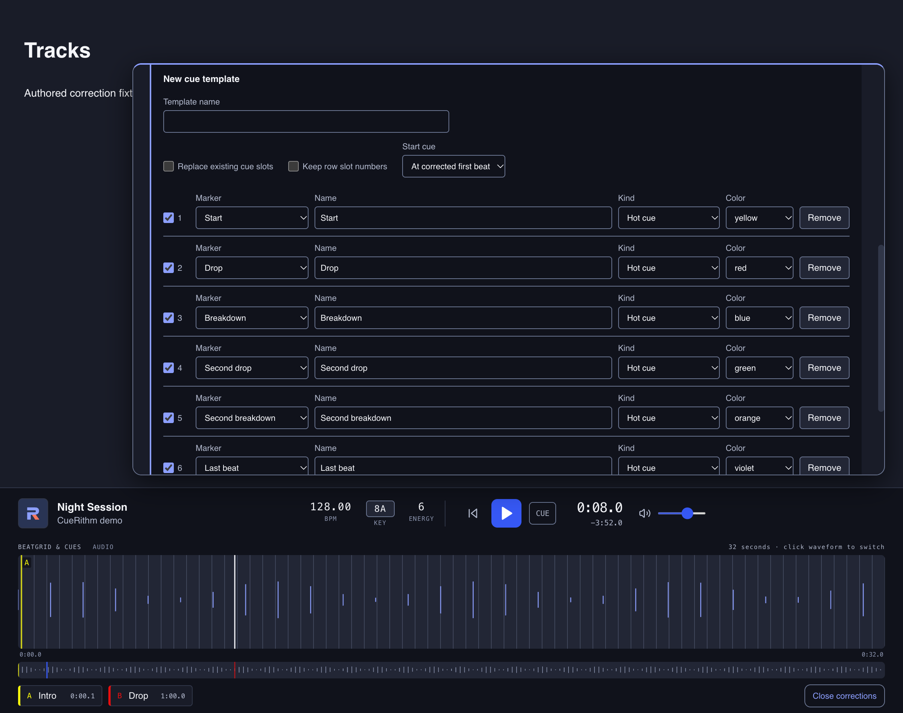

# Reuse one cue layout on many tracks

Save a cue layout as a named template, preview it on one track or on a whole selection, and save the result for all of them at once. Your first template takes about ten minutes.

<!-- figure:existing-manual-cue-template-cue-templates -->
<figure markdown>
{ .screen loading=lazy }
<figcaption>A cue template names and places cues for many tracks.</figcaption>
</figure>
<!-- /figure -->

**Before you start**

- The tracks must be prepared and in **Tracks**.
- To apply a template to several tracks, select them **before** you open the correction panel, which covers most of the table. See [Work on many tracks at once](../select-many.md#selection-and-playback).

## What a template does { #what-a-template-does }

A template is a named list of rows plus a few settings. Each row says which part of
the track gets a cue, what to call it, which colour to use, and whether it is a cue
or a loop. CueRithm keeps templates in your library, so every track can use them.

When you preview a template, CueRithm builds cues from each track's measured
markers (its start, drop, breakdown and so on), its saved BPM and its saved grid.
It does not run the cue detector again, and a template never changes the grid.
Nothing is saved until you choose **Save preview**.

## 1. Make a template { #make-a-template }

This example adds a **Mix out** cue 32 beats before the end cue on every track. It
leaves the cues a track already has alone.

<!-- figure:tracks-cue-template-editor -->
<figure markdown>
{ .screen loading=lazy }
{ .screen loading=lazy }
<figcaption>A template is a named list of rows; this one adds one cue before the end.</figcaption>
</figure>
<!-- /figure -->

1. Load a track, choose **Edit cues & grid**, and scroll to **Cue templates**.
2. Choose **New cue template**. The form starts with six rows: Start, Drop, Breakdown, Second drop, Second breakdown and Last beat.
3. In **Template name**, type `Mix out`.
4. Leave **Replace existing cue slots** unticked and tick **Keep row slot numbers**.
5. Untick **Use template row** on rows 1 to 6, so the template only creates your new cue.
6. Choose **Add template row**. Set **Marker** to *Offset from marker*, **Name** to `Mix out`, **Kind** to *Hot cue*, **Color** to orange, **Anchor** to *Last beat*, **Offset** to *Before* and **Beats** to `32`.
7. Choose **Save template**. The panel confirms *Template “Mix out” saved.*

At 130 BPM, 32 beats last 14.8 seconds. On *Come To Life (Original Mix)*, whose end
cue sits at about 4:26, the new cue lands at about 4:11, in slot 7.

*Why these settings:* with **Replace existing cue slots** off, a template can only
fill slots that are empty on a track. **Keep row slot numbers** gives each row the
slot of its own number, so row 7 uses slot 7, a slot that is usually free. Without
it, a row takes the slot of its position among the track's cues, which is usually
taken. Leaving rows 1 to 6 ticked would add extra cues in any of slots 1 to 6 that
a track does not use.

## 2. Apply it to one track { #apply-to-one-track }

1. In **Cue templates**, choose the template in **Saved template**.
2. Choose **Preview template**. The panel shows **Review before saving** with the cue count before and after, and a button for each cue.
3. Choose **Save preview**.

## 3. Apply it to many tracks { #apply-to-many-tracks }

1. In **Tracks**, select the tracks, for example with ++cmd++ click or ++cmd+a++ / ++ctrl+a++.
2. Press the play button on one row to load a track without changing the selection.
3. Choose **Edit cues & grid**. When more than one track is selected, a checkbox **Apply to 3 selected tracks** appears, with the number of tracks you selected.
4. Tick it, then choose **Preview template**.
5. Read the preview. Each track lists its BPM, its first beat and its cues before and after. A track with hand-made corrections shows *Manual corrections preserved*.
6. Choose **Save preview**.

The batch is exactly the selected tracks, whether or not the loaded one is among
them. The buttons that seek to a cue work only for the loaded track. Saving is all
or nothing: if one track is not prepared, has changed, or lacks a cue that the
template anchors on, nothing is saved and the panel says why. A batch holds up to
1000 tracks.

A track that lacks the marker a row hangs on gets no cue from that row. A track
without an end cue gets no **Mix out** cue.

## Choose how the template meets existing cues { #existing-cues }

Two controls decide what happens to the cues a track already has:
**Replace existing cue slots**, in the template, and **Preserve manual
corrections**, beside **Preview template**. **Preserve manual corrections** is
ticked by default.

| Replace existing cue slots | Preserve manual corrections | Result on each track |
|---|---|---|
| Off | Either | The track's cues stay. The template adds cues only in empty slots |
| On | On | The template's cues replace the cues CueRithm generated. Slots you changed by hand stay |
| On | Off | The template's cues replace all cues, including your own |

A slot counts as a manual correction when you added, changed or removed its cue
by hand. A cue you deleted stays deleted. A template does not mark its own cues as
manual, so a later template can replace them. The grid is never touched. If you
re-analyse a track, CueRithm forgets which slots were manual.

## Choose what each template row does { #rows }

| Control | What it does |
|---|---|
| **Use template row** | Includes the row. Unticked rows make no cue |
| **Marker** | The part of the track the row marks: *Start*, *Drop*, *Breakdown*, *Second drop*, *Second breakdown*, *Last beat*, *Emergency loop*, or *Offset from marker* |
| **Name** | The cue's label |
| **Kind** | *Hot cue*, *Saved loop*, *Active saved loop*, *Memory cue* or *Memory loop* |
| **Color** | None, yellow, red, blue, green, orange, violet, magenta, cyan or white |
| **Anchor**, **Offset**, **Beats** | For *Offset from marker* rows: which marker to measure from, *Before* or *After* it, and how many beats |
| **Loop beats** | For loop kinds: the loop's length in beats. The default is 16 |

Hot and memory cues differ in your DJ software. A *Memory cue* is saved so that
rekordbox sync stores it as a memory cue rather than a hot cue. Other programs
decide for themselves. A track only gets cues for markers it has: the *Emergency
loop* marker exists only if **Emergency loop** was on when the track was prepared.

## Choose the template's settings { #settings }

| Setting | What it does |
|---|---|
| **Template name** | Up to 200 characters. Saved templates are listed by name |
| **Replace existing cue slots** | See the table above. Off by default |
| **Keep row slot numbers** | Gives each row the slot of its own row number. Off by default |
| **Start cue** | Where the Start cue goes: *At corrected first beat* (the default), *At first saved cue* or *At track start* |
| **Use named saved cues as anchors** | Lets a row follow a cue you saved instead of the detector's marker |

The new form starts with its own names and colours for the six standard rows, such
as *Second drop* in green. They differ from the cues CueRithm places itself. Edit
them if you want the same look.

## Follow a cue you moved { #custom-anchors }

Templates measure from the detector's markers, not from where you moved a cue.
To make a template follow your corrections, tick **Use named saved cues as
anchors**. For each marker, pick *Measured marker* or the name of a saved cue. The
cue's name must match exactly one cue on every track in the batch, or the preview
is refused with *Custom anchor 'name' must match exactly one existing cue*.

## Edit or delete a template { #edit-or-delete }

Choose a template in **Saved template**, then **Edit template** to change it, or
**Delete template** to remove it. Deleting does not ask for confirmation and does
not touch cues that are already saved.

## What can go wrong

| Message or symptom | Cause | Fix |
|---|---|---|
| The preview shows no new cue | The slot is taken on that track, or the track lacks the marker | Use a higher row number, or check the track has an end cue |
| **Apply to N selected tracks** is missing | Only one track is selected | Select more tracks first, then load one with its play button |
| *Custom anchor 'name' must match exactly one existing cue* | The named cue is missing or appears twice on a track | Rename the cue, or use *Measured marker* |
| *Track changed; refresh the correction preview* on one track | One track in the batch changed while you worked | **Reload saved edits** and preview again. See [Undo or resolve a correction](undo-corrections.md#resolve-a-rejected-save) |
| A hot cue in slot 9 or above will not sync to rekordbox | rekordbox hot cues use slots 1 to 8 | Use *Memory cue* for extra cues, or lower row numbers |

## Related

- [Move or add a cue](move-or-add-cues.md)
- [Set a loop](set-loops.md)
- [Undo or resolve a correction](undo-corrections.md)
- [Choose how cues are placed](../cue-rules.md)

<!-- verified: apps/desktop/src/components/CueTemplateEditor.tsx (all labels, defaults, Add template row defaults, anchors); components/PublicationEditor.tsx (Cue templates, New cue template, Saved template, Edit template, Delete template, Preserve manual corrections default on, Apply to N selected tracks only when more than one selected, Preview template, messages); crates/cuerithm-library/src/manual_publication.rs (preview_cue_template: overwrite/preserve logic, custom anchors error, 1000 limit, templates never change grid, template_markers); crates/camelot-core/src/lexicon_publication.rs (publish: keep_cue_positions slot = row index, offsets, loops, memory data originalNum -1, Start behaviours); crates/cuerithm-library/src/rekordbox_sync_service/assets.rs (memory cues exempt from 8 slots); crates/cuerithm-library/tests/manual_publication.rs (preserve/regeneration/batch tests); apps/desktop/src/test/manual-publication.test.tsx; docs/superpowers/specs/2026-10-21-manual-publication-design.md; legacy guides/manual-corrections.md re-checked -->
