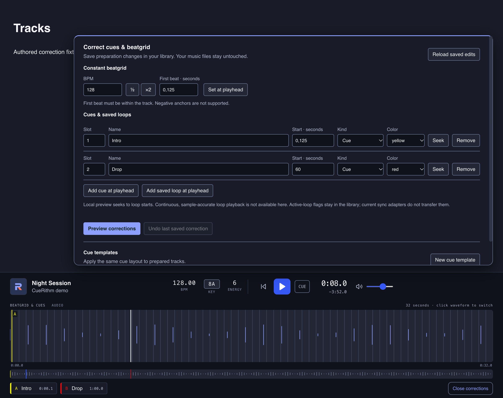

# Fix a wrong cue, loop or beatgrid

When a cue sits in the wrong place, a loop is missing, or the beat lines drift, correct it in the player. A single correction takes about five minutes and never touches your music files.

<!-- figure:existing-manual-cues-editor-index -->
<figure markdown>
{ .screen loading=lazy }
<figcaption>Correct cues, loops and the beatgrid beside the player.</figcaption>
</figure>
<!-- /figure -->

<!-- figure:tracks-corrections-panel -->
<figure markdown>
{ .screen loading=lazy }
{ .screen loading=lazy }
<figcaption>The correction panel opens above the player and the player stays usable.</figcaption>
</figure>
<!-- /figure -->

## Start here

- The grid looks wrong: [Check the beatgrid at beat level](../check-the-beatgrid.md), then [Fix a wrong beatgrid](fix-the-beatgrid.md).
- A cue is in the wrong place or missing: [Move or add a cue](move-or-add-cues.md).
- You want the same extra cues on many tracks: [Reuse one cue layout on many tracks](cue-templates.md).

## What you can correct { #what-you-can-correct }

| You can | You cannot |
|---|---|
| Move, rename, recolour, renumber, add and remove cues | Change the key or the energy. They stay as measured |
| Add saved loops with a start and an end | Play a loop continuously in the player. It seeks to the start only |
| Change the grid's BPM and its first beat | Make a variable-tempo grid, or mark which beat starts a bar. The grid is one BPM and one first beat |
| Apply a saved cue layout to one track or to a selection | Attach an energy value to a cue. CueRithm has one energy rating per track |

## How a correction works { #how-a-correction-works }

1. Load the track in the player and choose **Edit cues & grid**. The **Correct cues & beatgrid** panel opens above the player.
2. Edit the grid, the cue rows or both. Nothing is saved yet.
3. Choose **Preview corrections**. CueRithm lists the result: the BPM and first beat before and after, and the number of cues.
4. Choose **Save preview**. The correction is saved in your library.

The player, the track's BPM in the table and your next sync all use the saved
cues and grid. The key, the energy and the detector's own measurements stay as they
were. **Your music files and their tags are never written to.** The panel says so:
*Your music files stay untouched.*

If the result is wrong, **Undo last saved correction** restores the cues, grid and
BPM from before. See [Undo or resolve a correction](undo-corrections.md).

!!! warning "Analyze again replaces corrections"
    Analysing a track again writes a fresh set of cues and a fresh grid, which
    replaces anything you corrected by hand. [Analyze a track again](../analyze-again.md)
    only when you want that.

## Before you correct { #before-you-correct }

The panel works on the track loaded in the player, and only when that track is
prepared and settled:

- It must be in **Tracks**, not **Incoming** or **Archive**. Restore an archived track first.
- It must not be preparing, queued or waiting for attention.
- Its audio file must still be the file CueRithm analysed.

Otherwise the panel shows what is wrong and offers no draft to edit. The messages
and fixes are in [Undo or resolve a correction](undo-corrections.md#resolve-a-rejected-save).

A correction is also checked against the library when you save it. If anything else
in the library changes while the panel is open, for example another track finishing
preparation, the save is rejected and you reload the panel. Keep corrections short
and do them while the header says *All up to date*.

## Your goal → Page

| Your goal | Page |
|---|---|
| Move a cue to a new time, rename or recolour it, add or delete one | [Move or add a cue](move-or-add-cues.md) |
| Add a loop, or turn a cue into one | [Set a loop](set-loops.md) |
| Halve or double the BPM, retype it, or set the first beat | [Fix a wrong beatgrid](fix-the-beatgrid.md) |
| Give many tracks the same practice cue | [Reuse one cue layout on many tracks](cue-templates.md) |
| Revert the last correction, or understand a rejected save | [Undo or resolve a correction](undo-corrections.md) |

## What corrections change elsewhere { #what-changes-elsewhere }

| Where | What happens |
|---|---|
| Player | Shows the saved cues, loops and grid straight away |
| Table | **BPM** shows the corrected tempo. The small waveform in **PREVIEW** shows the saved cues, so it follows a correction. Its faint phrase lines still come from the detector's grid |
| Sync | The next [sync](../../sync/index.md) sends the corrected cues, loops, grid and BPM. Check the sync preview before you apply it |
| Tags | Nothing is written. **Embedded BPM** keeps whatever the file says |

## Not what you wanted?

- To change how cues are placed on future tracks, see [Choose how cues are placed](../cue-rules.md).
- To correct a title, artist or genre, see [Edit tags and artwork](../../tagging/edit-tags-by-hand.md).
- To read cues without changing them, see [Jump to the drop with cues](../jump-to-cues.md).

## Related

- [Jump to the drop with cues](../jump-to-cues.md)
- [Check the beatgrid at beat level](../check-the-beatgrid.md)
- [How are cues placed?](../../how-it-works/cues.md)
- [Cue names, letters and colours](../../reference/cue-types.md)

<!-- verified: apps/desktop/src/components/PublicationEditor.tsx (panel title, buttons, messages); PlayerPanel.tsx (Edit cues & grid); published-analysis.ts; crates/cuerithm-library/src/manual_publication.rs (load/guard checks, write_publication updates analysis.publication and tracks.bpm only); docs/superpowers/specs/2026-10-21-manual-publication-design.md; crates/cuerithm-library/tests/manual_publication.rs (raw analysis and source unchanged; sync projection; regenerated publication drops manual state); components/RowPreview.tsx (PREVIEW uses raw lexicon_cues); legacy guides/manual-corrections.md and about/roadmap.md re-checked -->
