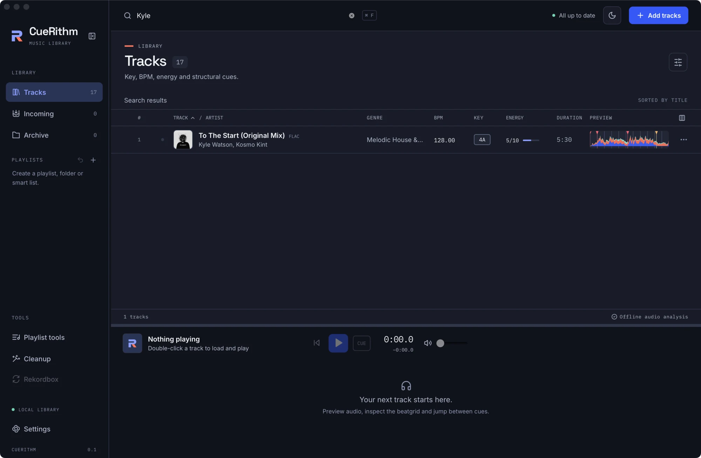

# Find a track: search, sort and filter

Type a few letters to narrow the table, click a column heading to sort it, and use category filters once you have grouped your tracks. It takes about a minute to learn.

**Before you start:** you need prepared tracks in **Tracks**. If the table is empty, [add some tracks](../files/add-tracks.md) first.

## Search by title, artist or genre { #searching-and-filtering }

<!-- figure:existing-33-search-2-find-tracks -->
<figure markdown>
{ .screen loading=lazy }
<figcaption>Search matches titles, artists and genres.</figcaption>
</figure>
<!-- /figure -->

1. Press ++cmd+f++ / ++ctrl+f++, or click the search box at the top of the window. It reads *Search tracks, artists, genres…*.
2. Type part of a title, an artist or a genre. The table narrows as you type, the label above it changes to **Search results**, and the footer counts the matches.
3. Delete the text to see the whole view again.

The shortcut works from any page, including Settings, and takes you back to the
library view you were last in.

CueRithm looks for exactly what you type, ignoring upper and lower case, inside
the title, the artist and the genre of each track. It does not search the album,
the key, the BPM or the file name.

| You type | What you get |
|---|---|
| `anyma` | 4 tracks: Atoma, No Good, Other Dimension and Prophecy, because *Anyma (ofc)* is in their artist field |
| `ANYMA` | The same 4 tracks. Case does not matter |
| `melodic house` | The 11 tracks whose genre is *Melodic House & Techno* |
| `extended mix` | Every track with *(Extended Mix)* in its title |
| `anyma atoma` | Nothing. What you type is matched as one piece of text against the title, artist and genre joined in that order, so both words would have to sit next to each other in that order |
| `nao` | Nothing for *Vai Não Pare*. Accents count |

Search covers the view you are in: **Tracks**, **Incoming**, **Archive** or the
playlist you opened. The text stays when you switch between **Tracks**,
**Incoming** and **Archive**, and clears when you open a playlist. Changing the
search also clears your [selection](select-many.md#selecting).

## Sort the table { #sorting }

Click a heading to sort by it. The first click sorts ascending, a second click on
the same heading reverses the order, and a small arrow shows the direction.

| Heading | Sorts by |
|---|---|
| **TRACK** | Title, ignoring case |
| **ARTIST** | Artist, ignoring case. It is a second button in the title heading, and a heading of its own once you [show the Artist column](choose-columns.md#available-columns) |
| **BPM** | The saved tempo, lowest or highest first |
| **ENERGY** | The 1 to 10 rating |
| **USER RATING** | Your star rating, once you show that column |

The table opens sorted by title, ascending, every time you start CueRithm. While
no track is selected, the bar above the table reminds you with *SORTED BY BPM* or
the heading you chose.

Try it on the demo library: click **BPM** twice and *Nivk, Rabteu - PLV (Creeds
remix - Extended)* comes first at 160 BPM, followed by the two 140 BPM tracks.
Click **ENERGY** twice and *Play With Fire (Original Mix)*, the only 8/10 track,
comes first. Fifteen of the 26 tracks share 6/10, so energy on its own separates
fewer tracks than BPM does.

Key, genre, duration and preview headings do not sort. To order a set by key, use
[Find tracks that mix with the one playing](../playlists/find-compatible-tracks.md)
or a smart playlist.

In an ordinary playlist the table opens in your own order. Choose **Manual order**
to return to it after sorting. See
[Reorder, remove and restore tracks](../playlists/edit-playlist-tracks.md).

## Filter by category { #category-filters }

When you have created categories with [Curate](../tagging/curate-tracks.md), a
**Category filters** menu appears at the left of the bar above the table.

1. Open **Category filters**.
2. Choose how to **Match**: **All selected choices**, **Any selected choice** or **Exclude selected choices**.
3. Tick choices, search for one with *Find a choice…*, or set a **Minimum rating** and **Maximum rating** from 1 to 5. **Notes contain** filters on your curation notes.
4. Choose **Apply category filters**. The menu title shows how many filters are active, for example *Category filters · 2*.
5. Choose **Clear category filters** to remove them.

Category filters combine with search and sorting.

## Find tracks by key, BPM or energy { #by-key-bpm-energy }

The table has no filter for key, BPM or energy. Use one of these instead:

- Sort by **BPM** or **ENERGY** and scroll to the range you want.
- Build a [smart playlist](../playlists/build-a-smart-playlist.md) with a rule such as *energy 7 or more*.
- Open [Compatible tracks](../playlists/find-compatible-tracks.md) to list tracks whose key, BPM and energy fit the one you pick.

## Move through a long list { #long-lists }

CueRithm loads 200 tracks at a time and loads the next 200 as you scroll, so the
footer can read *200 of 1,234 tracks*. Click a row and use ++arrow-up++ and
++arrow-down++ to move the selection, and ++enter++ to play the selected row.
To pick every track in the view, see [Work on many tracks at once](select-many.md).

## What can go wrong

| Symptom | Cause | Fix |
|---|---|---|
| *No matching tracks* appears | The text is not in any title, artist or genre in this view | Type one word instead of two, drop accents, or check you are in the right view. **Archive** tracks only appear in **Archive** |
| A track you just added is missing | It is still in **Incoming** while CueRithm prepares it | Open **Incoming**. See [Follow a track through Incoming](../files/follow-incoming.md) |
| The selection disappeared after you typed | Changing the view, a playlist, the search or a category filter clears the selection | Select again after you finish searching |
| The table is back to title order | Search and sort are not remembered between sessions | Sort again. Your [column choices](choose-columns.md) are remembered |
| A row shows a warning icon instead of the status tick | The track needs attention | See [Fix a track that needs attention](../files/needs-attention.md) and [Status icons and job states](../reference/status-icons.md) |

## Related

- [Show the columns you need](choose-columns.md)
- [Work on many tracks at once](select-many.md)
- [Read a track's key, BPM and energy](read-key-bpm-energy.md)
- [Write smart playlist rules](../playlists/smart-rules.md)

<!-- verified: apps/desktop/src/App.tsx (search box, shortcuts, sort state, category filter placement, footer text); components/TrackTable.tsx (headings, sort buttons, 200-row paging, arrow keys); components/CurationFilters.tsx (labels); crates/cuerithm-library/src/playlists/queries.rs (search_text instr match, sort columns); crates/cuerithm-library/src/jobs.rs (search_text = title artist genre, lowercase); apps/desktop/src/test/workspace.test.tsx; the private demo-library facts sheet counts re-checked; legacy guides/track-table.md re-checked -->
