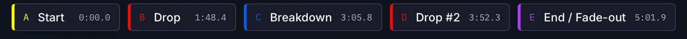

# Jump to the drop with cues

In about ten minutes you will load a track, read its waveform and cue buttons, jump from the start to the drop and the breakdown, and see how the set of cues differs from track to track.

**You need:**

- [ ] A prepared track in **Tracks**. The steps use *Come To Life (Original Mix)* by Cassian and AR/CO, which is 4:33 long at about 130 BPM
- [ ] Speakers or headphones

## 1. Load a track { #load-a-track }

In **Tracks**, press the play button at the left of the row for *Come To Life
(Original Mix)*, or double-click the row. The player at the bottom fills with the
title, the artist, 130 BPM, 7A
and 7/10, and the track starts playing. Press
++space++ to pause.

You should see a colour waveform, thin beat lines, a bar of coloured cue buttons
and, under the waveform, a strip showing the whole track.

*Why:* the player only plays a track you have loaded. Selecting a row is not enough.
See [Preview a track with the player](preview-a-track.md) for every control.

## 2. Read the waveform { #read-the-waveform }

The main waveform shows a 32-second window that follows the playhead. Look for:

- **Colour.** Bass, mids and highs have their own colours. You can change the palette in [Choose a waveform style](../customize/waveform-style.md).
- **Thin vertical lines.** Each is one beat.
- **A coloured line with a letter.** Each is a cue. The letter matches the button below.
- **A bright line.** That is the playhead.

The strip below the waveform is the **Track overview**. It always shows all 4:33,
and every cue is marked on it. Click it to seek.

## 3. Jump to a cue { #jump-to-a-cue }

Under the waveform, each cue has a button with its slot letter, name and time. For
*Come To Life (Original Mix)* you see five:

<!-- figure:existing-crop-cue-chips-jump-to-cues -->
<figure markdown>
{ .screen loading=lazy }
<figcaption>Each cue button shows its name and its time.</figcaption>
</figure>
<!-- /figure -->

| Button | Time | Colour | What it marks |
|---|---|---|---|
| A · Start | about 0:00 | Start | The start of the beatgrid, the first beat |
| B · Drop | about 0:59 | Drop | The main drop |
| C · Breakdown | about 1:51 | Breakdown | A breakdown long enough to qualify |
| D · Drop #2 | about 3:01 | Drop #2 | The second drop |
| E · End / Fade-out | about 4:26 | End / Fade-out | The last strong beat before the outro |

Each button shows its time to a tenth of a second. Click **B Drop**. The playhead
jumps to the drop and the waveform window follows it. If the track was playing, it
keeps playing from there; if it was paused, it stays paused.

*Why:* cues are saved positions, so you can reach the part of a track you care
about without scrubbing. Click **C Breakdown** and **D Drop #2** to hear the others.

## 4. Rehearse the approach { #rehearse-the-approach }

Click **B Drop**, then press ++arrow-left++ once. That moves the playhead one bar
back: four beats at the saved BPM, about 1.8 seconds at 130 BPM. Press play, and
you hear the last bar before the drop. Press ++arrow-right++ to step forward a bar
at a time.

*Why:* bar jumps keep you on the beat grid, so you can audition a mix-in point
without losing the count. They need a loaded track with a BPM, and they do nothing
while you type in a text box.

## 5. See the whole track { #see-the-whole-track }

Click the big waveform. The label above it changes from *32 seconds* to *Entire
track*, and all five cues appear at once. Click it again to return to the
32-second window.

Now press **CUE** in the transport. It pauses and jumps to the first cue, here **A
Start**.

## 6. Compare a track with fewer cues { #fewer-cues }

Load *Prophecy (Extended Mix)* by Baset, Anyma (ofc) and 19:26. It has four buttons:

| Button | Time |
|---|---|
| A · Start | about 0:00 |
| B · Drop | about 0:59 |
| C · Drop #2 | about 2:57 |
| D · End / Fade-out | about 4:26 |

There is no breakdown button, because CueRithm found no breakdown that qualifies. The
letters follow the order of the cues in time, not their type: `C` is the
breakdown on *Come To Life* and the second drop on *Prophecy*. Compare *Atoma
(Extended Mix)*, which has six cues because it has a second breakdown too.

A missing cue is not an error. CueRithm only places a cue when it finds the part of
the track it stands for. To change what counts as a breakdown, see
[Choose how cues are placed](cue-rules.md).

## 7. Spot the cues from the table { #spot-cues-in-the-table }

Go back to the table. The **PREVIEW** column draws a small waveform for each row
with a triangle at every cue. Rest the pointer on one for a moment and a tooltip
lists the cues as `A · Start`, `B · Drop` and so on.

The tooltip uses the detector's own names, *Second Drop* and *Last beat*. The
player shows the names that are saved with the track and sent to your DJ software,
*Drop #2* and *End / Fade-out*. They mark the same positions.

| In the player | Detector name | Colour |
|---|---|---|
| Start | Start | yellow |
| Drop | Drop | red |
| Breakdown | Breakdown | blue |
| Drop #2 | Second Drop | red |
| Breakdown #2 | Second Breakdown | blue |
| End / Fade-out | Last beat | violet |
| S.O.S. | not in the table tooltip | magenta |

*S.O.S.* is a 16-beat loop. CueRithm adds it only when **Emergency loop** is on in
the cue settings. See [Cue names, letters and colours](../reference/cue-types.md).

Cues are saved positions only. CueRithm does not put an energy value on a cue; the
energy is one rating for the whole track. If a cue sits in the wrong place, you can
[move it](corrections/move-or-add-cues.md).

## What you learned

- You load a track by playing it, and the cue buttons seek to saved positions.
- Letters follow time order, so the same letter can mean different cues on different tracks.
- Bar jumps and the zoom toggle help you check a mix-in point.
- The table tooltip uses detector names; the player uses the saved names.

## Next steps

- [Check the beatgrid at beat level](check-the-beatgrid.md)
- [Move or add a cue](corrections/move-or-add-cues.md)
- [Reuse one cue layout on many tracks](corrections/cue-templates.md)
- [How are cues placed?](../how-it-works/cues.md)

<!-- verified: apps/desktop/src/components/PlayerPanel.tsx (cue strip, cueSlot letters, CUE button, zoom toggle, bar-jump keys); components/RowPreview.tsx (tooltip lists raw detector names with letters, triangles); crates/camelot-core/src/lexicon_publication.rs (CueTemplate::default names Drop #2, Breakdown #2, End / Fade-out; colours); crates/cuerithm-library/src/publication.rs (position = order in time, S.O.S. only when emergency loop on); apps/desktop/src/views/Settings.tsx (Emergency loop); apps/desktop/src/test/player.test.tsx (F End / Fade-out); library-facts.md cue times (detector names); legacy learn/navigate-with-cues.md and technical/cues.md re-checked -->
