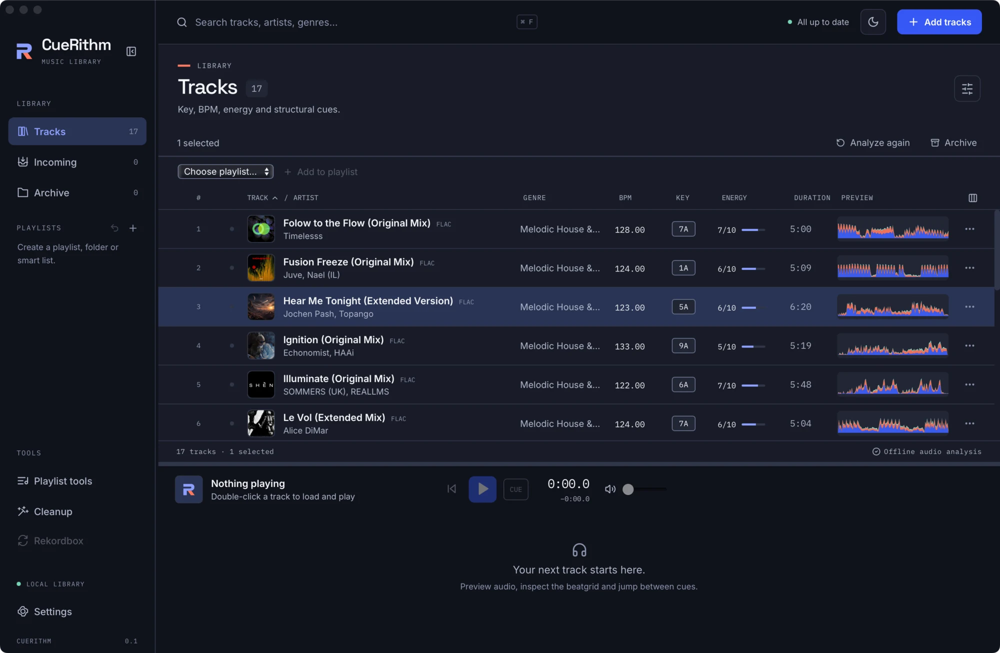

# Work on many tracks at once

Select a handful of tracks, or every track in the view, then edit their tags, group them, analyse them again, archive them or add them to a playlist in one action. Selecting and acting takes a few seconds.

## Select tracks { #selecting }

Selecting a track does not load it into the player. Playing and selecting are
separate.

| To select | Do this |
|---|---|
| One track | Click its row |
| Add or remove one track | ++cmd++ click / ++ctrl++ click the row |
| A run of tracks | Click the first row, then ++shift++ click the last. The run starts at the first selected row in the list and ends at the row you ++shift++ click |
| Every track in the view | ++cmd+a++ / ++ctrl+a++ |
| Move the selection one row | ++arrow-up++ or ++arrow-down++ with the table focused |

++cmd+a++ / ++ctrl+a++ selects every track that matches the current view, search
and filters, including the rows you have not scrolled to yet. The footer shows the
total, for example *26 tracks · 26 selected*. The shortcut does nothing while you
type in a text box.

The selection clears when you change the view, open another playlist, change the
search or apply a category filter. It also clears after **Analyze again**,
**Archive** and **Restore**.

## Act on the selection { #selection-toolbar }

As soon as one row is selected, the bar above the table changes from the sort note
to *N selected* and a set of buttons.

<!-- figure:existing-32-selection-toolbar-select-many -->
<figure markdown>
{ .screen loading=lazy }
<figcaption>Select tracks to act on them together.</figcaption>
</figure>
<!-- /figure -->

| Button | What it does | More |
|---|---|---|
| **Edit metadata** | Opens the tag editor for every selected track | [Edit tags and artwork](../tagging/edit-tags-by-hand.md) |
| **Review match** | Shows the catalog match for one track. It stays unavailable unless exactly one track is selected | [Review and fix a wrong match](../tagging/review-a-match.md) |
| **Curate** | Opens categories, rating and notes for the selected tracks | [Group tracks with categories and custom tags](../tagging/curate-tracks.md) |
| **Organize files** | Opens file organisation with these tracks chosen | [Rename and sort files into folders](../rename/organize-files.md) |
| **Analyze again** | Queues every selected track for a fresh analysis | [Analyze a track again](analyze-again.md) |
| **Archive** | Hides the tracks from **Tracks** and from playlists. Their analysis and cues stay | [Archive tracks you no longer play](../files/archive.md) |
| **Restore** | Appears in **Archive** and in playlists, and brings archived tracks back | [Archive tracks you no longer play](../files/archive.md) |
| **Drafts and history** | Always visible. Opens unsaved tag edits and past changes. A number shows how many drafts are waiting | [Undo a tag change](../tagging/tag-history.md) |

!!! warning "Analyze again replaces your corrections"
    A new analysis writes new key, BPM, energy, cues and grid for the track. Any
    cue, loop or grid you corrected by hand is replaced, and
    [Undo](corrections/undo-corrections.md) can no longer restore it.

## Add the selection to a playlist { #add-to-a-playlist }

Below the bar, a second strip appears with a **Destination playlist** menu that
starts at *Choose playlist…*.

1. Pick an ordinary playlist from the menu. Folders and smart playlists are not listed, because tracks cannot be added to them by hand.
2. Choose **Add to playlist**.

You can also drag the selection onto an ordinary playlist in the sidebar. Dragging
a row that is selected moves the whole selection; dragging a row that is not
selected moves just that row.

Inside an ordinary playlist the strip also offers **Remove from playlist**, the
**Order** arrows (*Move selected tracks up* and *down*) and, when you have sorted
by a column, **Manual order**. See
[Create a playlist and add tracks](../playlists/create-a-playlist.md) and
[Reorder, remove and restore tracks](../playlists/edit-playlist-tracks.md).

## Use the row menu for one track { #row-menu }

Click the **⋯** button at the right end of a row.

| Item | Applies to |
|---|---|
| **Edit metadata**, **Curate** | The whole selection if the row is part of it. Otherwise only this row, which becomes the selection |
| **Review match** | This row only |
| **Analyze again** | This row only, even when others are selected |
| **Archive track**, or **Restore to library** in **Archive** | This row only |

A row whose preparation failed shows a retry button in place of **⋯**. Its tooltip
reads *Retry preparation*. See
[Fix a track that needs attention](../files/needs-attention.md).

## Load a track and keep your selection { #selection-and-playback }

A click selects a row. A double-click, or the small play button at the left of the
row, loads the track and starts it. A double-click also selects that row alone.

To keep a selection of several tracks and load one of them, press the play button
on a row. It loads the track without changing the selection. Press ++enter++ with
the table focused to play the first selected row. This matters when you plan to
apply a [cue template to the selected tracks](corrections/cue-templates.md).

## What can go wrong

| Symptom | Cause | Fix |
|---|---|---|
| **Review match** is unavailable | More than one track, or none, is selected | Select exactly one track |
| **Add to playlist** is unavailable | No destination is chosen, or the playlist list is empty | Choose an ordinary playlist. [Create one first](../playlists/create-a-playlist.md) if the menu is empty |
| The selection vanished | You changed the view, the search or a filter | Select again after you finish searching. See [Find a track](find-tracks.md) |
| A double-click replaced your selection | A double-click selects the row it lands on | Use the row's play button instead |

## Related

- [Find a track: search, sort and filter](find-tracks.md)
- [Show the columns you need](choose-columns.md)
- [Reuse one cue layout on many tracks](corrections/cue-templates.md)
- [Keyboard shortcuts](../reference/keyboard-shortcuts.md)

<!-- verified: apps/desktop/src/App.tsx (onSelect, selectAll, toolbar buttons and conditions, archiveSelected, row-menu actions, selection reset effect); components/TrackTable.tsx (row menu, play button, double-click, Enter); components/PlaylistMembershipControls.tsx; apps/desktop/src/test/workspace.test.tsx (select all beyond loaded page); legacy guides/track-table.md re-checked -->
