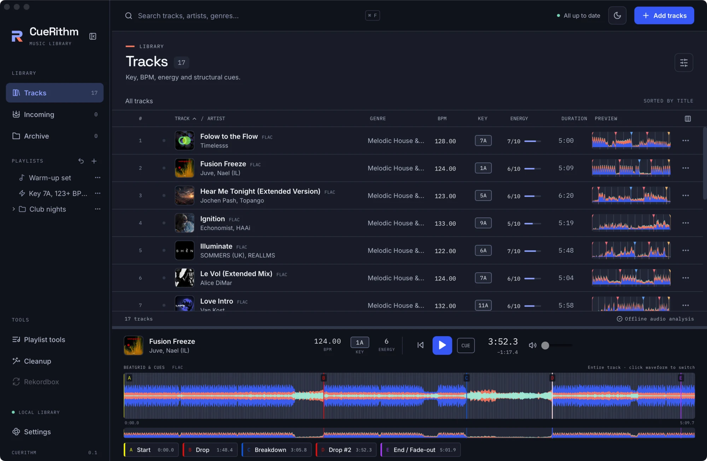

# Switch between light and dark

One button in the header switches CueRithm between light, dark and your computer's own setting. It takes a few seconds and CueRithm remembers your choice.

<!-- figure:existing-31-dark-selected-player-theme -->
<figure markdown>
{ .screen loading=lazy }
<figcaption>The dark theme.</figcaption>
</figure>
<!-- /figure -->

<!-- figure:existing-92-light-player-2-theme -->
<figure markdown>
{ .screen loading=lazy }
<figcaption>The light theme.</figcaption>
</figure>
<!-- /figure -->

## Change the theme { #change }

Find the **Colour theme** button in the header, to the left of **Add tracks** and to the right of the status line (*All up to date*). Select it to move to the next mode. The modes cycle in this order:

| Mode | The icon shows | What it does |
|---|---|---|
| System | Half sun, half moon | Follows your operating system's light or dark appearance, and changes when you change it |
| Light | Sun | Always light |
| Dark | Moon | Always dark |

Select the button once from System and CueRithm turns light, again and it turns dark, a third time and it returns to System. The tooltip names the current mode: *Colour theme: dark (click to change)*. A screen reader announces it as *Colour theme: dark*. The button is in the header of every view, including Settings, so you can switch without leaving what you are doing.

New libraries start in System mode. If your computer switches to dark at sunset and CueRithm is set to System, it follows while it is open.

!!! tip "This guide has its own switch"
    The light and dark button at the top of this guide only changes this website. It is separate from the one inside CueRithm.

## What changes with the theme { #what-changes }

The whole window changes, including the sidebar, the track table, the player and every tool. Colours that carry meaning stay readable in both themes. Key, BPM and energy always show a text label, and cues carry their names, so none of them depends on colour alone. The colours of [waveforms](waveform-style.md) are adjusted for each theme so every band keeps enough contrast against the background.

## What CueRithm remembers { #remember }

CueRithm saves a Light or Dark choice on this computer, in the application's own storage, not in your library. Choosing System removes the saved choice and lets the operating system decide. Three things follow from that:

- The choice is not in a [library backup](../files/library/back-up-library.md), and restoring a backup does not change it.
- The waveform style, the sidebar and player sizes and the table columns are stored the same way; see [Resize the sidebar and player](layout.md) and [Choose a waveform style](waveform-style.md#remember).
- A second computer, or a second user account, keeps its own choice.
- If CueRithm cannot read its saved choice, it falls back to System.

## If the theme does not follow your computer { #problems }

CueRithm follows your computer only in System mode. If it stays dark while your computer is light, the mode is Dark. Select the button until the half sun, half moon icon shows.

## Related

- [Choose a waveform style](waveform-style.md)
- [Resize the sidebar and player](layout.md)
- [Find the setting you need](find-a-setting.md)
- [Find your way around the window](../get-started/main-window.md)

<!-- verified: apps/desktop/src/theme.ts (modes, cycle order system->light->dark->system, localStorage key cuerithm-theme removed for System, fallback), App.tsx (theme-toggle button, aria-label "Colour theme: <mode>", title text, header position, icons Sun/Moon/SunMoon), apps/desktop/public/theme-init.js, waveform-colour.ts (legible per theme); legacy learn/appearance.md and get-started/main-window.md re-checked. -->
