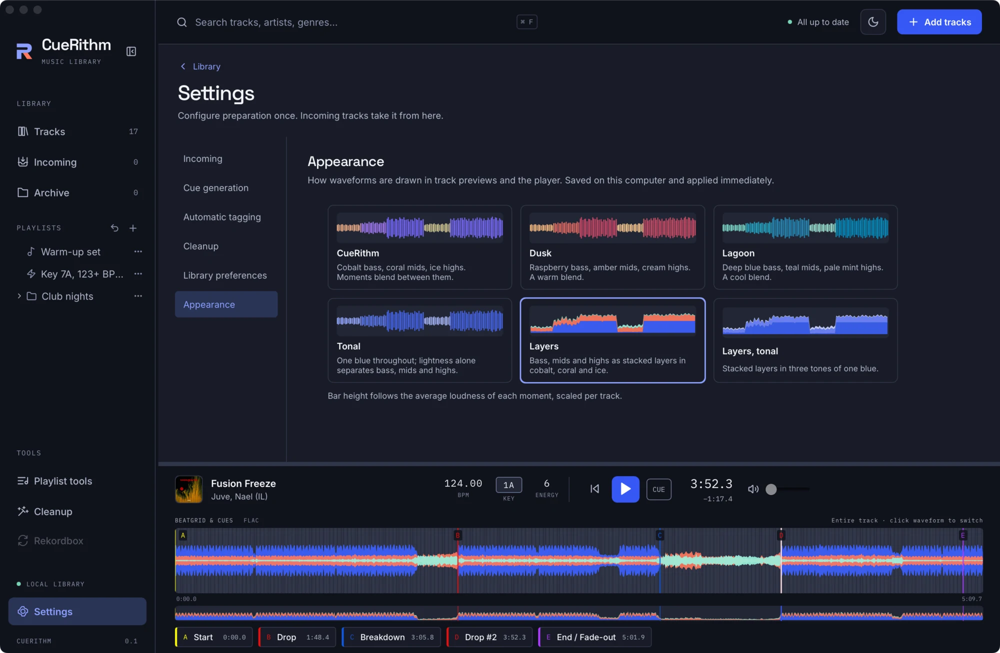
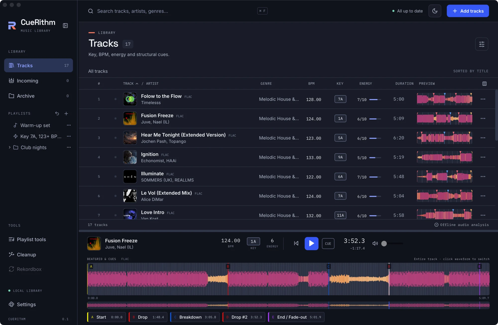
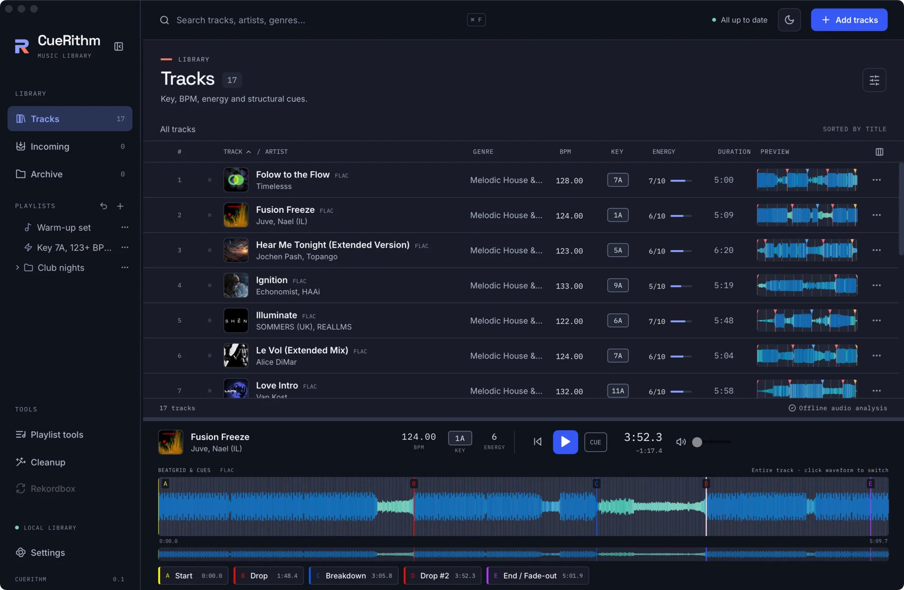

# Choose a waveform style

Pick one of six colour palettes for every waveform in CueRithm. It takes a few seconds, applies at once and needs no saving.

<!-- figure:existing-15-settings-appearance-waveform-style -->
<figure markdown>
{ .screen loading=lazy }
<figcaption>Pick a waveform style under Settings → Appearance.</figcaption>
</figure>
<!-- /figure -->

<!-- figure:existing-93-style-dusk-waveform-style -->
<figure markdown>
{ .screen loading=lazy }
<figcaption>Dusk.</figcaption>
</figure>
<!-- /figure -->

<!-- figure:existing-94-style-lagoon-waveform-style -->
<figure markdown>
{ .screen loading=lazy }
<figcaption>Lagoon.</figcaption>
</figure>
<!-- /figure -->

## Pick a style { #pick }

1. Choose **Settings** at the bottom of the sidebar.
2. Select the **Appearance** page in the list on the left.
3. Under **Waveform style**, select the style you want. Each option draws a small sample waveform, so you can compare before you choose.

The selected style is marked, and the change applies straight away to every waveform in the window. **Appearance** has no **Save settings** button, because nothing waits to be saved. The samples all draw the same made-up track (an intro, a drop, a breakdown and a second drop), so you compare palettes on identical audio, not on your own music.

| Style | Look |
|---|---|
| **CueRithm** | Cobalt bass, coral mids, ice highs. Moments blend between them. This is the default. |
| **Dusk** | Raspberry bass, amber mids, cream highs. A warm blend. |
| **Lagoon** | Deep blue bass, teal mids, pale mint highs. A cool blend. |
| **Tonal** | One blue throughout; lightness alone separates bass, mids and highs. |
| **Layers** | Bass, mids and highs as stacked layers in cobalt, coral and ice. |
| **Layers, tonal** | Stacked layers in three tones of one blue. |

## Where the style shows { #where }

The same choice applies everywhere CueRithm draws a waveform:

- The **PREVIEW** column of the track table, one small waveform per row (see [Find a track](../analysis/find-tracks.md)).
- The player's main waveform, which follows the playhead, and the overview under it that shows the whole track (see [Preview a track with the player](../analysis/preview-a-track.md)).
- The samples on the **Appearance** page.

The style changes colour only. CueRithm computes each waveform once from the decoded audio and caches it, so switching styles does not analyse anything again. [How is the waveform drawn?](../how-it-works/waveform.md) explains the computation.

## How to read each style { #read }

Bar height does not change between styles: it follows the average loudness of each moment, scaled per track so quiet and loud tracks both fill the height. The style decides the colour.

- **Blend styles** (**CueRithm**, **Dusk**, **Lagoon**, **Tonal**) colour each moment by how much bass, mid and high sound it holds. A kick-heavy moment leans towards the bass colour, and a hi-hat-heavy moment towards the high colour. Silent stretches use a neutral colour.
- **Layer styles** (**Layers**, **Layers, tonal**) draw the three bands as separate layers instead of mixing them. In the small overviews and table previews the layers stack up from the bottom edge. In the zoomed player waveform they overlay each other around the centre line.

## Choose for contrast and colour vision { #contrast }

Every palette steps from dark to light in the order bass, mids, highs, so you can tell the bands apart by lightness alone. The default pairs cobalt and coral, a blue and orange pair designed to stay distinct with red-green colour blindness. **Tonal** and **Layers, tonal** go further and use a single blue, so they never depend on hue. CueRithm also nudges each colour as the [theme](theme.md) changes, so it keeps enough contrast against the light or dark waveform background.

Key, BPM, energy and cue labels are text, whatever palette you choose.

## What CueRithm remembers { #remember }

The style is saved on this computer, in the application's own storage and not in the library. It is not part of a [library backup](../files/library/back-up-library.md). A second computer starts on **CueRithm** until you choose.

## Related

- [Switch between light and dark](theme.md)
- [Preview a track with the player](../analysis/preview-a-track.md)
- [Cue names, letters and colours](../reference/cue-types.md)
- [Find the setting you need](find-a-setting.md)

<!-- verified: apps/desktop/src/views/WaveformSettings.tsx (radiogroup "Waveform style", sample track, footnote on bar height), waveform-colour.ts (palette ids, labels, detail strings, anchors order, legible per theme, neutral colour for silence), waveform-style.ts (localStorage key cuerithm-waveform-style, default), waveform-shape.ts and components/PlayerPanel.tsx, RowPreview.tsx (stacked overview/preview vs overlaid zoom), views/Settings.tsx (Save settings hidden on Appearance); legacy learn/appearance.md and technical/waveform.md re-checked -->
