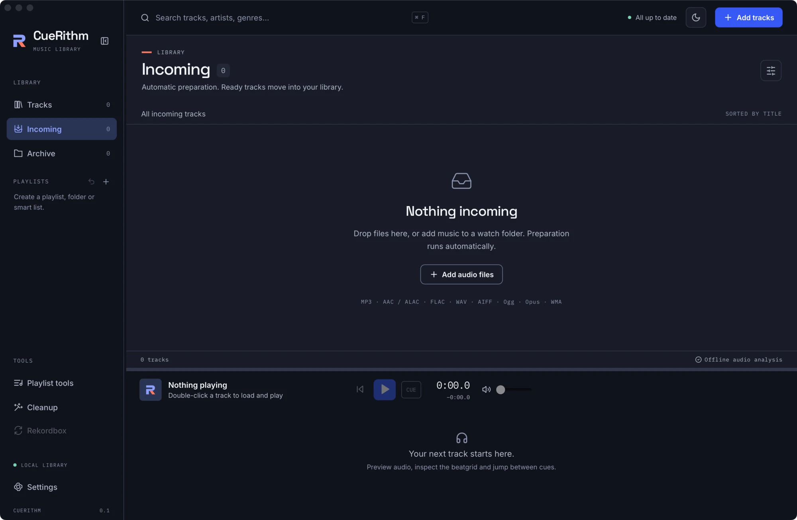

# Follow a track through Incoming

Incoming shows every track that is being prepared, the stage each one is in, and anything that needs you. Read it once and you will know what each row means and when a track counts as ready.

**Before you start:** add some files with [Add tracks](add-tracks.md) or a [watch folder](watch-folders.md).

## 1. Open Incoming { #open-incoming }

Choose **Incoming** under LIBRARY in the sidebar. Its number is highlighted while tracks are waiting. The title area reads *Automatic preparation. Ready tracks move into your library.*

Three things tell you how the batch is going:

- **The header, next to the search box:** *Preparing 26 tracks* while work is running or queued, *3 need attention* when everything else is done, and *All up to date* when nothing is left.
- **Each row:** a spinner, the track's file type (for example FLAC), and a line under the title that names the current stage.
- **The sidebar count:** Incoming drops as tracks finish and Tracks grows.

If you are in another view and a track needs you, a button reading *N need attention* appears at the top right and takes you to Incoming.

## 2. Read the stage on a row { #stages }

A track passes through some or all of these stages, in this order. Which ones appear depends on what you switched on in Settings.

<!-- figure:existing-21-incoming-analyzing-2-follow-incoming -->
<figure markdown>
{ .screen loading=lazy }
<figcaption>Each row shows the stage a track has reached.</figcaption>
</figure>
<!-- /figure -->

| Row shows | When it appears | What is happening |
|---|---|---|
| Queued | Always | The track waits for a free worker. CueRithm prepares several tracks at once, using about three quarters of your processor cores. |
| Waiting for file | Always | CueRithm checks that the file has stopped changing, so a half-copied file is never read. |
| Decoding | Always | The bundled decoder makes a private working copy. Your file is not modified. |
| Analyzing | Always, unless an earlier result for the same file can be reused | Key, BPM and beatgrid, whole-track energy and cues are measured. |
| Matching catalog | Automatic tagging on | CueRithm looks the track up with the providers you chose. |
| Preparing tags | Automatic tagging on | The tag changes are planned and checked. |
| `cleanup` | Cleanup on | Your cleanup rules are applied to the planned tags. This stage shows its name in lower case. |
| Writing tags | Tagging or cleanup on | The tags are written to a copy and then published, with a backup of the original kept. |
| Applying cues | Tagging and cleanup both off | The results and cues are saved in the library. |
| Organizing files | File organization set to rename, move or copy | The naming rule runs last, after tags and cleanup. Known paths in linked DJ libraries are repaired before the track finishes. |
| Setup | A problem before the first stage | Shown only with an error. See [Fix a track that needs attention](needs-attention.md). |

With tagging and cleanup off, a typical track goes Queued, Waiting for file, Decoding, Analyzing, Applying cues. With [Beatport and Traxsource tagging on](../tagging/tag-new-tracks-automatically.md), it also passes through Matching catalog, Preparing tags and Writing tags.

## What ready requires { #what-ready-requires }

CueRithm never marks a track ready with blanks. A track leaves Incoming only when it has:

- a key (shown as a Camelot chip such as 6A);
- a positive BPM and a beatgrid with at least one beat;
- a whole-track energy rating from 1 to 10;
- at least one cue, with every cue inside the track;
- every tagging, cleanup and file organization step you configured as required, finished.

If any of these cannot be produced, the track stays in Incoming and says why. Nothing is guessed. After a track is ready, you can [read its key, BPM and energy](../analysis/read-key-bpm-energy.md) in Tracks.

## Which rules apply to a track { #which-rules }

CueRithm captures the rules when you add a file: the [folder preset](folder-presets.md) assigned to its folder, or your global settings. Changing Settings afterwards does not alter a track that is already queued. Tracks that stopped with an error are different: **Save settings** retries them with the new rules, and so does **Retry** on the row.

## While you wait { #while-waiting }

- You can keep using CueRithm. Open Tracks, build playlists or play tracks that are already prepared.
- Select rows in Incoming to **Edit metadata**, **Review match**, **Curate**, **Organize files**, **Analyze again** or **Archive** them. Archiving a track in Incoming stops its preparation.
- If you quit CueRithm part-way, unfinished tracks are queued again and continue the next time you open it.

## Empty Incoming { #empty-incoming }

When nothing is left, Incoming reads *Nothing incoming. Drop files here, or add music to a watch folder. Preparation runs automatically.* and lists the supported formats: MP3, AAC / ALAC, FLAC, WAV, AIFF, Ogg, Opus and WMA.

<!-- figure:existing-20-incoming-empty-follow-incoming -->
<figure markdown>
{ .screen loading=lazy }
<figcaption>When every track is ready, Incoming is empty.</figcaption>
</figure>
<!-- /figure -->

## What can go wrong { #what-can-go-wrong }

| What you see | Why | What to do |
|---|---|---|
| A row stays on *Waiting for file* | The file is still being copied or synced | Wait; after five minutes it fails with *File copy did not settle* |
| Several rows stay on *Queued* | Other tracks are being prepared | Wait; the header shows how many remain |
| A warning triangle and a red message | A stage failed | [Fix a track that needs attention](needs-attention.md) |
| Nothing moves at all | See the symptom page | [A track is stuck in Incoming](../help/troubleshooting/incoming-stuck.md) |

## Related

- [Fix a track that needs attention in Incoming](needs-attention.md)
- [Status icons and job states](../reference/status-icons.md)
- [Choose how CueRithm places cues](../analysis/cue-rules.md)
- [How does CueRithm analyse a track?](../how-it-works/pipeline.md)

<!-- verified: apps/desktop/src/App.tsx (processing-indicator text, attention-link, empty-state text, selection toolbar buttons, Archive in Incoming); apps/desktop/src/components/Sidebar.tsx (LIBRARY, count accent); apps/desktop/src/components/TrackTable.tsx (stages label map; cleanup has no label so the raw stage name shows); crates/cuerithm-library/src/prepare.rs (process: stage order, committing branch only without tagging or cleanup, worker_count 75 percent, tests); crates/cuerithm-library/src/jobs.rs (validate_analysis = what ready requires; stage names; claim_next captured settings; store.rs open requeues running jobs); legacy guides/incoming-archive.md re-checked -->
