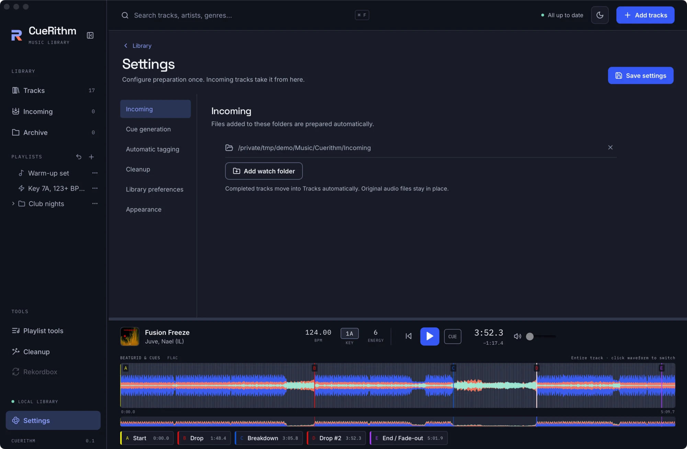
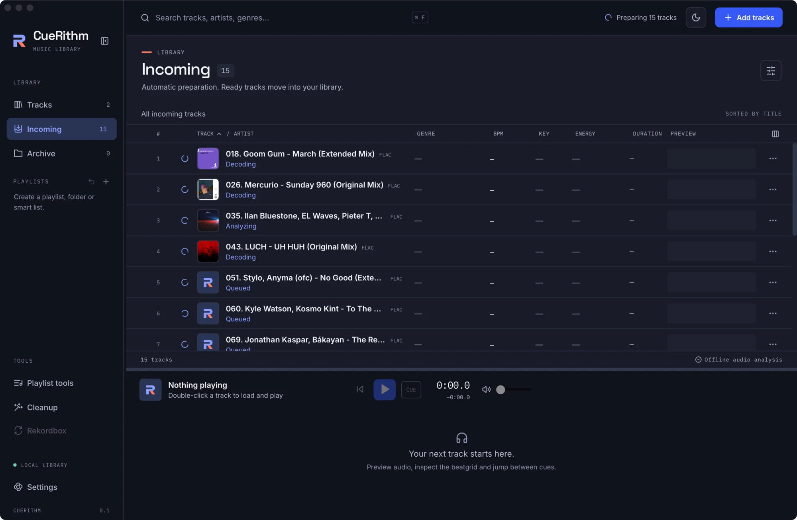

# Add your music

There are four ways to bring tracks in. All of them end in the same place: the **Incoming** view, where each track is prepared automatically.

| Way | How |
| --- | --- |
| **Add tracks** button | In the header. Opens the system file picker. |
| **Add audio files** button | Shown in the empty library. |
| **Drag and drop** | Drop audio files or folders on the window. An overlay says *Drop to prepare: Full analysis. Fresh cues. Ready for your library.* |
| **Watch folders** | In **Settings > Incoming**. Anything that appears in a watched folder is prepared automatically. |

## Watch folders

On a brand-new library CueRithm creates and watches `Music/Cuerithm/Incoming` inside your Music folder. Add more in **Settings > Incoming** with **Add watch folder**.

<figure markdown>
  { .screen loading=lazy }
  <figcaption>Files added to these folders are prepared automatically. Completed tracks move into Tracks; original audio files stay in place.</figcaption>
</figure>

A watcher listens for changes and a rescan runs every five seconds as a safety net. If a folder goes offline you see a *Folder is offline* warning in Incoming.

## Which files are accepted

Folder scans pick up files with these extensions (case-insensitive): `mp3`, `aac`, `m4a`, `alac`, `flac`, `wav`, `wave`, `aif`, `aiff`, `aifc`, `ogg`, `oga`, `opus`, `wma`. Hidden files (names starting with a dot) are ignored, and symbolic links are not followed.

Files you pick or drop individually are not filtered by extension. If one cannot be decoded it fails during preparation and waits in Incoming with an error you can read.

!!! warning "Protected media is not supported"
    Files protected by digital rights management cannot be decoded. Very long files also fail: decoding is capped at 64 million frames, about 24 minutes at 44.1 kHz. Long DJ mixes will not prepare.

## When does a file start processing?

A copy in progress must finish first. CueRithm checks the file's size and modified time twice, two seconds apart by default, and starts only when they stop changing. A file that keeps changing for five minutes fails with *File copy did not settle*. You can retry it later.

## What happens next

Open **Incoming** to watch the stages: *Queued*, *Waiting for file*, *Decoding*, *Analyzing*, and, when those features are on, *Matching catalog*, *Preparing tags*, *Writing tags* and *Applying cues*.

<figure markdown>
  { .screen loading=lazy }
  <figcaption>Incoming while a batch is prepared. The header reads "Preparing 15 tracks".</figcaption>
</figure>

When preparation succeeds the track leaves Incoming and appears in Tracks. If anything fails, the track stays in Incoming with the stage and error shown, and your earlier cues, if any, are kept. Follow the full walkthrough in [Prepare your first tracks](../learn/first-tracks.md).
