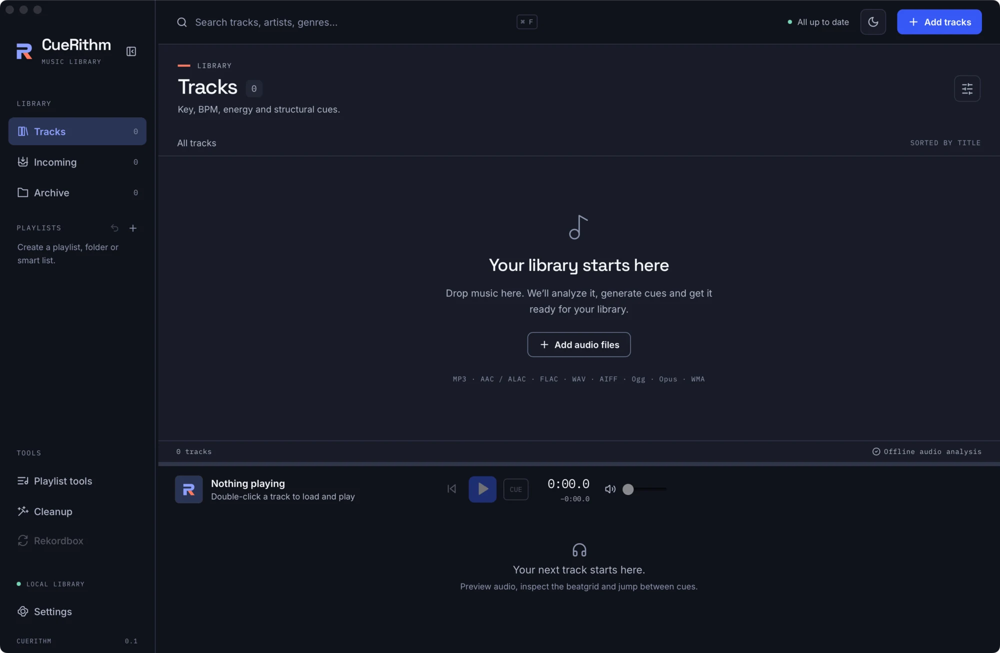

# Prepare your first tracks

Add a folder of music to an empty library, watch each track move through Incoming, and open the finished tracks with their key, BPM, energy and cues. Allow ten minutes; most of that is CueRithm working in the background.

**You need:**

- [ ] CueRithm installed ([Download and install CueRithm](install.md))
- [ ] A folder with at least five audio files in a [supported format](../files/supported-formats.md). By default CueRithm never edits, moves or copies them, but a copy of an album is a calm way to start.

The screenshots use 26 FLAC files from a Beatport purchase folder, `~/Music/Beatport`. Your tracks will be different and the steps are the same.

## 1. Start from an empty library { #1-start-from-an-empty-library }

Open CueRithm. A new library opens on **Tracks** and says *Your library starts here*, with an **Add audio files** button and the list of formats it accepts: MP3, AAC, ALAC, FLAC, WAV, AIFF, Ogg, Opus and WMA.

<!-- figure:existing-00-empty-first-tracks -->
<figure markdown>
{ .screen loading=lazy }
<figcaption>A new library is empty. The window lists the formats CueRithm accepts.</figcaption>
</figure>
<!-- /figure -->

**Why it is empty:** nothing is analysed until you add music. The only thing a new library does by itself is watch `Cuerithm/Incoming` in your Music folder.

## 2. Add tracks { #2-add-tracks }

Choose any one of these. They all end in the same place.

| Way | How |
|---|---|
| Drag and drop | Drag files or a whole folder from Finder, Explorer or your file manager onto the window. An overlay reads **Drop to prepare**. |
| **Add tracks** | Select it in the header and choose files in the picker. The picker selects files, not folders. |
| Watch folder | Copy files into `Cuerithm/Incoming` in your Music folder, or [watch a folder you already use](../files/watch-folders.md). |

For this tutorial, drag your folder onto the window. [Add tracks: drop, pick or watch a folder](../files/add-tracks.md) has every detail, including what happens if you add the same file twice.

**You should see** CueRithm switch to **Incoming** by itself.

## 3. Watch Incoming { #3-watch-incoming }

Each row in **Incoming** names the stage it is in under the title. With tagging and cleanup off, a track goes through *Queued*, *Waiting for file*, *Decoding*, *Analyzing* and *Applying cues*. The header reads *Preparing 26 tracks* while work is running, and the **Incoming** count in the sidebar falls as tracks finish.

<!-- figure:existing-21-incoming-analyzing-first-tracks -->
<figure markdown>
{ .screen loading=lazy }
<figcaption>Each track shows its stage while CueRithm prepares it.</figcaption>
</figure>
<!-- /figure -->

CueRithm prepares several tracks at once, using about three quarters of your processor cores, so you can keep working. [Follow a track through Incoming](../files/follow-incoming.md) explains every stage.

??? question "A row shows a warning triangle. What now?"
    A stage failed and CueRithm kept the track in Incoming instead of guessing. Read the message under the title, then follow [Fix a track that needs attention](../files/needs-attention.md). The rest of the batch carries on.

## 4. Find them in Tracks { #4-find-them-in-tracks }

When a track finishes it leaves **Incoming** and the **Tracks** count grows. When the header says *All up to date*, open **Tracks**.

<!-- figure:existing-30-tracks-first-tracks -->
<figure markdown>
{ .screen loading=lazy }
<figcaption>Prepared tracks land in Tracks with their key, BPM and energy.</figcaption>
</figure>
<!-- /figure -->

**You should see** one row per track with a key chip, a BPM, an energy rating, the duration and a mini waveform with cue markers. For the first track in the demo library, **17 (Extended Mix)** by Miss Monique, Henri Bergmann and Mario Eighta, the row reads 6A, 128 and 7/10, 4:32 long. The table shows BPM with two decimals, so expect something like 128.00.

A track only leaves Incoming when it has all of these:

- a key,
- a BPM and a beatgrid,
- an energy rating from 1 to 10,
- at least one cue.

**Why:** CueRithm never fills in a blank to mark a track ready. [What ready requires](../files/follow-incoming.md#what-ready-requires) lists the full rule.

## 5. Play one and read its numbers { #5-play-one }

Double-click **Other Dimension (Extended Mix)** by Volkoder and Anyma (ofc). The player at the bottom loads it and starts playing.

<!-- figure:existing-crop-player-panel-first-tracks -->
<figure markdown>
{ .screen loading=lazy }
<figcaption>Select a track to see its waveform, beatgrid and cues in the player.</figcaption>
</figure>
<!-- /figure -->

**You should see**, in the player header, a BPM of about 128 (the player shows two decimals), key 6A and energy **7**. Under the waveform is one button per cue, each with its letter, name and time:

| Button | Time |
|---|---|
| Start | 0:00 |
| Drop | 0:30 |
| Breakdown | 2:23 |
| Drop #2 | 3:15 |
| Breakdown #2 | 4:38 |
| End / Fade-out | 5:08 |

Click **Breakdown** and playback jumps to about 2:23. Press ++space++ to pause. [Jump to the drop with cues](../analysis/jump-to-cues.md) takes this further, and [Read a track's key, BPM and energy](../analysis/read-key-bpm-energy.md) explains the three numbers.

## What just happened { #what-just-happened }

1. CueRithm waited until each file stopped changing, then recorded where it is and a fingerprint of its contents.
2. The bundled decoder turned it into a private 44.1 kHz stereo copy, so every format shares one timeline. Your file was not touched.
3. Key, tempo and beatgrid, energy and cues were computed from those samples, on your computer.
4. The results were saved to the library in one step and the track became ready.

[How does CueRithm analyse a track?](../how-it-works/pipeline.md) tells the whole story.

## What you learned

- A new library is empty until you add music, and every way of adding it leads to **Incoming**.
- **Incoming** is where tracks are prepared; **Tracks** is where finished ones live.
- A finished track has a key, BPM, beatgrid, one energy rating and cues, and the player lets you jump between the cues.

## Next steps

- [From a folder of new music to a playlist for the booth](first-hour.md) carries these tracks all the way to a rekordbox sync.
- [Keep a folder like Beatport in your library automatically](../files/watch-folders.md) makes the next purchase prepare itself.
- [Tag new tracks from Beatport and Traxsource](../tagging/tag-new-tracks-automatically.md) adds catalog tags as tracks arrive.
- [Find your way around the window](main-window.md) names every part of the screen you just used.

<!-- verified: apps/desktop/src/App.tsx (empty-state text and formats line, Add audio files, drop overlay "Drop to prepare", addPaths switches to Incoming, header status texts); components/TrackTable.tsx (stage labels, columns, BPM toFixed(2)); components/PlayerPanel.tsx (cue strip, BPM/KEY/ENERGY); crates/cuerithm-library/src/prepare.rs (stage order waiting, decoding, analysis, committing; folder expansion for dropped folders; worker count) and jobs.rs validate_analysis (ready requirements); crates/camelot-core/src/lexicon_publication.rs (published cue names Drop #2, Breakdown #2, End / Fade-out); host.rs (first-run watch folder); values from _meta/the private demo-library facts sheet (cue times are the facts sheet's; the sheet lists raw detector names Second Drop, Second Breakdown and Last beat, the player shows the published names); legacy learn/first-tracks.md re-checked. -->
