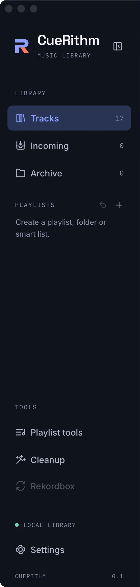
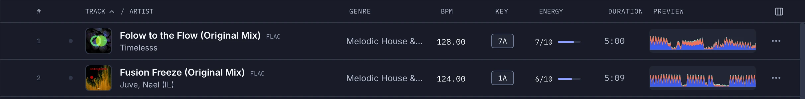

# The main window

CueRithm has one window with four regions: a **sidebar** on the left, a **header** across the top, the **main area** (a track table or a tool) and a **player** that stays at the bottom.

<figure markdown>
  { .screen loading=lazy }
  <figcaption>Sidebar, header, track table and player. Drag the dividers to resize the sidebar and the player.</figcaption>
</figure>

## The sidebar

{ .crop .crop-tall loading=lazy }

- **Library**
    - **Tracks**: every prepared, non-archived track.
    - **Incoming**: tracks being prepared, or waiting for attention.
    - **Archive**: tracks you set aside. They keep their analysis and cues.
- **Playlists**: your playlists, folders and smart playlists, with **Create playlist** and **Undo last playlist change**.
- **Tools**: **Playlist tools** and **Cleanup**. **Rekordbox** is shown but disabled, because direct sync is not available in this build.
- **Settings** at the bottom, with the version label.

The numbers beside Tracks, Incoming and Archive are live counts.

Press ++cmd+b++ (or ++ctrl+b++) to collapse the sidebar to an icon rail. The rail expands again while the pointer or keyboard focus is on it.

## The header

- **Search** (++cmd+f++): filters the current view by title, artist and genre. It is a case-insensitive "contains" match.
- **Status**: *All up to date*, *Preparing N tracks* with a spinner, or *N need attention*.
- **Colour theme** button: cycles System, Light and Dark.
- **Add tracks**: opens the file picker and queues your choice into Incoming.

## The track table

The table lists tracks with artwork, title, artist, genre, BPM, key, energy, duration and a mini waveform with cue markers. Click a row to select it. Selecting shows a toolbar with **Analyze again**, **Archive** and an **Add to playlist** control.

<figure markdown>
  { .crop loading=lazy }
  <figcaption>Key appears as a labelled chip such as 7A, energy as a number out of 10 with a bar, BPM with two decimals.</figcaption>
</figure>

<figure markdown>
  { .screen loading=lazy }
  <figcaption>Type in the search box to filter the view. Press the columns button at the end of the table header to choose which columns to show.</figcaption>
</figure>

Read more in [The track table](../guides/track-table.md).

## The player

The player is always visible. It shows the loaded track, its BPM, key and energy, transport controls, a detailed waveform with beat lines and cue markers, a small overview, and one button per cue.

<figure markdown>
  { .crop loading=lazy }
  <figcaption>Click the waveform to switch between the entire track and a 16-second window that follows the playhead.</figcaption>
</figure>

Read more in [Player, waveform and cues](../guides/player.md).

## Light and dark

CueRithm follows your system theme by default. Use the header button to pick Light or Dark.

<figure markdown>
  { .screen loading=lazy }
  <figcaption>The light theme. Key, energy and cue labels stay readable without relying on colour alone.</figcaption>
</figure>
