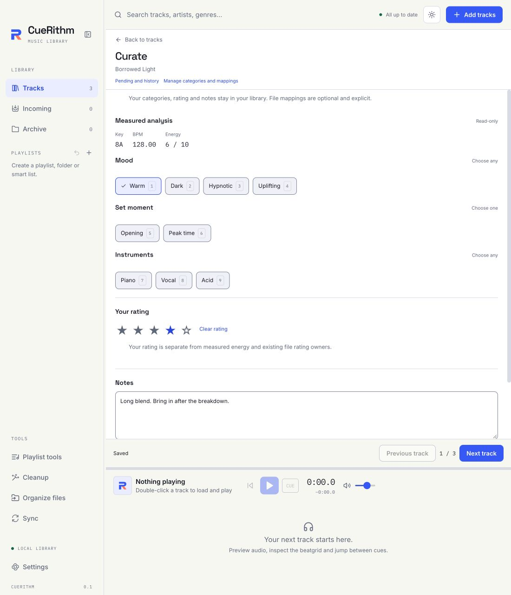

# Curate tracks

Select tracks and open **Curate** beside the table. Use category groups, user
rating and notes while keeping the player available. Measured key, BPM and
energy remain read-only.

[View the dark theme](../assets/screens/89-curate-dark.png).

These values are library-only by default. Curating an offline or missing source
does not require reading its audio. User rating is separate from an existing
file rating; notes are separate from native comments.

## Categories and selections

Create groups and choices in category management. Multiple-select groups allow
several choices; single-select groups replace only that group's previous choice.
Mixed batch selections show a mixed state. Adding or removing a choice preserves
unrelated categories and values on each track.

Renaming keeps stable IDs used by filters, smart playlists and captured cleanup
decisions. Deletion requires
explicit handling of dependent values and rules. CueRithm does not remove a
missing predicate and silently broaden a playlist.

Use category, rating and notes filters to narrow the table. Previous/Next follows
the captured ordered scope. The edited track stays available if its new values
remove it from that filter. Navigation changes selection independently of the
playing track.

## Autosave, pending work and Undo

Changes first receive a durable local receipt. Publication can then be queued or
in progress. A newer edit remains pending when an older write finishes. Notes
publication is coalesced; leaving the track or quitting waits for the latest
local changes to persist.

Open Pending/history to inspect unfinished work and exact publication results.
Retry resumes retained work. Discard abandons an unpublished revision when
eligible. Undo reverses a published operation only while its ownership and
revision checks still hold; it preserves unrelated later changes.

Archiving a track retains its pending work without blocking other tracks.
Restore it before resolving that work. If restoration creates a new preparation
operation, an older file-write intent can require Discard and a fresh edit.
Archive reports busy while a file publication is running. Finish or recover an
interrupted native publication before changing that track's archive status.

## Optional native mappings

Native mappings are a separate opt-in. Choose a supported container and an
explicit field, comment identity or rating owner. Two sources cannot claim the
same target accidentally. Multiple values need a proved native representation
or an explicitly selected reversible encoding.

Mapping or taxonomy changes can leave existing file values out of date. Use
explicit re-export for those tracks; saving a mapping does not silently rewrite
the whole library. Unsupported destinations remain unavailable. Incoming mapped
edits join its protected preparation and organization workflow, with guarded
recovery and Undo.

For direct native metadata editing, see [Edit metadata](metadata-editing.md).
