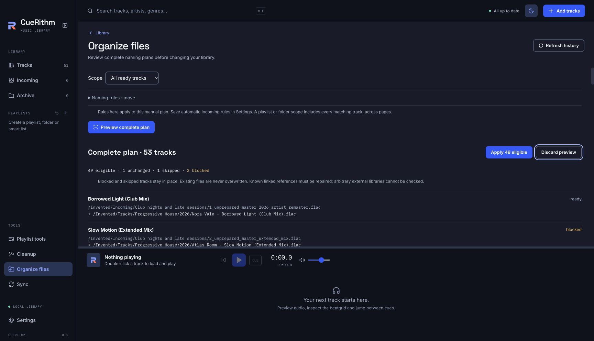
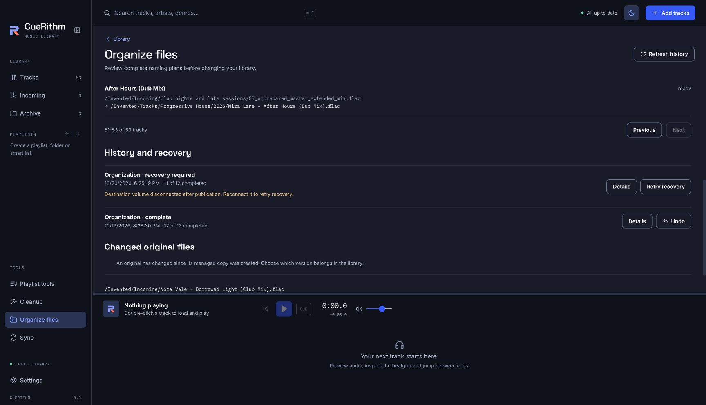

# File organization

File organization applies a naming pattern to audio files after preparation. It is off by default. Open **Settings → File organization**, choose a mode and press **Save settings** to use it for future Incoming tracks.

{ .screen loading=lazy }

| Mode | Result |
| --- | --- |
| Leave files in place | Keep the current filename and folder. |
| Rename in place | Change the filename within its current folder. |
| Move to folder | Publish a verified file in the chosen folder, update references, then retire the original to a recovery backup. |
| Copy to folder | Manage the verified copy in the chosen folder and leave the original in place. |

The destination is selected with the native folder picker. Existing files are never overwritten. Recovery backups remain available; completing an operation does not automatically delete them.

## Naming patterns

Use braces for metadata and square brackets for optional parts. CueRithm keeps the audio extension. For example:

```text
{artist} - {title}[ ({version})]
```

Move and copy patterns may include folders, such as `{artist}/{album}/{title}`. Rename stays in the current folder. Tokens include artist, title, album, genre, label, version, release date, year, key, BPM and measured whole-track energy. Missing metadata stays missing: a filename displayed in the table is not proof of a title tag.

**Example filenames** use invented metadata to explain the rule. They are not a complete plan and do not authorize any file operation. Every actual track is checked against its final metadata, current source and destination.

The missing-value policy can require attention or omit an optional part. Keeping the original filename or skipping a collision requires **Organization is optional**. A required managed destination cannot silently count as complete when a track was skipped.

## Organize existing tracks

Open **Organize files** from Tools or the track selection actions. Choose selected tracks, a playlist, a registered folder or all eligible tracks. Selection includes tracks selected across table pages.

Preview checks the complete scope. Review the totals and paged before/after paths, including unchanged files, skipped tracks, blockers and required reference repairs. **Apply** uses that frozen plan; it does not use only the visible page. If eligible tracks can proceed while others are blocked, the action and result counts identify that partial scope.

The storage estimate includes staging and retained recovery backups. Minimum available space is the lowest free space on the drives the plan needs. Repairing a native database for many tracks can retain multiple database backups; narrow the scope if that estimate is too large. Insufficient space blocks publication.

{ .screen loading=lazy }

Changes to a source, metadata, destination or linked target can invalidate a preview. Generate a fresh preview rather than applying an outdated path plan.

## Linked DJ libraries and playback

Known linked desktop libraries require a supported path-only repair before the original path can be retired. A running application, unavailable target, external edit or unsupported repair blocks the affected track with a reason. Independent device exports with their own copied media do not need their source paths changed.

CueRithm can check references it knows about through import or sync history. It cannot discover every external application or playlist that might refer to a file. Inspect those references separately before organizing files used elsewhere.

Track IDs, playlist membership, analysis and cues stay attached to the track. A byte-identical path change keeps the current playback snapshot and position; it does not start transport.

## History, recovery and Undo

History reports the actual completed, unchanged, skipped, blocked, failed, cancelled and recovery-required counts. Cancellation stops at a safe boundary; a file already published may need recovery rather than disappearing from the history.

**Cancel pending files** can also stop unpublished work in a restored batch. Completed changes stay in place. Files already staged or published retain their recovery evidence and may still require **Recover** before a guarded Undo.

{ .screen loading=lazy }

Use **Recover** for an interrupted operation and **Undo** when available to return managed files and references to their captured prior state. Undo checks the files and targets again. Later edits or a newly occupied original path cause a conflict instead of being overwritten.

Copy mode remembers the original bytes so watch folders do not ingest the same owned file again. If that original changes, resolve the conflict by keeping the managed copy for the observed revision or adding the changed original as a new Incoming track. New bytes are never silently ignored.
