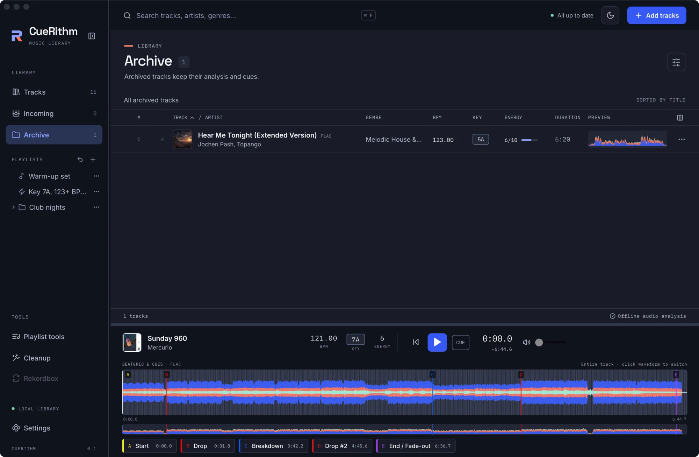

# Incoming and Archive

Incoming and Archive are track states in CueRithm's library. Files stay in place by default. An enabled [file organization](file-organization.md) rule can rename, move or copy a file after successful Incoming preparation. Archiving does not move audio.

## Incoming

A track stays *incoming* from the moment it is added until preparation succeeds. The subtitle reads: *Automatic preparation. Ready tracks move into your library.*

<figure markdown>
  { .screen loading=lazy }
</figure>

### Stages

| Stage label | Meaning |
| --- | --- |
| Queued | Waiting for a free worker. |
| Waiting for file | The file is still changing. |
| Decoding | The bundled decoder is producing the working copy. |
| Analyzing | Key, tempo, energy and cues. |
| Matching catalog | Looking up an enabled catalog provider (tagging on). |
| Preparing tags | Building the tag plan (tagging or cleanup on). |
| Writing tags | Staging and publishing tags. |
| Organizing files | Applying the saved naming rule and repairing known references before completion. |
| Applying cues | Refreshing cues, for example after a genre change. |

### When a track needs attention

A failed stage sets the track to *Needs attention*. It stays in Incoming with the stage and error. The usual causes are an unsupported or protected file, a file longer than about 24 minutes, a disk or permission problem, being offline while tagging is on, or a provider error.

Press the **retry** icon on the row to try again. Saving **Settings** re-queues ordinary failed preparation with the new settings. Interrupted file organization keeps its captured settings and recovery evidence. Its history entry offers **Retry in Incoming** to resume that work. An unpublished naming failure can use a corrected organization rule without repeating verified analysis; staged or published operations must finish or be safely cancelled first.

Catalog ambiguity and known recording/edition conflicts open **Review**. Compare
the current and proposed fields, choose which values to use, then preview and
apply. Accepted choices resume the same captured operation; ordinary Retry does
not silently choose another candidate. Use **Requery** for a fresh lookup under
the current provider policy. **Keep existing once** is available for an eligible
Incoming job without requiring a provider connection. Offline metadata editing
also remains available. See [Review and edit metadata](metadata-editing.md).

If an optional provider needs setup, use **Settings > Automatic tagging > Set up**
or **Manage**. Credential actions are separate from **Save settings**. Rejected
keys, unverified email, rate/quota limits and unavailable sources are provider
failures, not successful no-match results. The [setup guide](../learn/auto-tagging.md#provider-setup)
explains the available actions and request limits.
Volumo requires a personal API key when selected and uses an existing ISRC to
resolve catalog links; it does not provide a full free catalog-search API.

With fingerprint identification enabled and consent saved, unresolved readable
tracks may receive AcoustID/MusicBrainz candidates. Those candidates require
edition review even when a recording is recognized. Short clips may not be
identifiable. This fallback uploads no audio and does not replace measured
analysis. Naming remains last, after accepted tags and cleanup.

### What "ready" requires

A track becomes ready only when it has a key, a positive BPM with a non-empty beatgrid, an energy rating from 1 to 10 and at least one cue, with all positions inside the track. Configured required tagging, cleanup and organization must also finish, including reference repair and recoverable file cleanup. Otherwise it stays in Incoming. Retrying an interrupted organization operation reuses verified analysis when its source and captured settings still match.

### Empty Incoming

*Nothing incoming. Drop files here, or add music to a watch folder. Preparation runs automatically.*

## Archive

**Archive** (selection toolbar or row menu) takes a track out of Tracks and out of ordinary playlist views without deleting anything. The subtitle reads *Archived tracks keep their analysis and cues.* Archived tracks stay in the library database, in their playlists' membership and on disk.

<figure markdown>
  { .screen loading=lazy }
</figure>

Select a track and press **Restore** to bring it back. Restoring re-queues it for preparation against your current settings.

Smart playlists include archived tracks only if a rule asks for them with *Archived is true*, and include incoming tracks only with *Incoming is true*.
