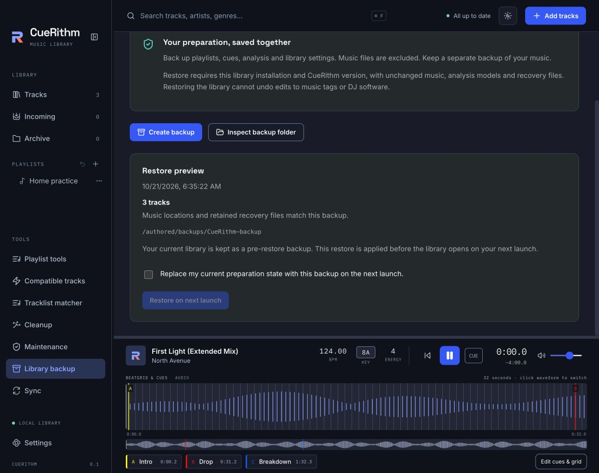

# Back up your library

Library backup saves your CueRithm preparation: playlists, cues, analysis and
library settings, preparation presets and Curate history. Appearance preferences
and provider credentials are not included. Music files are excluded. Keep a
separate backup of your music.
The backup folder contains a SQLite database and a private location manifest;
keep both files together. The manifest records source locations and file hashes.

## Create a backup

1. Finish preparation, metadata/Curate writes, file organization and any cleanup, maintenance or DJ sync work. Resolve
   recovery warnings and discard unused sync previews.
2. Open **Library backup** and choose **Create backup**.
3. Choose a destination. CueRithm creates a dated folder and shows its location.

CueRithm checks source bytes and retained recovery files while creating the
snapshot. A changed source must be prepared again before making a fresh backup.
Missing source files stay listed as unavailable; their audio is not recovered.

## Restore preparation

1. Choose **Inspect backup folder** and select a dated CueRithm backup folder.
2. Review its date, track count and unavailable sources.
3. Confirm replacement of the current preparation state, then choose
   **Restore on next launch**.
4. Close and reopen CueRithm. Cancel the scheduled restore before closing if
   needed.

Restore applies before the library opens. CueRithm checks compatibility and file
consistency again and keeps a pre-restore backup in the application's data folder
under `library-backups/pre-restore-<request-id>-<attempt-id>/`. The backup folder inside it can
be inspected and scheduled for restore in the same way. Cancelling a scheduled restore removes its owned staged copies. Completed
pre-restore backups remain available; this delivery does not manage their retention.

If startup checks block the restore, CueRithm opens your current library and keeps
that restore request visible with its reason. Choose **Cancel scheduled restore**
to keep working, or fix the reported file state and choose **Retry on next launch**.
A blocked request is never retried silently. An interruption during the database
update is handled separately; startup stops if its retained recovery snapshot
cannot be validated.

## Limits

This delivery supports the same CueRithm version, operating system and library
installation. It does not move a library to another computer. The installation
identity file in the application data folder must remain available.

Music, owned sidecars, analysis models and retained tagging, cleanup, maintenance,
organization and DJ sync resources must match their saved state. Organization
originals, Copy-source ownership, partial stages and native reference recovery
files keep their exact file and folder identities. They are checked in place;
the backup does not copy their audio or restore external DJ databases. Later tagging, organization, removal, backup disposal
or DJ sync can make an older database snapshot ineligible for restore.

Restoring the database cannot reverse edits to music tags or changes in DJ
software. CueRithm refuses the restore when its file and recovery checks fail;
it does not silently drop recovery history or overwrite music to make it fit.

Backups currently support database files up to 1 GiB and up to 50,000 source
locations. Retained resource inventories also have file, depth and size limits.
CueRithm checks complete source and resource hashes; this can take time on a large
collection. A failed backup does not replace your library.
