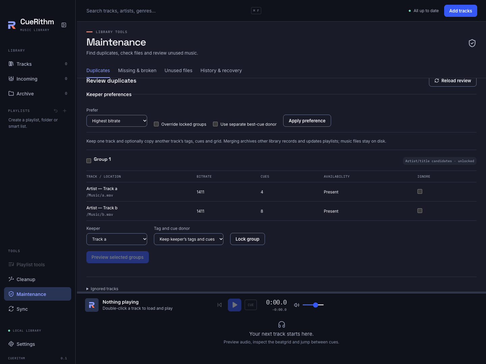
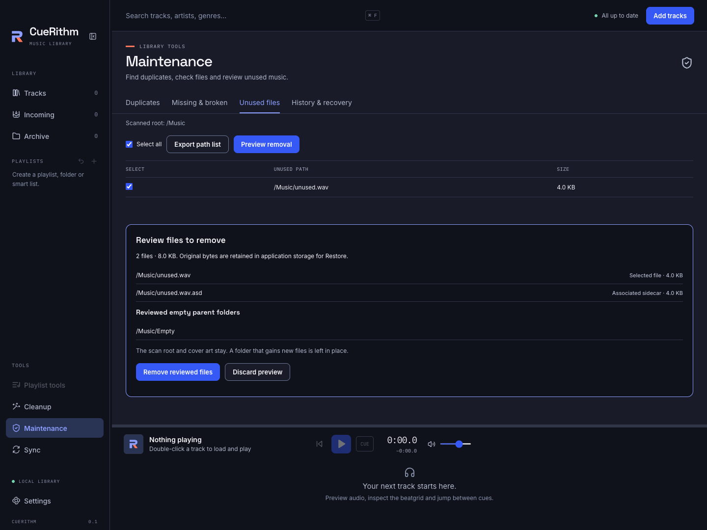

# Maintenance

Open **Maintenance** under Tools. Choose **Duplicates**, **Missing & broken**, **Unused files**, or **History & recovery**. Scanning never changes music files, tags, cues or playlists. Normal preparation never removes unused files or disposes of retained originals.

## Review duplicates

*Example generated collection.*

1. Choose the full library, selected playlists, or full-library groups that touch selected playlists.
2. Choose **Exact decoded audio** to compare sound, or an artist/title tolerance to find possible matches. Similar titles can belong to different mixes; review those candidates carefully.
3. Scan, then choose **Review groups**. Unavailable and ignored tracks cannot be keepers or donors.
4. Choose each group's keeper. Optionally choose an independent **Tag and cue donor** to copy tags, cues and grid. Keeper preferences can favour a folder, bitrate, cue count or matching text. Overriding locks and choosing a separate best-cue donor are explicit options.
5. Select groups, then choose **Preview selected groups**. Check keeper, archive actions, donor-to-recipient copies and ordered playlist changes. Choose **Apply reviewed merge** only when these are correct.

Merging archives library records and updates playlist references. It does not remove music files. Copy-only groups import donor tags, cues and grid without archiving records or replacing playlist references. Lock a group to preserve its choices; unlocking a locked group with a donor offers copy-only mode or an explicit unlock for merging.

Use **Ignored tracks** to load the persistent ignore list and stop ignoring a track. This works even when its original review is stale. Saved reports and review choices survive restart: use **Reload saved report** or **Resume saved review**. A reload rechecks the original sources and scope. Rescan when sources changed; an old preview cannot bypass these checks.

**History & recovery** lists committed merges and their Undo status. **Undo merge** restores captured file bytes and library state when the current files and relevant library records still permit it. History alone does not guarantee Undo remains available after later edits.

## Check missing and broken files

Choose **Scan library files** for availability checks. Enable **Inspect audio decoding** for stricter checks. Missing, unavailable, unsupported, timed-out and decode-error outcomes remain distinct. A present file in an availability-only report has not passed decoding inspection.

Reconnect unavailable drives and scan again. **Show present files** includes successful checks in the results.

### Reconnect moved music

Select tracks and choose **Relocate** from the selection toolbar or track context
menu. For one track, choose a replacement file; for several, choose a folder to
search recursively. Existing available files are skipped. Review each old path,
candidate, evidence and collision before applying. Filename matches are suggestions;
only matching known encoded-file hashes count as verified content.

Choose **Find Lost Tracks** to replace a complete source folder or drive root.
The default scope is missing files; unavailable storage is a separate option.
**All tracks** permits a reviewed change to available files too. An extension
change is always an explicit replacement and can require checking cue timing.

Keep the preflight backup enabled and choose its destination folder. A failed
backup blocks Apply. Turning the backup off is an explicit review choice.
Relocation changes the library reference while retaining track identity, cues and
playlist membership. It never moves or edits audio.

For an occupied destination, choose the complete surviving entry or skip the
collision. CueRithm archives the other entry and rewires ordinary playlist
membership; it does not silently mix their metadata. Use relocation history to
Undo after restart while the guarded library state still matches. Undo reconnects
the old reference even if that old audio is still missing.

## Review unused files

*Example generated collection.*

1. Choose the specific folder to inspect. Optionally include or exclude file extensions.
2. Scan and read any issues. A partial scan is incomplete and cannot be used for removal. Files referenced by archived library records are also protected.
3. Select files, then choose **Preview removal**. No file is selected automatically. Read every selected file, associated sidecar, folder metadata file and empty parent folder in the preview.
4. Choose **Remove reviewed files** to remove only the reviewed paths. CueRithm retains verified original bytes in application storage for Restore. The reviewed root and cover art stay; folders containing new files are left in place.

**Export path list** returns text you can copy and save. It writes no disk file and removes nothing. The report's root, completeness and staleness remain visible beside the exported list.

## Restore files and manage retained originals

In **History & recovery**, expand **Reviewed paths** to inspect a saved removal. **Restore files** recreates missing parents and restores to unoccupied original locations. Newer files and altered or missing backups cause a visible conflict; they are not overwritten. Eligibility shown in history is checked again when Restore runs.

Retained originals occupy application storage until explicitly disposed. Select original removal operations, choose **Review backup disposal**, and check the exact owned backup paths and the removals that will lose Restore. Disposal can include an operation that has already been restored. Confirm the permanent loss before choosing **Permanently dispose reviewed backups**. This action cannot be undone and does not change any music path. A reviewed byte amount is not a guarantee of physical disk space released, especially while cleanup is pending or filesystem snapshots retain data.

## Cancellation, stale reports and recovery

Cancel waits for the running operation to settle before another can start. If publication has begun, rollback finishes first. Leaving Maintenance requests cancellation and discards late results. Check history after cancellation to discover any operation that already committed.

Library or maintenance changes invalidate previews. Reload a review after a revision conflict; rescan when a report says its sources or scope are stale. Recovery and history preserve each operation's state, errors and pending cleanup. After fixing an unavailable location or storage conflict, choose the relevant **Retry … recovery** action. Interrupted work is recovered at startup, while later file versions are preserved as conflicts.
