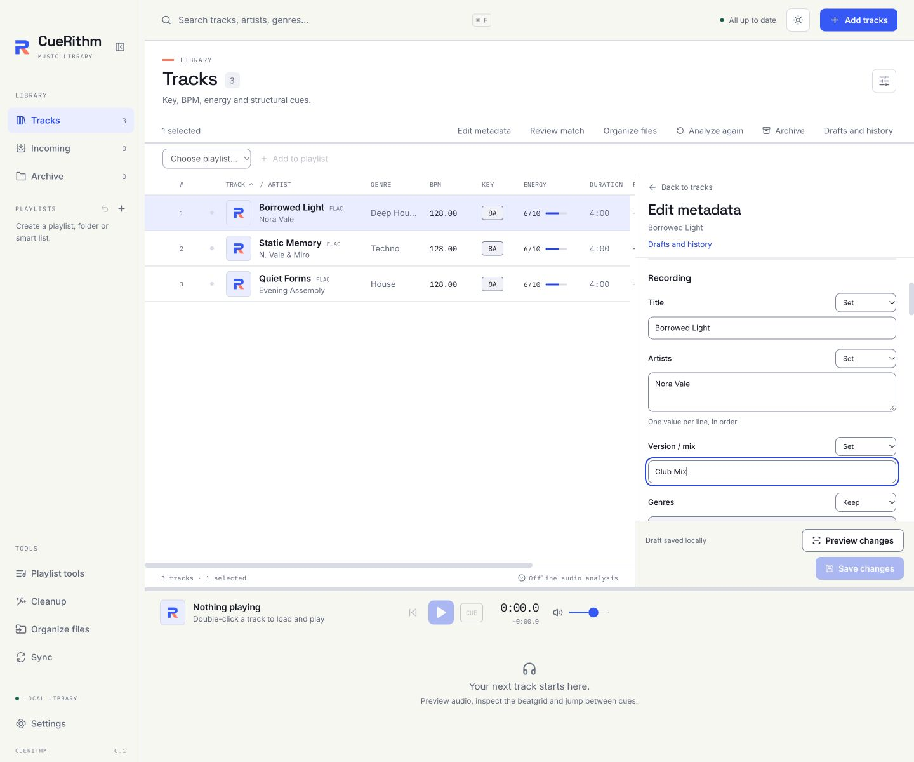

# Review matches and edit metadata

Select a track and open **Review match** or **Edit metadata** from its row menu. The editor also accepts multiple selected tracks, including selections across table pages. Selecting or editing a track does not start playback.

The inspector stays above the player. In a narrow window it replaces the table until you return to the library; your selection and filter remain available.

## Review a catalog match

Incoming tracks that need a match decision keep their captured candidates. Review shows the source metadata, edition, duration, catalog identifiers and proposed fields. Name similarity ranks candidates; it is not a probability that the recording is correct.

Choose a candidate and review each field's **Keep**, **Replace** or **Append** action. Conflicting recording or edition evidence needs an explicit acknowledgement before that choice can proceed. Artwork is loaded through a bounded native preview rather than directly from a remote image URL.

**Use selected match** accepts the frozen preview. For an Incoming exception, CueRithm queues a fresh preparation attempt under the same job, retains the explicit decision and reuses compatible measured analysis. Required missing fields, naming rules and reference repairs can still require attention.

**Keep existing once** continues that Incoming operation without accepting a catalog replacement. It does not change your global no-match policy. **Requery** replaces the retained candidate generation; an older preview can no longer authorize a write.

Rematching an existing Ready track stays review-only until you accept changes. Those changes use metadata publication without automatic renaming or cue regeneration. If no provider is configured, the inspector explains the required setup.

Detected Cloudflare restrictions use the shared [challenge solver settings](catalog-solver.md). Missing, unreachable or incompatible solvers leave affected lookups unavailable. **Requery** uses the current saved provider settings; a configured URL is checked when used. You can still edit metadata or keep existing values once without a catalog lookup.

## Edit file tags

*Invented tracks. [Dark mode example](../assets/screens/88-metadata-editor-dark.png).*

The editor covers common text and contributor fields, genre/style, label, catalog number, ISRC, release/original dates, independent track/disc numbers and totals, file-tag key/BPM, ratings, comments and artwork. Measured key, BPM, whole-track energy and cue timing remain separate.

| Action | Effect |
| --- | --- |
| Keep | Leave the field out of this edit. |
| Set | Replace the selected field with the entered value or values. |
| Clear | Remove the selected field explicitly. |
| Append | Add supported multiple values while preserving existing values. |

Mixed values start as Keep. An empty text box is not an instruction to clear tags. Dates retain their precision: a year or year-month does not acquire an invented day.

Some exact values require ID3v2.4. **Allow conversion to ID3v2.4** is opt-in, and the preview identifies affected files. Unsupported values or ambiguous native records produce a visible blocker rather than being silently flattened or removed.

Ratings address a specific owner and preserve other owners and play counters. Comments address their language and description. Artwork replacement/removal targets the selected picture; other pictures remain intact. MP4 artwork uses its actual ordinal/digest identity because the format does not store native cover types.

## Drafts, preview and Save

Edits are persisted to a local draft while you type. **Draft saved locally** means the draft is durable; **Save changes** writes file tags. **Drafts and history** keeps unfinished work reachable after changing selection, searching, navigating away or reopening CueRithm.

1. Enter edits and wait for draft persistence.
2. Choose **Preview changes** and inspect before/after values and per-field outcomes.
3. Choose **Save changes** to publish that exact preview.

++cmd+s++ or ++ctrl+s++ previews first, then saves an eligible preview. Changing the draft or source invalidates the old preview. Incoming edits become protected preparation overrides: automatic tagging does not replace the fields you changed, and cleanup never rewrites a value you saved, though it still normalizes the fields you left alone. Already published organization/reference work must finish recovery before its naming evidence can be replaced.

Closing or quitting waits for pending draft updates. A failed draft save keeps the editor open with an error. Retry persistence or explicitly confirm **Discard unsaved changes** to restore the last acknowledged local draft; this does not delete that durable draft or pretend the failed edits were saved. File publication uses its native journal for interruption recovery.

## Results and Undo

Results distinguish changed, unchanged, queued, failed and recovery-required work. Read each affected field's outcome; a partial batch does not mean every selected track was saved.

Use history to inspect a batch, **Retry recovery** for retained publication work, and **Undo saved changes** when eligible. Undo validates the captured file and native-record state. A later edit or replacement causes a conflict instead of being overwritten.

Retained original backups are included under **Settings → Automatic tagging → Recovery backups**. Unpublished preview audio is retired when replaced, edited, discarded or recovered after restart. Saved originals remain available for guarded Undo.

Editing an existing Ready track does not automatically organize its file. Use [File organization](file-organization.md) explicitly when you also want its filename or location changed.
