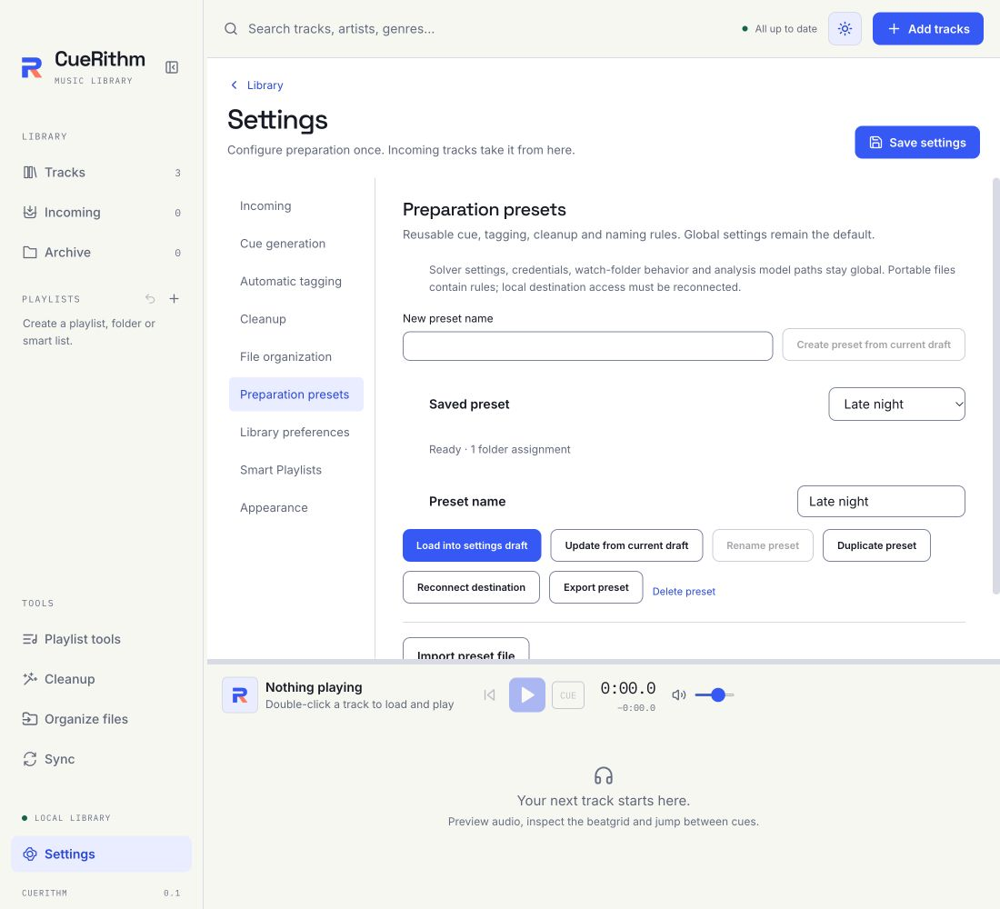

# Preparation presets

Use **Settings → Preparation presets** for named combinations of cue, tagging,
cleanup and file-organization rules. The existing global settings remain the
default. Creating or editing a preset does not rerun existing tracks.

[View the dark theme](../assets/screens/90-preparation-presets-dark.png).

## Save and load rules

Create a preset from the current Settings draft, duplicate it, rename it or
update it from that draft. Loading a preset changes the draft; **Save settings**
commits global changes. Unrelated unsaved solver, ingestion and model settings
are preserved.

Each saved preset has an immutable revision. A claimed preparation operation
keeps its captured rules. New intake and explicit current-rule retries resolve
the current folder assignment and global transport. Recovery does not replace
accepted native publication evidence with a new recipe.

## Folder assignments

Choose a preset for a watched folder, inherit a parent assignment, or explicitly
choose Global default. The deepest verified assigned folder wins; a similarly
named sibling is not a child. Explicit Global default stops inheritance from a
broader folder.

Save folder-assignment changes with the Settings draft. A stale settings or
assignment revision rejects the whole save. An unavailable folder or preset
blocks that source with a setup action instead of silently using different
rules. Reconnection allows unchanged files to be admitted again.

When a source folder's identity changes, use **Reconnect folder assignment** and
Save settings even if its selected preset stays the same. Status reads do not
silently replace the folder's stored authority.

## Import and export

Export a preset through the native JSON save dialog, or import a validated
document. The versioned format includes an explicit allowlist of rules. It
excludes credentials, solver endpoints, detected access restrictions, watched
folder assignments, model paths and local destination grants.

Imported Move/Copy rules require a destination to be reconnected before use.
Import creates a preset without applying it globally or assigning folders.
Unknown versions and fields produce an error instead of being silently ignored.

Solver URL/timeout and detected Cloudflare restrictions remain application-wide.
A configured solver endpoint is configuration, not proof that a service is
healthy. Optional provider credentials are managed separately.
