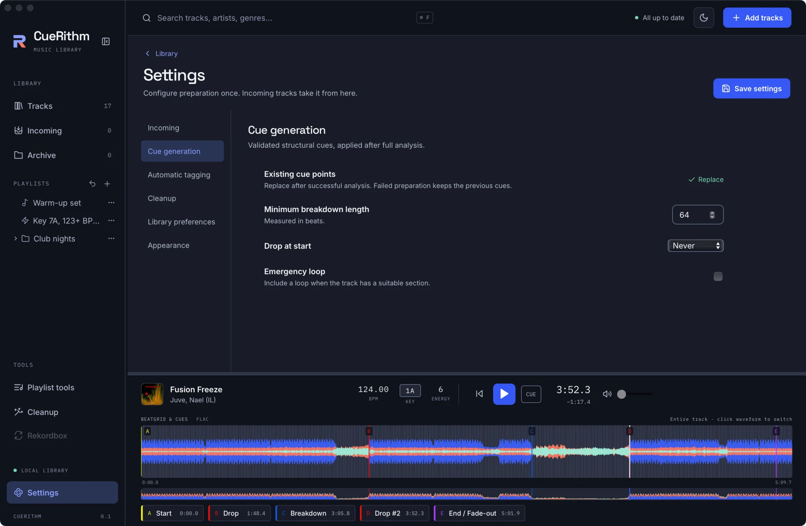
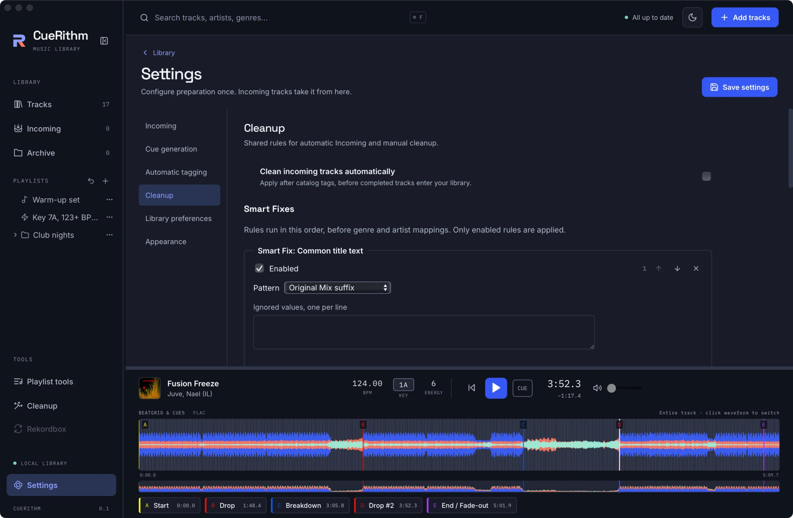
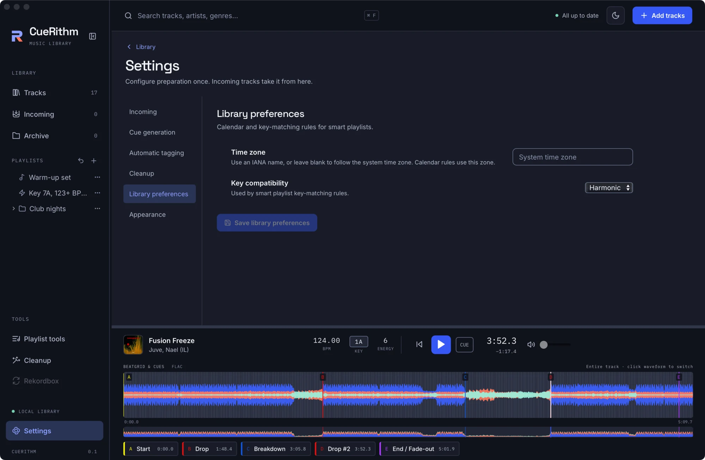
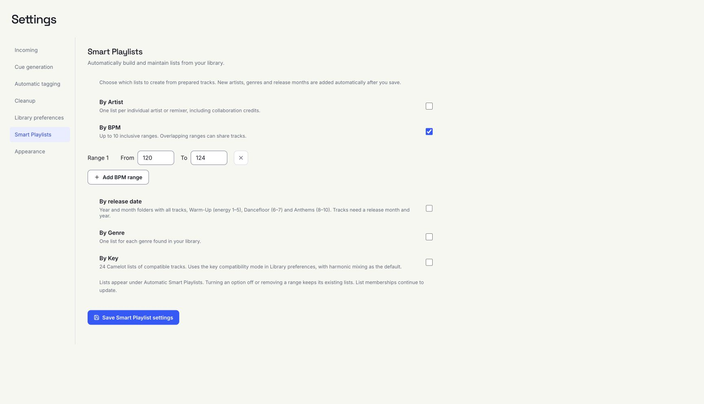

# Settings reference

Open **Settings** at the bottom of the sidebar, or the sliders button at the top right of the library. CueRithm saves preparation settings in the library. **Save settings** appears at the top (it reads *Saving…* then *Settings saved*); Library preferences and Smart Playlists have their own save buttons. Appearance and provider credential actions save immediately.

## Incoming { #incoming }

| Control | Default | Meaning |
| --- | --- | --- |
| **Add watch folder** | `Music/Cuerithm/Incoming` on a new library | Files that appear in these folders are prepared automatically. Remove one with the **×** beside it. |

Completed tracks enter Tracks automatically. Original audio files stay in place unless a saved **File organization** mode is enabled. The file-stability wait (2 seconds) is not adjustable in the interface.

## Cue generation { #cue-generation }

<figure markdown>
  { .screen loading=lazy }
</figure>

| Control | Default | Meaning |
| --- | --- | --- |
| **Existing cue points** | Replace | Fixed. Cues are replaced after a successful analysis. A failed preparation keeps the previous cues. |
| **Minimum breakdown length** | 64 | In beats (1 to 4096). Shorter breakdowns are not used. |
| **Drop at start** | Never | **Never** or **Automatic**. Whether a drop may be placed at the very start of a track. |
| **Emergency loop** | off | Adds a loop cue (labelled S.O.S.) when the track has a suitable late section. |

## Automatic tagging { #automatic-tagging }

See [Automatic tagging settings](tagging-settings.md).

Ten catalog providers are listed. Additional providers are opt-in; SonoVault and
Volumo require personal API keys when chosen, and BPM Supreme uses an optional account.
MusicBrainz needs no key, and Discogs supports anonymous access. Provider **Save**,
**Test**, **Replace** and **Remove** affect the system credential store immediately.
They do not save your global preparation draft or enable a provider. **Save
settings** applies provider choices and field rules. See [provider setup](../learn/auto-tagging.md#provider-setup).

**Identify unresolved recordings** is a separate, off-by-default fingerprint
fallback. Consent permits sending a locally generated fingerprint and duration
to AcoustID, without audio. The build provides its application identity. Results
require edition review, and local consent is excluded from portable presets.

## Cleanup { #cleanup }

<figure markdown>
  { .screen loading=lazy }
</figure>

| Control | Default | Meaning |
| --- | --- | --- |
| **Clean incoming tracks automatically** | off | Apply the saved rules to each new track after tagging and before it enters Tracks. |
| Smart Fixes, Genres, Artists | empty | The same editors as the Cleanup tool. See [Cleanup rules](cleanup-rules.md). |

## File organization { #file-organization }

The default is **Leave files in place**. Choose Rename in place, Move to folder or Copy to folder, a filename pattern, missing-value handling and collision policy. Move and copy use a destination selected with the native folder picker. **Save settings** applies the rule to future Incoming preparation. Naming runs last after accepted tagging and cleanup, before Ready. Examples use invented metadata; the complete actual scope is checked before publication. See [File organization](file-organization.md) for manual previews, linked libraries, recovery and Undo.

## Library preferences { #library-preferences }

<figure markdown>
  { .screen loading=lazy }
</figure>

| Control | Default | Meaning |
| --- | --- | --- |
| **Library time zone** | system | An IANA name such as `Europe/Amsterdam`. Calendar rules in smart playlists use it. |
| **Key compatibility mode** | Harmonic | **Harmonic** or **Fuzzy**. Used by *is compatible with key*. Press **Save library preferences**. |

## Smart Playlists { #smart-playlists }

Every automatic option is **off** in a new or existing library. Choose the categories to create, then press **Save Smart Playlist settings**. Lists appear under **Automatic Smart Playlists**. Only prepared, non-archived tracks supply new grouping values.

| Option | Creates |
| --- | --- |
| **By Artist** | One list per individual artist or remixer. Commas, semicolons and collaboration markers separate credits. Named remix credits in titles are used when the remixer tag is empty. |
| **By BPM** | One list for each configured range, up to ten. Both ends are included; overlapping ranges can share tracks. |
| **By release date** | Year folders containing month folders. Each month has **Month, Year**, **Warm-Up Month, Year** (energy 1 to 5), **Dancefloor Month, Year** (6 to 7) and **Anthems Month, Year** (8 to 10). The all-tracks list includes tracks without an energy rating. |
| **By Genre** | One list per individual genre in the library. |
| **By Key** | All 24 Camelot key lists, including compatible keys according to **Library preferences → Key compatibility mode**. Harmonic is the default: same key, adjacent numbers with the same letter, and the relative major/minor. |

New tracks and metadata changes expand enabled categories automatically, including new years and months. Release grouping uses explicit release tags (including `RELEASE_TIME`) before `DATE`; valid year-month and full dates are supported. A year alone cannot supply a month. Audio and file tags are unchanged.

Turning an option off stops creating lists in that category. Existing lists remain and their memberships stay live. Removing a BPM range also keeps its existing list. Invalid or incomplete range drafts are discarded when saving with BPM generation off. Renamed or moved generated lists retain their identities; deleting one prevents that identity from being recreated automatically. Enabled categories maintain generated list rules. Duplicate a generated list to customize its rules. Manual lists are never adopted just because their names match.

{ .screen loading=lazy }

## Appearance { #appearance }

Choose from six waveform palettes. See [Choose a theme and waveform style](../learn/appearance.md). The light and dark theme is a separate button in the header.

## What is not a setting

There is no model selector, no tempo-range control, no cue template editor and no audio device picker in this release. Playback uses the system default output.
