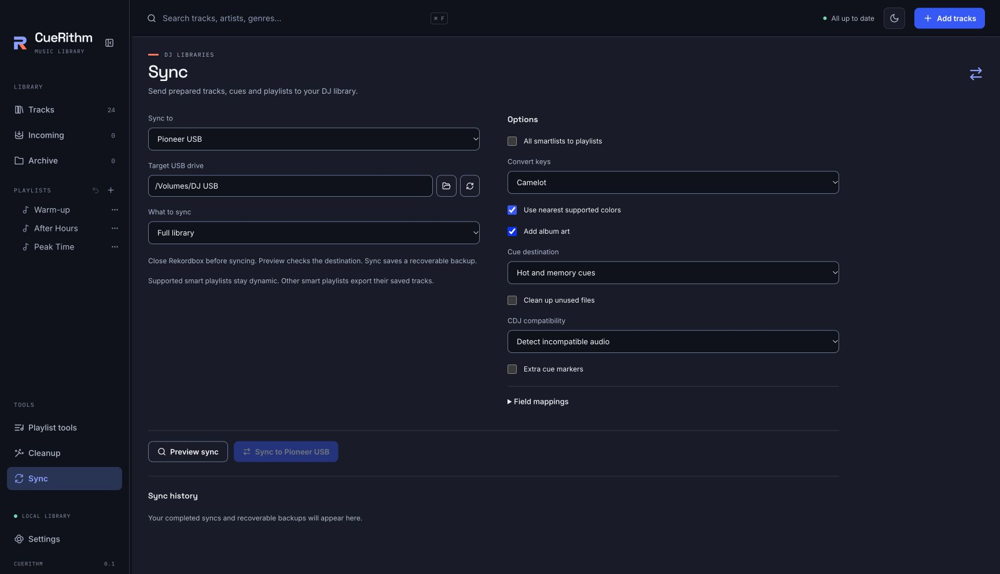

# Sync to DJ software

Use **Sync** in the sidebar to send prepared tracks, metadata, cues, beatgrids and
playlists to a DJ library or USB drive. Each sync starts with a preview and saves a
recoverable backup.

<figure markdown>
  { .screen loading=lazy }
</figure>

## Choose a destination

The **Sync to** menu offers five targets:

| Target | Choose |
| --- | --- |
| VirtualDJ | A current VirtualDJ 8.5 library folder |
| Engine DJ | A current Engine DJ library folder or target drive |
| djay Pro | A current djay Media Library folder |
| Serato DJ Pro 4 | A Serato Library folder |
| Pioneer USB | A mounted USB drive |

Initialize desktop libraries in their DJ application first. Choose a discovered
library, use the folder button to browse, or enter its location. The refresh button
checks for libraries again. Older library formats are not a separate export target.
Existing direct rekordbox 6/7 groundwork is separate from these five sync targets;
Pioneer USB exports to a drive rather than a desktop rekordbox library.

## Choose what to sync

Only prepared, active tracks are eligible. Incoming and archived tracks are excluded.
Finish preparation when a track has no saved analysis, and resolve smart playlists
that have no usable saved results before exporting.

| What to sync | Included |
| --- | --- |
| Full library | All eligible tracks and playlists |
| Playlist or folder | The selected playlist, or playlists inside the selected folder, with their eligible tracks |
| Modified since last sync | Eligible tracks and playlists changed since the last successful sync to this destination |

Smart playlists stay dynamic when the destination supports their entire definition.
Otherwise, they export their saved matching tracks as ordinary playlists. Enable
**All smartlists to playlists** to export ordinary playlists throughout. Pioneer USB
always uses ordinary playlists.

## Set the options

Options change with the destination. **Use nearest supported colors** adapts colors
to the target, while **Field mappings** chooses which local text value fills each
destination field. **Keep existing beatgrids** preserves destination beatgrids where
available. Engine DJ and Serato also offer **Beatgrid locks**.

Engine DJ can **Copy audio to the target drive**. Engine DJ and Pioneer USB can
**Add album art**. Serato and Pioneer USB offer **Convert keys** with original,
musical, Camelot and Open Key notation.
Engine DJ copies audio automatically for libraries at recognized mounted-drive
locations, including `E:\Engine Library` on Windows. Enable **Copy audio to the
target drive** for other folders when the export needs its own audio copies.

### Pioneer USB

<figure markdown>
  { .screen loading=lazy }
</figure>

Choose **Hot cues**, **Memory cues** or **Hot and memory cues** under
**Cue destination**. **Extra cue markers** adds the extra markers supported by this
export. Review any cue-limit or compatibility notices in the preview.

**CDJ compatibility** can leave audio unchanged, detect incompatible audio, or
convert incompatible audio. Conversion writes copies on the USB drive and leaves
source audio intact. **Clean up unused files** removes unreferenced files from the drive’s export
folders. Source files known to your library are protected; inspect removals in the
preview before syncing. If the drive contains two Pioneer library catalogs, disable
cleanup to preserve both.

## Preview and apply

1. Close the destination DJ application. For Pioneer USB, close rekordbox.
2. Choose **Preview sync**.
3. Review the track and playlist counts, compatibility notices, files to create,
   update or remove, and folders to create or remove.
4. Choose **Sync to** followed by the destination name to apply that preview.

Changing the library, destination, scope or options invalidates the preview. Create
a fresh preview before applying those changes. If the destination has changed since
preview, resolve the conflict and preview again.

Full-library and modified syncs can remove playlists that CueRithm previously created
and that have since been removed locally. The preview lists these as owned playlists
to remove. A playlist matched to an existing destination playlist is retained when
removed locally; the preview reports matched playlists retained. Unrelated native
library entries are left alone. Edits in the destination that conflict with a sync
are reported for resolution.

## Backups and interrupted operations

**Sync history** lists completed syncs and operations with recovery information.
Choose **Restore backup** to reverse a sync. Restore checks for later destination
edits and stops on a conflict instead of overwriting them.
Archiving a synced track does not prevent restoring its backup; its source location
and file contents must still match the recorded sync.

Serato writes cues and grids into source music files, so its backup includes those
audio files as well as its native library files. Pioneer USB conversion backs up and
restores the affected USB copies; it does not replace the original source audio.

If an operation is interrupted, keep the destination available and return to
**Sync history**. Use **Finish sync** when offered to complete sync recovery, or
**Finish restore** to complete restore recovery. **Restore backup** is available
where the interrupted operation can be rolled back. Failed or interrupted work does
not advance the last successful sync until recovery completes.

This implementation remains under verification. The screenshots show the production
Sync interface with invented example data. Synthetic format checks and reference
parser agreement are separate from acceptance in the destination DJ applications
and on physical CDJ hardware; these images do not establish that acceptance.
