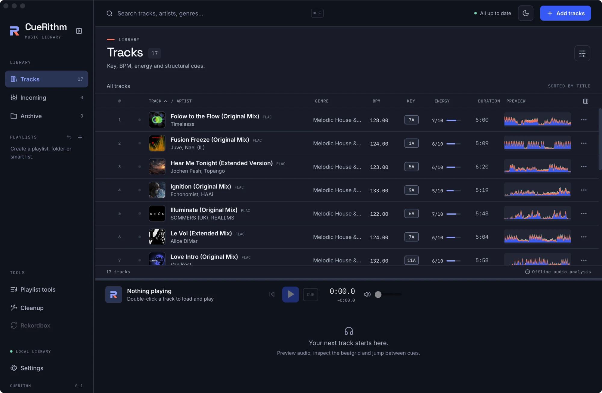
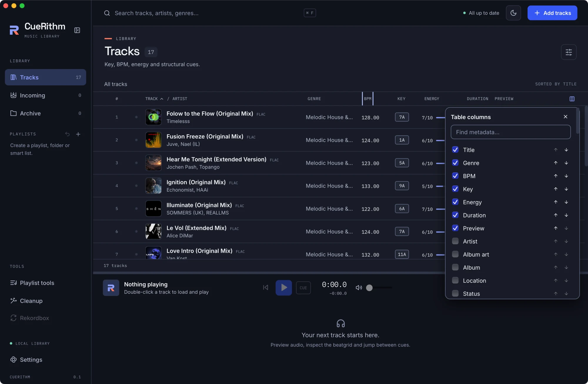

# The track table

The table shows the tracks of the current view: **Tracks**, **Incoming**, **Archive** or a playlist. It is virtual, so large libraries scroll smoothly, and it loads 200 rows at a time as you scroll.

<figure markdown>
  { .screen loading=lazy }
</figure>

## Columns

Default columns, left to right:

| Column | Shows |
| --- | --- |
| Play and row number | A play button (an animated equaliser while playing) and the row number. |
| Status | A small icon: stage while preparing, *Needs attention*, or the tagging result. |
| **TRACK / ARTIST** | Artwork, title, a file-type badge such as `FLAC`, and the artist. |
| **GENRE** | The genre tag. |
| **BPM** | Measured tempo, two decimals. |
| **KEY** | A chip in Camelot notation, for example `7A`. |
| **ENERGY** | `N/10` and a bar. |
| **DURATION** | `m:ss`. |
| **PREVIEW** | A mini waveform with cue markers. |

A missing value is shown as an em dash.

The **Choose and order columns** button at the right end of the header opens a *Table columns* dialog with a *Find metadata* search, a checkbox per column and arrows to reorder. <figure markdown>
  { .screen loading=lazy }
  <figcaption>The Table columns dialog. Tick a column to show it and use the arrows to reorder.</figcaption>
</figure>

Beyond the defaults you can show album, location, status, album art, file type, date added, date modified, codec, sample rate, channels, bit depth, bitrate, size, encoded duration, container, and any embedded tag field CueRithm finds, such as album artist, comment, rating, year, track and disc number, label, ISRC and catalogue number. Your choices are saved on this computer.

## Sorting

Click **TRACK**, **ARTIST**, **BPM** or **ENERGY** to sort. Click again to reverse. Title and artist sort case-insensitively. Inside an ordinary playlist you can also return to **Manual order**.

## Searching and filtering

The header search filters the current view by **title, artist and genre** with a case-insensitive "contains" match. Press ++cmd+f++ to jump to it. The list updates as you type, the toolbar label changes to *Search results*, and the footer counts the matches. There are no per-column filters.

<figure markdown>
  { .screen loading=lazy }
  <figcaption>Searching "Kyle" matches the artist name. The grey hint text disappears as soon as you type.</figcaption>
</figure> For anything richer, make a [smart playlist](smart-rules.md).

## Selecting

| Action | Result |
| --- | --- |
| Click | Select one row |
| ++cmd++ + click | Toggle a row |
| ++shift++ + click | Select a range |
| ++cmd+a++ | Select every track in the view |

When rows are selected, the toolbar above the table changes.

<figure markdown>
  { .screen loading=lazy }
  <figcaption>With a selection: Analyze again, Archive, and the playlist chooser.</figcaption>
</figure>

- **Analyze again** re-queues the selected tracks. This is the only way finished results change.
- **Archive** hides tracks from Tracks and playlists but keeps their analysis and cues. In the Archive view this becomes **Restore**.
- **Choose playlist** and **Add to playlist** add the selection to an ordinary playlist.

## Row menu

The **⋯** button on a row offers **Analyze again** and **Archive track** (or **Restore to library** in the Archive). A row that needs attention shows a retry icon instead.

## Status icons

While preparing: *Queued*, *Waiting for file*, *Decoding*, *Analyzing*, *Matching catalog*, *Preparing tags*, *Writing tags*, *Applying cues*. Tagging outcomes: *Tagged from catalog match*, *Already tagged*, *No catalog match; existing tags kept*. A failed track shows *Needs attention*, with the error as a tooltip and, in Incoming, as the second line of the row.
