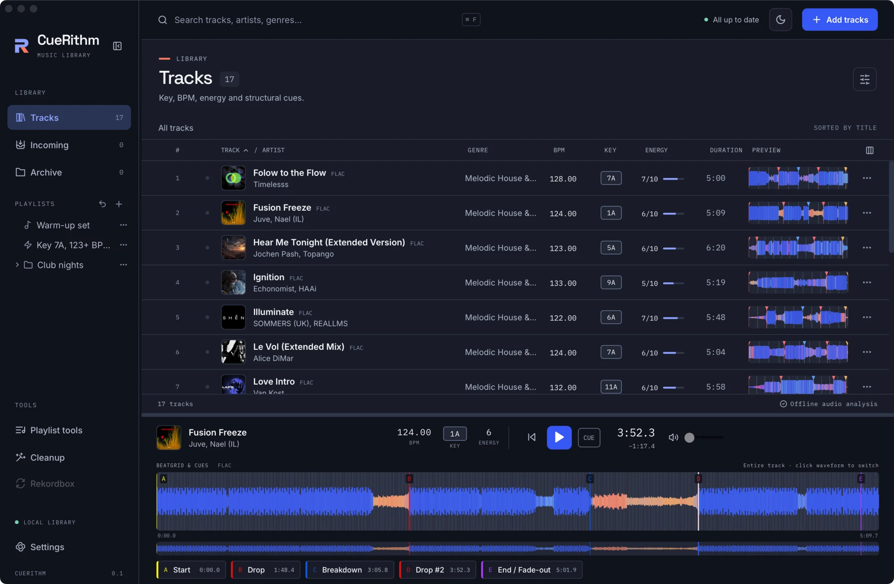

# How is the waveform drawn?

The waveform in the table and in the player is computed from the same decoded audio the analyser uses, then cached. Its colour shows the balance of bass, mids and highs at each moment.

<!-- figure:existing-95-style-cuerithm-bars-how-it-works-waveform -->
<figure markdown>
{ .screen loading=lazy }
<figcaption>One of six waveform styles.</figcaption>
</figure>
<!-- /figure -->

!!! abstract "What this means for you"
    - **Colour is frequency balance, not loudness.** A moment dominated by kick and sub looks different from one dominated by hats, so you can read a track's structure at a glance.
    - **Bar height follows the average loudness of each moment**, scaled per track so quiet and loud tracks both use the height.
    - **A dash instead of a waveform means it could not be built**, for example because the file is missing or cannot be decoded. See [A track shows a dash or will not play](../help/troubleshooting/no-waveform-or-playback.md).
    - **Changing the style is instant and per computer.** It does not recompute anything. See [Choose a waveform style](../customize/waveform-style.md).

## What is computed { #what-is-computed }

For up to 16,384 bins across the track, CueRithm stores:

- the minimum and maximum sample and the average level (RMS) in each bin, which set the bar height;
- three frequency-band levels;
- an RGB triple for the colour.

The row previews in the table use 240 bins; the player uses 16,384. A waveform is built the first time it is needed, when a row scrolls into view or you play the track, and then cached. Rows that you scroll past quickly are skipped.

## The three bands { #the-three-bands }

A 4,096-point Hann-windowed FFT at 44.1 kHz, using at most 4,096 analysis points per waveform, splits the sound into three bands:

| Band | Range | Role |
|---|---|---|
| **Bass** | 0 to 150 Hz (weight 1.2) | The kick and sub |
| **Mids** | 150 to 1,500 Hz | Body, vocals, synth lines |
| **Highs** | 1,500 to 6,000 Hz | Hats and air |

The strongest band in each moment is scaled to 255. For the stacked **Layers** styles, nested levels use 60 to 120 Hz, 120 to 500 Hz and 900 to 1,500 Hz.

## How colour is chosen { #colour }

The interface blends the band weights into a palette in a perceptual colour space (OKLab). Every palette steps from dark to light in the order bass, mids, highs, so the bands stay distinguishable by lightness alone, which keeps them readable for colour-blind users. The default pairing of cobalt and coral is a blue-orange axis that survives red-green colour blindness. Silent stretches take the neutral text colour.

<!-- figure:how-waveform-colours -->
<figure markdown>
{ .screen loading=lazy }
{ .screen loading=lazy }
<figcaption>Colour follows the balance of bass, mids and highs at each moment.</figcaption>
</figure>
<!-- /figure -->

| Style | What it looks like |
|---|---|
| **CueRithm** (default) | Cobalt bass, coral mids, ice highs. Moments blend between them |
| **Dusk** | Raspberry bass, amber mids, cream highs. A warm blend |
| **Lagoon** | Deep blue bass, teal mids, pale mint highs. A cool blend |
| **Tonal** | One blue throughout; lightness alone separates bass, mids and highs |
| **Layers** | Bass, mids and highs as stacked layers in cobalt, coral and ice |
| **Layers, tonal** | Stacked layers in three tones of one blue |

CueRithm stores the chosen style on your computer, in the app's own browser storage and outside the library, so it is not part of a [library backup](../files/library/back-up-library.md).

## Where the waveform is cached { #caching }

Waveform data is cached on disk in the `cache/waveforms` folder of the application data folder, keyed by the source file's hash, the decoder identity and the bin count. Changing the file or the decoder produces a fresh waveform. These files are a cache: see [Where CueRithm keeps your data](../files/library/where-data-lives.md).

!!! note "A small display difference"
    The Settings preview multiplies the high band for legibility. The engine's own weight for highs is 1.0.

## Where you see it in the app { #where-you-see-it }

<!-- figure:how-waveform-styles -->
<figure markdown>
{ .screen loading=lazy }
{ .screen loading=lazy }
<figcaption>Six styles share the same data; switching is instant.</figcaption>
</figure>
<!-- /figure -->

| Place | What shows |
|---|---|
| **Preview** column in Tracks | A 240-bin waveform with phrase lines and cue ticks |
| The player | The full waveform, a 32-second zoom, the beat grid and cue markers: see [Preview a track with the player](../analysis/preview-a-track.md) |
| **Settings → Appearance** | The six styles, each drawn on a made-up track, with the note that bar height follows average loudness, scaled per track |

## Related

- [Choose a waveform style](../customize/waveform-style.md)
- [Preview a track with the player](../analysis/preview-a-track.md)
- [How are cues placed?](cues.md)
- [How are audio files decoded?](decoding.md)

<!-- verified: crates/cuerithm-library/src/waveform.rs (bins 1..=16384, 4096 Hann FFT, MAX_ANALYSIS_POINTS 4096, bands 0-150 x1.2 / 150-1500 / 1500-6000, level bands 60-120 / 120-500 / 900-1500, cache key source hash + decoder + bins), apps/desktop/src-tauri/src/host.rs (cache/waveforms), apps/desktop/src/App.tsx (240 and 16384 bins), RowPreview.tsx (concurrency, dash on failure), waveform-colour.ts (six palettes, OKLab, neutral for silence), waveform-style.ts (localStorage key), waveform-shape.ts (per-track scaling), WaveformSettings.tsx (labels, note, preview boost x4 on highs); PlayerPanel.tsx (32 seconds zoom); legacy technical/waveform.md re-checked. Legacy 'Layers tonal' is 'Layers, tonal' in the code -->
