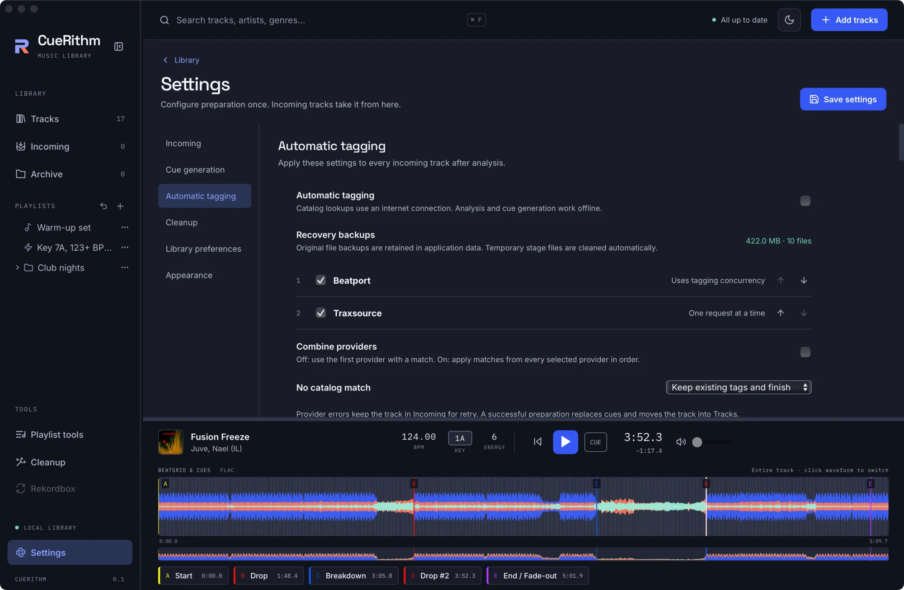

# Tag from Beatport and Traxsource

Turn on automatic catalog tagging, choose which fields to write, and learn how CueRithm protects your audio files during tag writes.

Tagging is off by default. Analysis and cue generation work offline with tagging disabled.

## 1. Open the settings

Go to **Settings > Automatic tagging**.

<figure markdown>
  { .screen loading=lazy }
  <figcaption>Automatic tagging. Providers run in the order listed.</figcaption>
</figure>

## 2. Switch it on

Tick **Automatic tagging**. Note the line beneath: *Catalog lookups use an internet connection. Analysis and cue generation work offline.*

## 3. Choose providers

Beatport and Traxsource are listed with checkboxes and up and down arrows. No account or login is needed for either.

- **Combine providers** off (the default): the first provider that finds a match wins.
- **Combine providers** on: every selected provider is asked, and their matches apply in order.

## 4. Decide what happens without a match

**No catalog match** can be:

- **Keep existing tags and finish**: the track continues and moves into Tracks (the default).
- **Keep in Incoming for attention**: the track waits for you.

A provider *error*, such as being offline, is never treated as "no match". The track stays in Incoming so you can retry.

## 5. Choose the fields to write

Scroll the page to **Fields to write**. By default CueRithm writes genre, BPM, style, label and release date. Title, artist, album, key, artwork, ISRC and identifiers are off until you tick them. Measured key and BPM from CueRithm's own analysis are written by default, not the catalog's values, and the library always keeps its own measurements.

## 6. Run it

New tracks, tracks arriving in a watch folder and **Analyze again** use your settings. Existing tracks are not retagged just because you changed a setting.

## The safeguards

- CueRithm writes tags to a staged copy of the file.
- It decodes that copy again and checks that the audio matches the original sample for sample. A mismatch stops the write.
- The original is kept in recovery backups, whose size is shown on the settings page.
- An atomic swap replaces your file. If anything fails afterwards, CueRithm restores the original. If you have edited the file in the meantime, it preserves your newer edit.

!!! warning "Traxsource status"
    Traxsource can require a browser challenge. Configure an optional [FlareSolverr-compatible solver](../guides/catalog-solver.md) to use it when blocked. CueRithm remembers detected restrictions and stops direct retries; without a solver the source becomes unavailable. A failed required lookup leaves tracks in Incoming. Live fetching and parsing were verified with Trawl, without writing music tags.

## What just happened

Matching normalises titles and artists, searches the catalog, scores candidates and accepts the best one that clears your strictness setting (0.70 by default). See [Catalog matching](../technical/matching.md), [Safe tag writing](../technical/tag-writing.md) and [Automatic tagging settings](../guides/tagging-settings.md). The tagging code is adapted from [OneTagger](../about/credits.md#onetagger).
