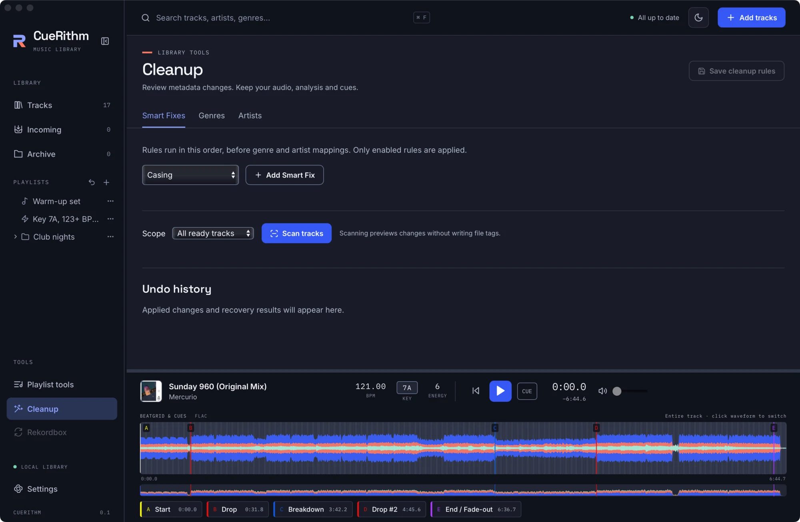
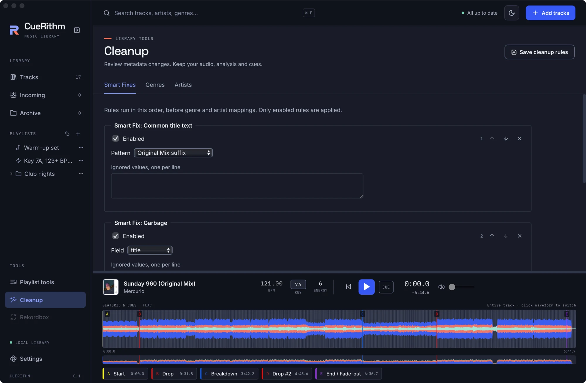
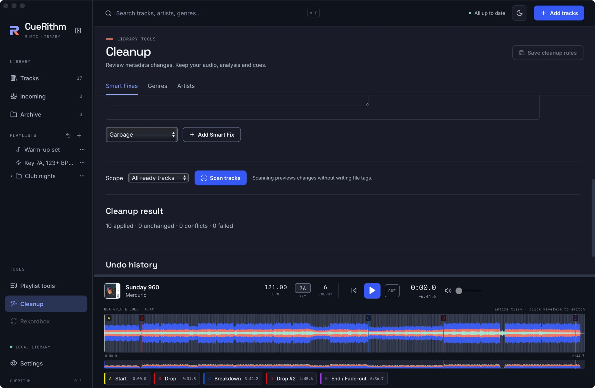
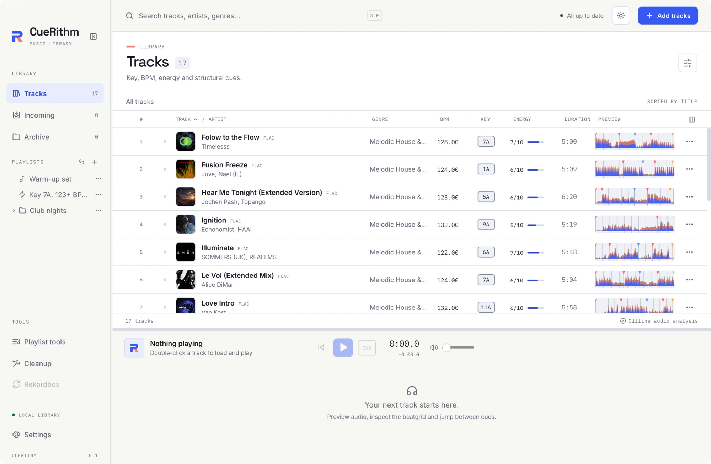

# Clean up messy titles

**You will:** strip the "(Original Mix)" suffix from titles with a Smart Fix, review exactly what would change, apply it, and undo it if you change your mind.

Cleanup never guesses silently. It follows a fixed flow: **edit rules, scan, review, apply, undo**.

## 1. Open Cleanup

Choose **Cleanup** under **TOOLS** in the sidebar. There are three tabs: **Smart Fixes**, **Genres** and **Artists**.

<figure markdown>
  { .screen loading=lazy }
  <figcaption>Cleanup starts with no rules. Nothing is changed until you add some and apply.</figcaption>
</figure>

## 2. Add Smart Fixes

Pick a fix from **New Smart Fix** and press **Add Smart Fix**. Add **Common title text** (its pattern defaults to *Original Mix suffix*) and **Garbage** (removes stray punctuation and repeated spaces). Rules run in the order listed, and only enabled rules apply.

<figure markdown>
  { .screen loading=lazy }
  <figcaption>Two Smart Fixes. Each has an Enabled box and ordering and removal buttons.</figcaption>
</figure>

Press **Save cleanup rules**.

## 3. Scan

Choose the **scope**: *All ready tracks* or just your selection. Press **Scan tracks**. A scan reads your files and shows a preview. It writes nothing.

<figure markdown>
  { .screen loading=lazy }
  <figcaption>"10 proposed changes. 7 unchanged · 0 unavailable." Tick or untick each proposal.</figcaption>
</figure>

Each proposal shows the before and after of every field it changes. Untick any you do not want. If you edit the rules or the scope, the old preview is discarded.

## 4. Apply

Press **Apply 10 changes**. CueRithm writes the file tags and the library metadata together, keeping a durable copy of every original.

<figure markdown>
  { .screen loading=lazy }
  <figcaption>"10 applied · 0 unchanged · 0 conflicts · 0 failed", then the Undo history.</figcaption>
</figure>

Back in **Tracks** the titles have changed. Analysis, key, BPM, beatgrid, energy and cues are untouched, because cleanup only edits human-readable metadata.

<figure markdown>
  { .screen loading=lazy }
  <figcaption>After cleanup, "Folow to the Flow (Original Mix)" reads "Folow to the Flow". Tracks whose title had no matching suffix were left alone.</figcaption>
</figure>

## 5. Undo

The **Undo history** lists each apply with its time and track count. Press **Undo** to restore the original file bytes and metadata. If a file was edited again after the apply, CueRithm keeps your newer edit and reports it as a conflict instead of overwriting it. Undo history survives a restart.

## Make it automatic

In **Settings > Cleanup** enable **Clean incoming tracks automatically**. The same rules then run on every new track, after catalog tagging and before the track enters Tracks. Existing tracks are never rewritten by a settings change.

## What just happened

Each fix is a fixed algorithm, not a regular expression you write. The engine is a pure function: it takes the current metadata and rules and returns proposed values, and the library service applies them with journaling and rollback. See [Cleanup rules](../guides/cleanup-rules.md) and [Cleanup engine](../technical/cleanup-engine.md).
