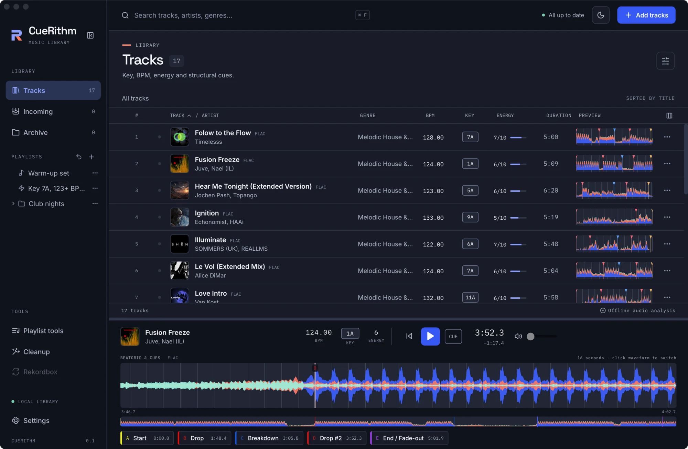

# Navigate a track with cues

**You will:** load a track, read the beatgrid and jump between its structural cues.

## 1. Load a track

Select a row, then press the play button on the row, or double-click the row. The track decodes and appears in the player. Playback uses your system's default audio output.

<figure markdown>
  { .screen loading=lazy }
  <figcaption>The player with the whole track, five cue markers and a button per cue.</figcaption>
</figure>

## 2. Read the waveform

The colour waveform has three layers: bass, mids and highs. In the **Layers** style shown here, bass is cobalt, mids are coral and highs are ice-mint. You can change the palette in [Settings > Appearance](appearance.md). Thin vertical lines are beats. Cue markers are labelled with a letter.

Below the waveform is a small **overview** of the whole track. Click it to seek.

## 3. Jump to a cue

Each cue has a button with its letter, name and time.

<figure markdown>
  { .crop loading=lazy }
  <figcaption>Cue buttons. Click one to seek there.</figcaption>
</figure>

A typical set looks like this:

| Cue | Meaning |
| --- | --- |
| A · Start | The first beat of the grid. |
| B · Drop | The main drop. |
| C · Breakdown | A breakdown, when the track has one that is long enough. |
| D · Drop #2 | The second drop. |
| Breakdown #2 | A second breakdown, when present. |
| E · End / Fade-out | The last strong beat before the outro. |

Not every track gets every cue. A track with no clear breakdown simply has fewer cues. The **CUE** button in the transport jumps to the first cue and pauses.

## 4. Zoom to the beats

The waveform defaults to a **32-second** view that follows the playhead. Beat lines become clearly visible, so you can check that the grid sits on the kicks.

<figure markdown>
  { .screen loading=lazy }
  <figcaption>Zoomed view, shown with the previous 16-second window. Click the waveform to switch between the default 32-second view and the whole track.</figcaption>
</figure>

Use ++arrow-left++ and ++arrow-right++ to jump a bar (four beats) at a time, and ++space++ to play or pause.

## What just happened

The cue buttons and markers are drawn from the cues saved at preparation time. The beat lines come from the saved BPM and first-beat anchor. Cues are read-only in this release: you can seek to them, but not edit them. The detection logic is described in [The cue engine](../technical/cues.md).
