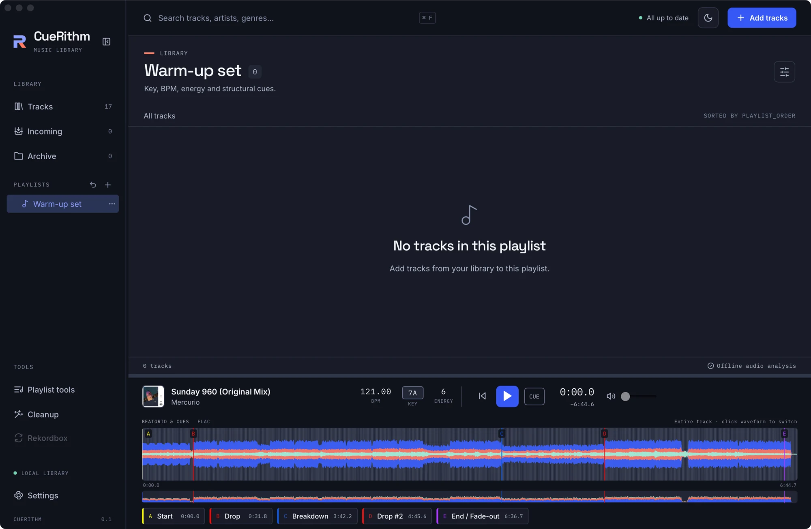
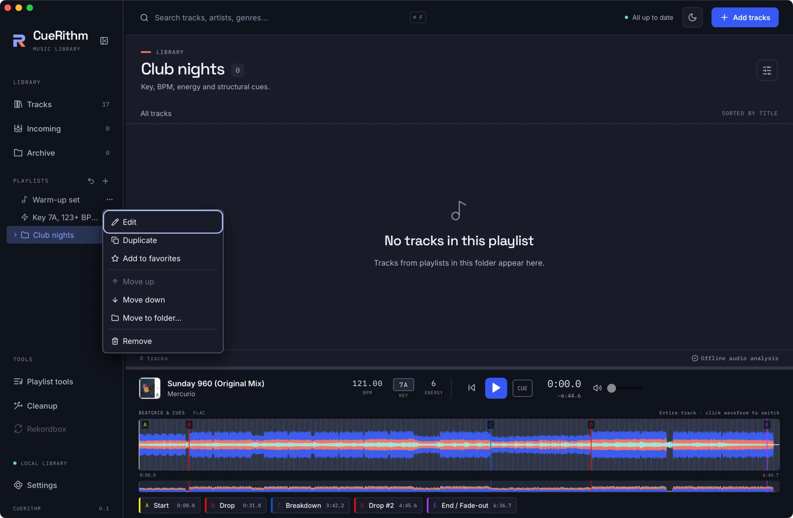

# Build playlists and folders

Create a playlist and a folder, add tracks, then put them in the order you want.

CueRithm has three kinds of playlist item: **Playlist** (you choose the tracks), **Folder** (a container) and **Smart playlist** (rules choose the tracks, see [Build a smart playlist](smart-playlist.md)). Playlists live inside the library. Audio files are never touched, and removing a playlist never deletes music.

## 1. Create a playlist

Click the **+** beside **PLAYLISTS** in the sidebar. The editor asks for a name, a type and a parent folder.

<figure markdown>
  { .screen loading=lazy }
  <figcaption>Name it, keep the type as Playlist, and choose Create.</figcaption>
</figure>

The new playlist opens empty.

<figure markdown>
  { .screen loading=lazy }
</figure>

## 2. Add tracks

Select one or more tracks, then either:

- Drag them onto the playlist in the sidebar. Only ordinary playlists accept tracks; folders and smart playlists do not.
- Open the **Choose playlist** menu in the toolbar, pick the playlist and press **Add to playlist**.

<figure markdown>
  { .screen loading=lazy }
  <figcaption>A playlist in manual order. The toolbar offers Remove from playlist and Order arrows.</figcaption>
</figure>

A track appears at most once in a playlist.

## 3. Reorder

When a playlist is shown in **manual order**, select tracks and use the up and down arrows beside *Order* to move them one place. You can also drag tracks onto another row to insert them before it. If you have sorted by a column, press **Manual order** first.

## 4. Make a folder

Create another item and set **Playlist type** to **Folder**. Folders can contain playlists, smart playlists and other folders. Drag a playlist onto a folder to put it inside, or use **Move to folder…** in the playlist's menu.

<figure markdown>
  { .screen loading=lazy }
  <figcaption>A playlist, a smart playlist (lightning bolt) and a folder in the sidebar.</figcaption>
</figure>

Opening a folder shows the tracks of every playlist inside it, each track listed once.

## 5. The playlist menu

Each playlist has a **⋯** menu.

<figure markdown>
  { .screen loading=lazy }
  <figcaption>Edit, Duplicate, Add to favorites, Move up and down, Move to folder, Remove.</figcaption>
</figure>

**Remove** moves the playlist to the *Removed playlists* list in the sidebar. Use **Restore** to bring it and its contents back. **Undo last playlist change** (the arrow at the top of the Playlists section) reverses your latest edit, including a tool or generator run.

Playlist membership is stored by track identity, not by file path, in the library database. Each edit is a checked transaction, so a stale window cannot overwrite a newer change. See [The library database](../technical/library.md) and [Playlists, folders and favourites](../guides/playlists.md).
