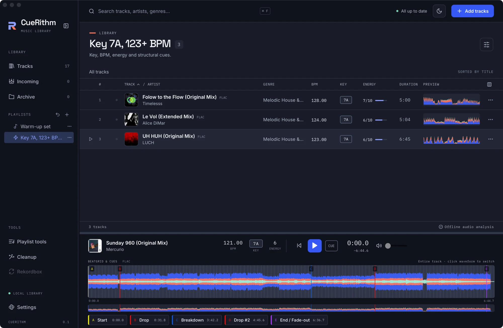

# Build a smart playlist

Make a playlist that automatically includes every track in a chosen key above a minimum BPM.

!!! tip "Create whole categories automatically"
    To build lists for artists/remixers, BPM ranges, release months and energy, genres or compatible keys, opt in under **Settings → Smart Playlists**. CueRithm creates them and adds new groups as prepared tracks arrive. See [Automatic Smart Playlists](../guides/playlists.md#automatic-smart-playlists). Use the steps below for your own custom conditions.

## 1. Choose the type

Click **+** beside **PLAYLISTS**. Name the playlist, then set **Playlist type** to **Smart playlist**. A rule editor appears: *Rules keep membership up to date automatically.*

## 2. Add conditions

A smart playlist has up to 128 conditions in one flat list. Each has a **field**, an **operator** and a **value**. Choose **Match all conditions** or **any condition** at the top.

For this tutorial:

1. Condition 1: field **Key**, operator **contains**, value `7A`.
2. Press **Add condition**. Condition 2: field **BPM**, operator **is at least**, value `123`.

<figure markdown>
  { .screen loading=lazy }
  <figcaption>The smart rule editor. Each condition has a field, an operator and a value.</figcaption>
</figure>

!!! tip "Use the right field"
    The field list includes raw technical fields (for example `audio.sample_rate`) next to friendly ones such as BPM, Energy, Key, Genre and Date added. See [Smart playlist rules](../guides/smart-rules.md) for the full catalogue.

## 3. Preview, then create

Press **Preview matches**. CueRithm evaluates the rules and shows the count, for example *3 matching tracks*. A smart playlist cannot be saved without a current successful preview. Then press **Create**.

<figure markdown>
  { .screen loading=lazy }
  <figcaption>The smart playlist, marked with a lightning bolt in the sidebar, showing its matches.</figcaption>
</figure>

## 4. It keeps itself current

When you prepare a new track, change metadata, apply a cleanup or edit another playlist, smart playlists re-evaluate in the background. If an evaluation fails, CueRithm keeps the last good result and shows an error and *Showing the last successfully evaluated results.*

You cannot add or remove tracks in a smart playlist by hand. To freeze its current contents into an ordinary playlist, use the **Save ordinary snapshot** tool in [Playlist tools](../guides/playlist-tools.md).

## Ideas

| Goal | Conditions |
| --- | --- |
| Harmonic neighbours of a track you are playing | Key *is compatible with key* `7A` |
| Peak-time weapons | Energy *is at least* `8` and BPM *is between* `124` and `130` |
| Fresh additions | Date added *is in the last* `14 days` |
| Needs a look | Genre *has no value* |
| Everything with a loop | Cues *has a loop* |

## What just happened

The rules were evaluated against measured analysis (key, BPM, energy come from CueRithm's own analysis, not file tags) and library metadata. Text comparisons are case-insensitive. A missing number compares as zero. Details are in [Smart playlist engine](../technical/smart-engine.md).
