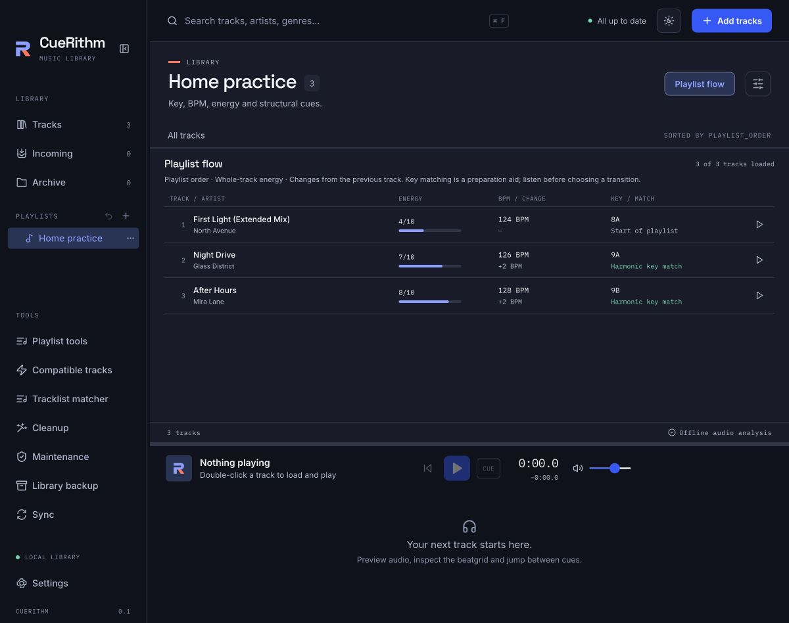

# Check the flow of a playlist

See a playlist in play order with each track's energy, its BPM change from the track before and whether the keys sit next to each other, so you can spot a jump before the night. It takes a minute.

**Before you start:** open an ordinary playlist with a few tracks. [Create a playlist and add tracks](create-a-playlist.md) builds the *Warm-up set* used on this page.

## Open the flow view { #open }

<!-- figure:playlists-flow-warm-up -->
<figure markdown>
{ .screen loading=lazy }
{ .screen loading=lazy }
<figcaption>Flow follows play order and flags the one transition without a harmonic key match.</figcaption>
</figure>
<!-- /figure -->

1. Click an ordinary playlist in the sidebar, for example **Warm-up set**.
2. Click **Playlist flow** at the top right of the track area.

The track table is replaced by the flow overview. Click **Playlist flow** again to return to the table. The button only appears for ordinary playlists; folders and smart playlists have no hand-made order to read.

The overview follows the saved playlist order, whatever column the table was sorted by. It shows the playlist in the order you would play it.

## Read each row { #read }

The columns are **TRACK / ARTIST**, **ENERGY**, **BPM / CHANGE** and **KEY / MATCH**.

<!-- figure:existing-playlist-flow-check-playlist-flow -->
<figure markdown>
{ .screen loading=lazy }
<figcaption>Read the order and the step between neighbouring tracks.</figcaption>
</figure>
<!-- /figure -->

| Column | What it shows |
|---|---|
| Position, title, artist | Where the track sits, and which one it is |
| **ENERGY** | The whole-track rating as `6/10` with a bar. One rating per track; see [How is energy rated?](../how-it-works/energy.md) |
| **BPM / CHANGE** | The track's BPM, and below it the change from the previous track, such as `+1 BPM` or `0 BPM` |
| **KEY / MATCH** | The track's key, and below it how it compares with the previous track's key |

The key line reads one of these:

| Message | Meaning |
|---|---|
| **Start of playlist** | The first track has nothing before it |
| **Harmonic key match** | The same number on either letter, or a neighbouring number on the same letter (12 and 1 are neighbours) |
| **No harmonic key match** | Any other pair of keys |
| **Key comparison unknown** | One of the two keys is missing or not recognised |
| **Previous track not loaded** | The track before it is not in the overview, so no comparison is made |

The flow always uses this harmonic rule, whichever **Key compatibility** mode you chose in Library preferences. Where a measurement is missing, the row says **Energy unknown**, **BPM unknown** or **Key unknown** instead of guessing. See [Understand Camelot keys](../analysis/camelot-keys.md).

## Read the Warm-up set { #example }

With the eight tracks from the tutorial in play order, the flow looks like this:

| # | Track | Energy | BPM and change | Key and match |
|---|---|---|---|---|
| 1 | When The Fire Starts To Burn (Extended Mix) | 6/10 | 126 BPM, — | 7A, start of playlist |
| 2 | Palm Of Your Hands (Extended Mix) | 6/10 | 127 BPM, +1 | 11A, no harmonic key match |
| 3 | Desert (Original Mix) | 6/10 | 128 BPM, +1 | 12A, harmonic key match |
| 4 | F\*ck The Club (Extended Mix) | 6/10 | 128 BPM, 0 | 12A, harmonic key match |
| 5 | Murda (Extended Mix) | 6/10 | 128 BPM, 0 | 1A, harmonic key match |
| 6 | Shake The Block (Extended Mix) | 6/10 | 128 BPM, 0 | 1A, harmonic key match |
| 7 | Underground (Extended Mix) | 6/10 | 129 BPM, +1 | 2A, harmonic key match |
| 8 | Atoma (Extended Mix) | 6/10 | 130 BPM, +1 | 2A, harmonic key match |

The BPM rises by one at a time, the energy stays level, and one transition is flagged: the first, from `7A` to `11A`. The flag is a prompt to listen, not an error. Select that row and click its play button (**Preview in player**) to hear it in the persistent player; see [Preview a track with the player](../analysis/preview-a-track.md). If you do not like it, reorder the playlist in the table with [the order controls](edit-playlist-tracks.md#reorder-tracks), or look for a better neighbour with [Find tracks that mix with the one playing](find-compatible-tracks.md).

## Read a long playlist { #long-playlists }

The overview shows 40 tracks at a time. Use **Previous tracks** and **Next tracks** to page through them. The heading counts how many tracks have loaded, for example *60 of 120 tracks loaded*. If the playlist is longer than what has loaded, the note *Partial overview. Comparisons cover loaded neighbors only.* appears, and **Load more track details** fetches more.

A member that is archived or still in Incoming is not shown, so the row after it says **Previous track not loaded**. Restore or finish preparing the track to see it. See [Reorder, remove and restore tracks](edit-playlist-tracks.md#restore-tracks).

## What the flow does not do { #limits }

The overview compares neighbours by BPM, key and one whole-track energy rating. It does not measure transition length or overlap, and it has no per-section energy. Key matching is a preparation aid; listen before you choose a transition.

## What can go wrong

| What you see | Why | What to do |
|---|---|---|
| There is no **Playlist flow** button | A folder, a smart playlist or no playlist is open | Open an ordinary playlist |
| *Loading playlist order…* stays on screen | The order is still being read | Wait a moment, or click **Retry playlist flow** if it reports an error |
| *Add tracks to see this playlist’s flow.* | The playlist is empty | [Add tracks](edit-playlist-tracks.md#add-tracks) |
| *No track details loaded yet.* | The playlist has members but their details have not loaded | Click **Load more track details** |

## Related

- [Find tracks that mix with the one playing](find-compatible-tracks.md)
- [Reorder, remove and restore tracks](edit-playlist-tracks.md)
- [Read a track's key, BPM and energy](../analysis/read-key-bpm-energy.md)
- [Group playlists in folders and reorder them](organize-playlists.md)

<!-- verified: apps/desktop/src/components/PlaylistFlow.tsx (columns, messages, paging 40, counts); playlist-flow.ts (compareFlowKeys harmonic only, BPM change rounding, unknown handling); App.tsx (Playlist flow button for ordinary playlists only, canonical order via playlistMembers, Load more track details, Retry playlist flow); src/test/playlist-flow.test.tsx; rows computed from _meta/the private demo-library facts sheet; legacy guides/playlist-flow.md re-checked -->
