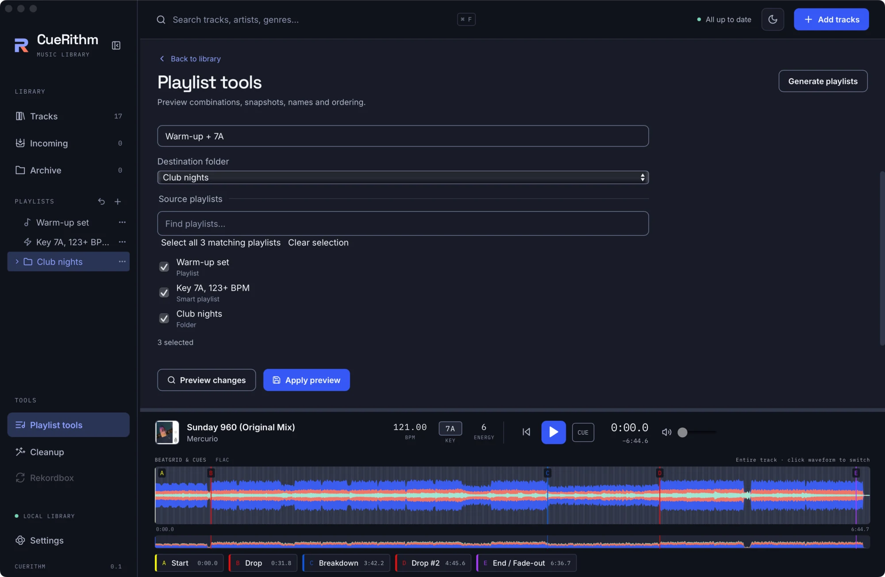

# Combine, split and tidy playlists

Merge two sets into one, freeze a smart playlist into a list you can edit, slice a playlist by a rule, and sort, number or rename many playlists at once. Every change is previewed first and undone with one click.

**Before you start:** you need at least one playlist or folder. [Create a playlist and add tracks](create-a-playlist.md) shows how.

## Open Playlist tools and preview every change { #open-tools }

1. Under **TOOLS** in the sidebar, click **Playlist tools**. If a playlist was open, it is already chosen as the source.
2. In **Tool**, choose what you want to do: **Combine playlists**, **Save ordinary snapshot**, **Sort playlists**, **Number playlists**, **Add text prefix** or **Uppercase names**.
3. Fill in the controls that appear, then click **Preview changes**. A list shows *N playlist changes*: each new or renamed playlist with its track count.
4. Check the list and click **Apply preview**. CueRithm confirms with *Playlist changes applied. Use sidebar Undo to revert.*

All changes in one preview are applied together as one undoable step. Audio files and analysis are never touched. The playlist picker has a **Find playlists…** box, **Select all N matching playlists** and **Clear selection**, and counts what you have chosen.

A preview belongs to the playlists as they were when you made it. If something changes before you apply, CueRithm says *Playlists changed. Preview again before applying.* A preview that reads a rule depending on the clock expires after about a minute with *Preview expired. Preview again before applying.* Preview again in both cases.

## Combine playlists into a new one { #combine }

<!-- figure:existing-60-playlist-tools-combine-combine-and-tidy-playlists -->
<figure markdown>
{ .screen loading=lazy }
<figcaption>Combine playlists with a rule for which tracks to keep.</figcaption>
</figure>
<!-- /figure -->

1. Choose **Combine playlists**.
2. In **Combination**, choose how to merge:

    | Choice | The new playlist holds |
    |---|---|
    | **Tracks in any selected playlist** | every track from any source, each once |
    | **Tracks in every selected playlist** | only tracks that are in all the sources |
    | **Active library tracks absent from all selected playlists** | every prepared, unarchived track that is in none of them |

3. Type a **Result name** and choose a **Destination folder** (**Your playlists** is the top level).
4. Tick the source playlists, then **Preview changes** and **Apply preview**.

The result is an ordinary playlist. The sources stay as they were. A smart playlist or a folder can be a source; its tracks at that moment are used. Tracks keep their order, and a track that appears twice is listed once, at its first place. The last choice is a fast way to find everything you have not put in a set yet; the recipe [Find tracks that are not in a set yet](recipes/tracks-not-in-a-set-yet.md) does the same with a live smart playlist.

## Save a playlist as an ordinary snapshot { #snapshot }

A snapshot turns something that changes by itself into a playlist you can edit by hand.

1. Choose **Save ordinary snapshot**.
2. Choose exactly one playlist, smart playlist or folder as the source.
3. Type a **Result name** and choose a **Destination folder**.
4. **Preview changes**, then **Apply preview**.

A smart playlist becomes an ordinary playlist holding the tracks it has right now. A folder is copied with its structure: sub-folders stay folders, and every playlist and smart playlist inside becomes an ordinary playlist with its current tracks. The copy has the name you typed; the items inside keep their names. A snapshot of a smart playlist lists its tracks in title order, so reorder it afterwards if the order matters; see [Reorder, remove and restore tracks](edit-playlist-tracks.md#reorder-tracks).

## Split a playlist by a rule { #split }

CueRithm has no split button, but a smart playlist can slice any playlist. For example, to pull the hardest tracks out of Peak hour:

1. Create a smart playlist and add the condition `playlist` **is in playlist** **Peak hour**. See [Write smart playlist rules](smart-rules.md#playlist-rules).
2. Add a second condition, such as **Energy** **is at least** `7`, and keep **all conditions**.
3. **Preview matches** and **Create**.
4. To keep the slice as a fixed list, take a snapshot of it as above.

The original is untouched. Keep a rule that refers to a folder outside that folder, or CueRithm refuses it as a dependency cycle.

## Sort playlists in a folder { #sort }

1. Choose **Sort playlists**.
2. In **Folder to sort**, choose the folder. **Your playlists** is the top level.
3. Choose an **Order**: **Name A–Z**, **Name Z–A** or **Track count, highest first**.
4. Leave **All sibling playlists** ticked to sort everything in that folder. Untick it to pick which items take part; the others keep their places.
5. **Preview changes**, then **Apply preview**.

Name sorting ignores capitals. In a track-count sort, folders count as zero and smart playlists count their current tracks.

## Number, prefix or capitalise names { #rename-tools }

These three tools rename the playlists you tick. Names can be up to 255 characters.

| Tool | Controls | Example result |
|---|---|---|
| **Number playlists** | **Starting number** (1 to begin with), **Leading zeroes**, **Replace existing number prefixes** | `01 Warm-up set`, `02 Peak hour` |
| **Add text prefix** | **Text prefix**, added exactly as typed | `Fri - Warm-up set` for the prefix `Fri - ` |
| **Uppercase names** | none | `WARM-UP SET` |

**Number playlists** numbers the items in the order they appear in the sidebar, top to bottom, and puts one space between number and name. With **Leading zeroes** on, numbers are padded to at least two digits. **Replace existing number prefixes** removes a leading number of up to three digits, with an optional full stop, spaces and a dash, before adding the new one, so you can renumber a set without stacking prefixes. **Add text prefix** adds no separator of its own, so end your text with a space.

## Undo a tool run { #undo }

Click the arrow beside **+** (**Undo last playlist change**). It reverses the whole run at once. See [Undo a playlist change](organize-playlists.md#undo).

## What can go wrong

| What you see | Why | What to do |
|---|---|---|
| **Preview changes** is greyed out | A required control is empty, for example **Result name** or the source list | Fill it in |
| *Smart playlist … unavailable* | A smart source could not be evaluated | Open it, fix the error banner, and preview again |
| *No changes were needed.* | The result would equal what is there | Nothing to do |

## Related

- [Build a smart playlist](build-a-smart-playlist.md)
- [Generate playlists from your library](generate-playlists.md)
- [Group playlists in folders and reorder them](organize-playlists.md)
- [Check the flow of a playlist](check-playlist-flow.md)

<!-- verified: apps/desktop/src/views/PlaylistTools.tsx (labels, defaults, result texts); use-playlist-preview.ts (stale and expired messages); components/PlaylistPicker.tsx; crates/cuerithm-library/src/playlists/tools.rs (combine modes and order, snapshot of folders, sort rules, prefix_name numbering and replace rules, uppercase), previews.rs, evaluate.rs (smart members in title order); src/test/playlist-tools.test.tsx, playlist-panels.test.tsx; legacy guides/playlist-tools.md re-checked -->
