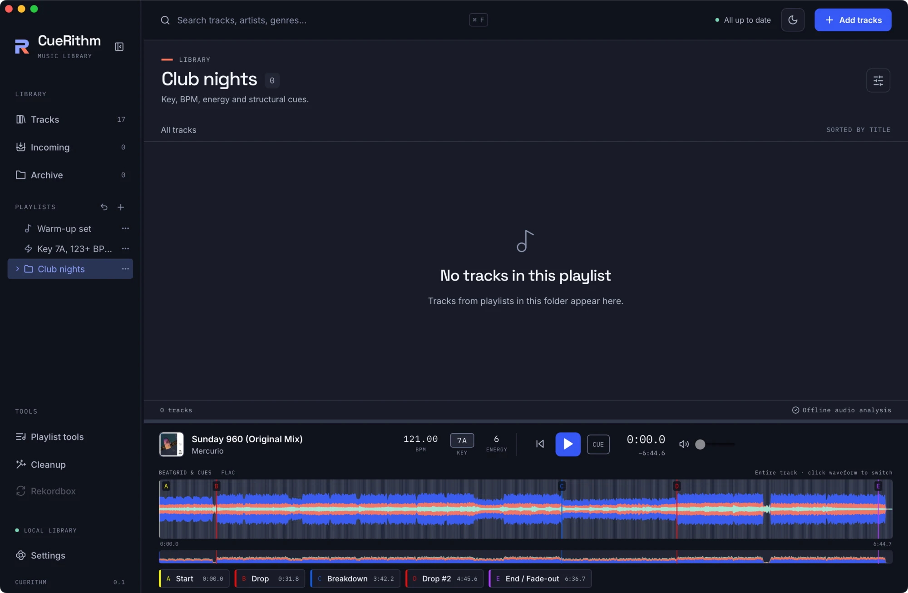
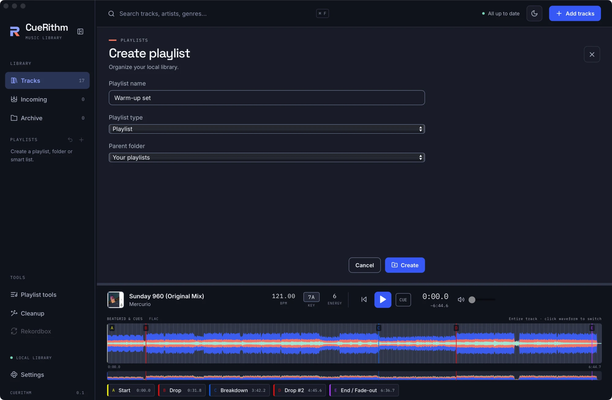
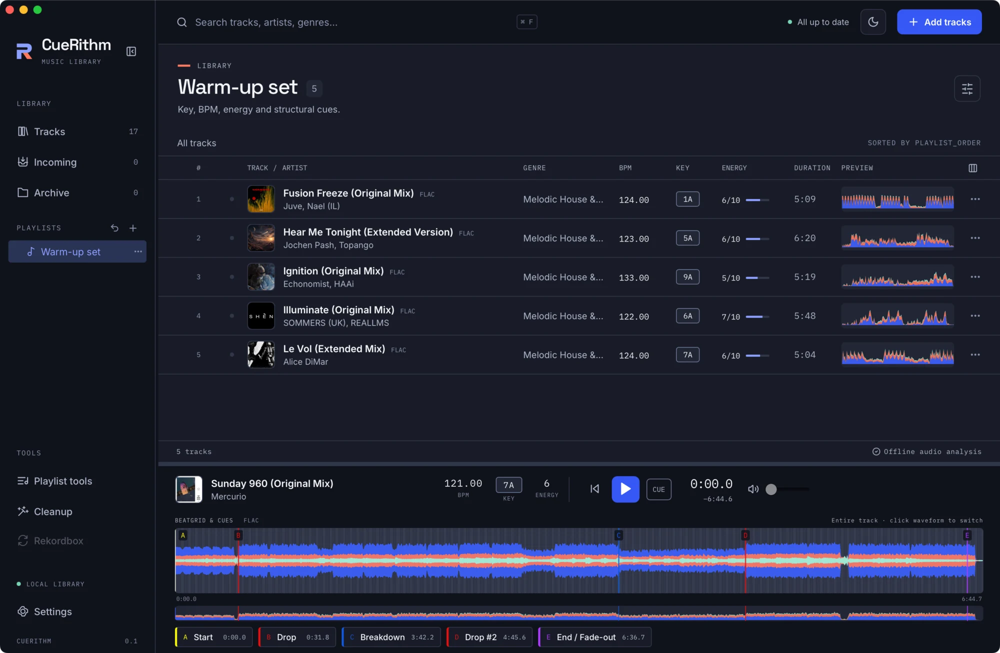

# Create a playlist and add tracks

In about ten minutes you build a <strong>Club nights</strong> folder with a <strong>Warm-up set</strong> playlist inside it, add eight tracks, and put them in the order you would play them.

**You need:**

- [ ] CueRithm with at least eight prepared tracks in **Tracks** ([Prepare your first tracks](../get-started/first-tracks.md) shows how)
- [ ] Nothing else. Playlists live in your CueRithm library and never change an audio file.

This tutorial uses tracks from the 26-file Beatport purchase folder that every example in this guide comes from. Your own library will have different titles. Pick eight tracks with similar BPM and the steps stay the same.

## 1. Create the Club nights folder { #create-folder }

<!-- figure:existing-57-sidebar-playlists-create-a-playlist -->
<figure markdown>
{ .screen loading=lazy }
<figcaption>Folders, playlists and smart playlists share the sidebar.</figcaption>
</figure>
<!-- /figure -->

1. Click the **+** button beside **PLAYLISTS** in the sidebar (its name is **Create playlist**).
2. In **Playlist name**, type `Club nights`.
3. Set **Playlist type** to **Folder**. Leave **Parent folder** on **Your playlists**, which means the top level.
4. Click **Create**.

**You should see** a folder named **Club nights** in the sidebar, and the main area shows the empty folder: *No tracks in this playlist* and *Tracks from playlists in this folder appear here.*

**Why a folder first:** a folder gathers related playlists, such as every set for one night. Opening a folder lists the tracks of all the playlists inside it, once each.

## 2. Create the Warm-up set playlist inside it { #create-playlist }

<!-- figure:existing-51-playlist-editor-named-create-a-playlist -->
<figure markdown>
{ .screen loading=lazy }
<figcaption>Name the playlist and choose where it lives.</figcaption>
</figure>
<!-- /figure -->

<!-- figure:playlists-create-editor -->
<figure markdown>
{ .screen loading=lazy }
{ .screen loading=lazy }
<figcaption>A new item is created inside the folder you have open.</figcaption>
</figure>
<!-- /figure -->

1. With **Club nights** still open, click **+** again. **Parent folder** already says **Club nights**, because a new item is created inside the folder you have open.
2. Type `Warm-up set` in **Playlist name**.
3. Keep **Playlist type** on **Playlist**, then click **Create**.

**You should see** the new playlist open with the message *No tracks in this playlist* and *Add tracks from your library to this playlist.* Click the chevron beside **Club nights** to see **Warm-up set** nested under it.

## 3. Add seven tracks { #add-seven }

<!-- figure:existing-54-playlist-with-tracks-create-a-playlist -->
<figure markdown>
{ .screen loading=lazy }
<figcaption>A playlist keeps the order you give it.</figcaption>
</figure>
<!-- /figure -->

<!-- figure:playlists-add-bar -->
<figure markdown>
{ .screen loading=lazy }
{ .screen loading=lazy }
<figcaption>Pick the destination under Choose playlist and click Add to playlist.</figcaption>
</figure>
<!-- /figure -->

1. Click **Tracks** in the sidebar.
2. Click **When The Fire Starts To Burn (Extended Mix)**. Then hold ++cmd++ (++ctrl++ on Windows and Linux) and click these six tracks, in this order:
    - **Desert (Original Mix)**
    - **F\*ck The Club (Extended Mix)**
    - **Murda (Extended Mix)**
    - **Shake The Block (Extended Mix)**
    - **Underground (Extended Mix)**
    - **Atoma (Extended Mix)**
3. A bar of playlist controls appears above the table. Open the menu that reads **Choose playlist…**, pick **Club nights / Warm-up set**, then click **Add to playlist**.

**You should see** the selection stay in place and nothing else change in the table. Click **Warm-up set** in the sidebar: the playlist now holds seven tracks, in the order you clicked them. <!-- UNVERIFIED: click order is kept because the selection is an insertion-ordered set (App.tsx onSelect) and AddMembers appends in order; not run in the app -->

You can drag the selection onto **Warm-up set** in the sidebar instead of using the menu. Expand **Club nights** first so the playlist is visible. See [Reorder, remove and restore tracks](edit-playlist-tracks.md#add-tracks) for both ways and what each does.

## 4. Add the eighth track and move it into place { #move-into-place }

<!-- figure:playlists-warm-up-open -->
<figure markdown>
{ .screen loading=lazy }
{ .screen loading=lazy }
<figcaption>Warm-up set in manual order, BPM climbing from 126 to 130.</figcaption>
</figure>
<!-- /figure -->

1. Go back to **Tracks**, select **Palm Of Your Hands (Extended Mix)**, choose **Club nights / Warm-up set** and click **Add to playlist**.
2. Open **Warm-up set**. The new track is last, at position 8, because tracks are added at the end.
3. Click it, then click the up arrow beside **Order** (**Move selected tracks up**) six times. Or drag its row onto the row of **Desert (Original Mix)**: a dropped track lands before the row you drop it on.

**You should see** the playlist in this order:

| # | Track | BPM | Key | Energy |
|---|---|---|---|---|
| 1 | When The Fire Starts To Burn (Extended Mix) | 126 | 7A | 6/10 |
| 2 | Palm Of Your Hands (Extended Mix) | 127 | 11A | 6/10 |
| 3 | Desert (Original Mix) | 128 | 12A | 6/10 |
| 4 | F\*ck The Club (Extended Mix) | 128 | 12A | 6/10 |
| 5 | Murda (Extended Mix) | 128 | 1A | 6/10 |
| 6 | Shake The Block (Extended Mix) | 128 | 1A | 6/10 |
| 7 | Underground (Extended Mix) | 129 | 2A | 6/10 |
| 8 | Atoma (Extended Mix) | 130 | 2A | 6/10 |

The BPM climbs from 126 to 130, and after the first track the keys step from 11A through 12A and 1A to 2A. That is the shape of a good warm-up, and it is what [Check the flow of a playlist](check-playlist-flow.md) reads back to you.

## 5. See what a column sort does { #manual-order }

1. Click a column header, for example **BPM**.
2. The table re-sorts and the arrows next to **Order** disappear. The playlist order has not changed; only the view has.
3. Click **Manual order** in the playlist bar to return to the order you built.

**Why:** the table can be sorted by any column, but only the manual order is the order of your set. CueRithm never saves a column sort into a playlist.

## 6. Undo a change (optional) { #undo-a-change }

The arrow beside **+** is **Undo last playlist change**. Click it once and the most recent change is reversed: one arrow press from step 4, or the whole drag if you dragged. Each click steps one change further back. There is no redo, so repeat the move if you undo too far.

## What you learned

- A **folder** groups playlists, and a **playlist** holds tracks you choose, in an order you control.
- A new item is created inside the folder you have open.
- Tracks are added at the end, in the order you selected them. A track appears at most once in a playlist.
- Sorting a column changes the view, not the playlist. **Manual order** brings the real order back.

## Next steps

- [Group playlists in folders and reorder them](organize-playlists.md) to rename, duplicate, favourite and move playlists.
- [Reorder, remove and restore tracks](edit-playlist-tracks.md) for the full set of membership controls.
- [Check the flow of a playlist](check-playlist-flow.md) to compare BPM, energy and keys from one track to the next.
- [Build a smart playlist](build-a-smart-playlist.md) when you want CueRithm to pick the tracks.

<!-- verified: apps/desktop/src/App.tsx (create button, choosePlaylist sets sort playlist_order, empty-state text, Manual order, selected Set order, drop-before reorder); components/Sidebar.tsx; views/PlaylistEditor.tsx; components/PlaylistMembershipControls.tsx; playlist-order.ts; crates/cuerithm-library/src/playlists/edits.rs (AddMembers appends and de-duplicates); src/test/playlists-workspace.test.tsx, playlist-membership.test.tsx, playlist-track-drag.test.tsx, playlist-actions.test.tsx; track values from _meta/the private demo-library facts sheet -->
