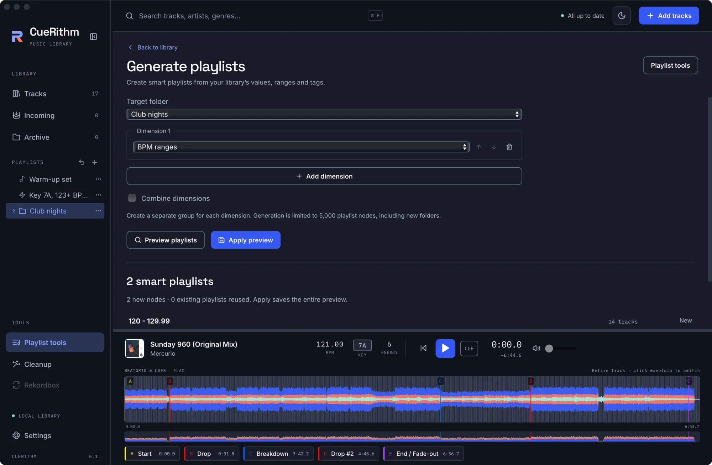

# Generate playlists from your library

Build a whole set of smart playlists in one go: one per genre, per BPM band, per energy level, per key or per tag. You review the list before anything is created, and one click undoes it. It takes about five minutes.

**Before you start:** you need prepared tracks in **Tracks**. Values come from prepared, unarchived tracks only.

Three features create smart playlists, so pick the one that fits:

| You want | Use |
|---|---|
| One playlist with your own rules | [Build a smart playlist](build-a-smart-playlist.md) |
| Lists by artist, BPM, genre, key or release month that CueRithm keeps adding to | [Keep smart playlists up to date automatically](automatic-smart-playlists.md) |
| A batch of lists from the values in your library today, which you review and then edit | This page |

## Open the generator { #open-generator }

1. Under **TOOLS**, click **Playlist tools**.
2. Click **Generate playlists** at the top right.

The page opens with *Create smart playlists from your library’s values, ranges and tags.* If the generator was already open, **Playlist tools** at the top right takes you back.

## Choose where the lists go { #target }

In **Target folder**, choose **New folder** or an existing folder.

- For a new folder, give it a **New folder name** (the suggestion is `Generated playlists`) and a **Parent folder**.
- For an existing folder, the new lists are added to it. A list that already exists with the same name and the same rules is reused, not duplicated.

## Choose what to split by { #dimensions }

Each **dimension** is one way of cutting your library. The menu for **Dimension 1** starts on `genre`, and you can add more with **Add dimension**, up to 16. Each one must be different. The arrows reorder them and the bin removes one.

| Dimension | Creates one list for each… | Example names |
|---|---|---|
| A text, number or colour field such as `genre`, **Artist**, **Key** or **Energy** | value found in your prepared tracks | `Tech House`, `7A`, `07 Energy` |
| **Decades** | decade of the `year` tag | `2020s` |
| **BPM ranges** | band of 10 BPM that holds a track | `120 - 129.99` |
| **Bitrate buckets** | bitrate band | `< 128 kbps`, `320 kbps+` |
| **File size buckets** | size band | `< 5 MB`, `50 MB+` |
| **Duration buckets** | length band | `< 2 min`, `10 min+` |
| **Custom tags** | tag, either **Observed tags** or **Choose tags** | the tag name |
| **Category: …** | tag in that category | the tag name |

Good to know:

- Each list is a smart playlist whose rule is exact: the **Key** dimension makes the list `7A` with the rule **Key** **is** `7A`, which matches that key only. For tracks that mix with a key, use [automatic key lists](automatic-smart-playlists.md#options) or [a rule](recipes/tracks-that-mix-with-a-key.md).
- BPM bands end in `.99` because BPM is compared to two decimals. A band is only made if a track falls in it.
- For **Energy** and **Rating** you can tick **Include all 0–10 energy values, even without matches** (or **0–5 star rating**) to make a list for every value.

## Combine dimensions or keep them apart { #combine }

- With **Combine dimensions** unticked, each dimension gets its own group of lists. With two or more dimensions, each group sits in a sub-folder named for it, such as `Genre` or `BPM ranges`.
- With it ticked, you get every pairing of one value from each dimension. The name joins the two, for example `120 - 129.99 07 Energy`, and both rules must hold. Some pairings match no track and are still listed, so read the track counts in the preview. <!-- UNVERIFIED: empty pairings are listed; read from generator.rs (no filter after the Cartesian product), not run in the app -->

## Preview, then apply { #preview-apply }

<!-- figure:existing-62-playlist-generator-generate-playlists -->
<figure markdown>
{ .screen loading=lazy }
<figcaption>Preview the playlists before you create them.</figcaption>
</figure>
<!-- /figure -->

1. Click **Preview playlists**. The page shows *N smart playlists*, then *N new nodes · M existing playlists reused. Apply saves the entire preview.*
2. Each row shows the list's name, its rules under **Conditions**, its track count and whether it is **New** or **Reuse existing**. **Show more playlists** reveals the rest of a long list.
3. Click **Apply preview**. CueRithm confirms with *Generated playlists saved. Existing compatible playlists keep their identities.*

Everything in one preview is created together as one undoable step. Click **Undo last playlist change** (the arrow beside **+**) to remove the lot. Changing any control clears the preview, and so does any other playlist change; preview again.

For example, the **BPM ranges** dimension on the Beatport purchase folder used in this guide previews four lists:

| List | Tracks |
|---|---|
| `120 - 129.99` | 11 |
| `130 - 139.99` | 12 |
| `140 - 149.99` | 2 |
| `160 - 169.99` | 1 |

The recipe [Make a playlist for every BPM range](recipes/playlist-per-bpm-range.md) walks through it.

## Run it again later { #rerun }

Generated lists are ordinary smart playlists, so their members stay current and you can edit or move them. What does not happen on its own is a new list for a value that did not exist when you generated. Run the generator again with the same target to add only the new lists; the existing ones are reused and listed as **Reuse existing**. If CueRithm finds a playlist with the same name but different rules, it stops with *Existing playlist has a different definition* followed by the name. Rename or remove the old one first.

## Know the limits { #limits }

A run can make at most 5,000 playlists and folders in total, counting new folders. A field with more than 5,000 different values is refused with *Too many observed values; choose a narrower field*, and a combination that would pass the limit with *Cartesian generation would exceed 5000 nodes*. Choose fewer or narrower dimensions.

## What can go wrong

| What you see | Why | What to do |
|---|---|---|
| **Preview playlists** is greyed out | No dimension is chosen, a dimension is unavailable, or two are the same | Read *Choose available, distinct dimensions before previewing.* and correct it |
| *No playlists generated from the selected values.* | Your prepared tracks have no values for these fields | Choose another dimension, or finish [preparing your tracks](../files/follow-incoming.md) |
| **Apply preview** is greyed out | The preview is empty or has expired | Click **Preview playlists** again |
| A conflict with an existing name | A folder or playlist with that name is already there | Choose another folder name, or rename the existing item |

## Related

- [Write smart playlist rules](smart-rules.md)
- [Combine, split and tidy playlists](combine-and-tidy-playlists.md)
- [Keep smart playlists up to date automatically](automatic-smart-playlists.md)
- [Smart playlist fields and operators](../reference/smart-playlist-fields.md)

<!-- verified: apps/desktop/src/views/PlaylistGenerator.tsx (labels, defaults, messages, 16 dimensions, Include all values checkboxes); crates/cuerithm-library/src/playlists/generator.rs (observed values, prepared tracks only, limits and error messages, separate sub-folders, Cartesian combine without filtering empty pairings, reuse rule), generator/templates.rs (names, rules, buckets); src/test/playlist-generator.test.tsx; crates/cuerithm-library/tests/playlist_generation.rs; counts computed from _meta/library-facts.md; legacy guides/playlist-tools.md re-checked -->
