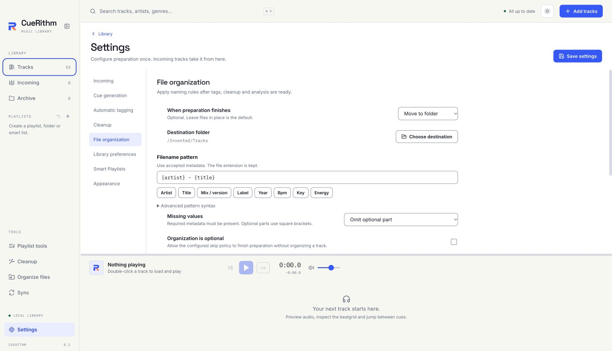

# Choose how files are renamed or moved after preparation

The File organization section decides whether CueRithm leaves a prepared file where it is, renames it, or moves or copies it into a folder, and how it builds the new name. The default changes nothing on disk. About five minutes to read.

<!-- figure:existing-17-settings-file-organization-reference-settings-file-organization -->
<figure markdown>
{ .screen loading=lazy }
<figcaption>The File organization section of Settings.</figcaption>
</figure>
<!-- /figure -->

!!! tip "New to this?"
    [Rename and sort files into folders](../../rename/organize-files.md) walks through a first reorganisation with a preview. [Build a naming pattern](../../rename/naming-patterns.md) teaches patterns step by step. This page is the complete list of controls.

This section applies to **future Incoming tracks**. To reorganise tracks you already have, use **Organize files** in the sidebar ([Rename and sort files into folders](../../rename/organize-files.md)). Naming runs last: after catalog tags and cleanup are accepted and before the track becomes ready. The audio itself is never altered.

## The controls { #controls }

Open **Settings → File organization** and press **Save settings**.

| Control | What it does | Default | Valid values | Task page |
|---|---|---|---|---|
| **When preparation finishes** | What happens to the audio file once the track is ready | **Leave files in place** | **Leave files in place**; **Rename in place** (new name, same folder); **Move to folder**; **Copy to folder** (the original stays) | [Rename and sort files into folders](../../rename/organize-files.md) |
| **Destination folder** | Where moved or copied files go. Shown for **Move to folder** and **Copy to folder** only. It reads "Choose where completed files belong." until you pick one, or "Saved folder is unavailable. Choose it again." if the saved folder cannot be reached. | None | A folder on this computer | [Rename and sort files into folders](../../rename/organize-files.md) |
| **Choose destination** | Opens the system folder picker. Reads "Choosing…" while open. | n/a | n/a | n/a |
| **Filename pattern** | The name, and for move and copy any subfolders, built from the track's final tags and measurements. The file extension is kept. | `{artist} - {title}` | 1 to 2048 bytes. **Rename in place** cannot contain `/`. | [Build a naming pattern](../../rename/naming-patterns.md) |
| Token buttons: **Artist**, **Title**, **Mix / version**, **Label**, **Year**, **Bpm**, **Key**, **Energy** | Insert that token at the cursor, for example `{title}`. The pattern accepts more tokens than the buttons show. | n/a | See [File naming tokens](../naming-tokens.md) | [Build a naming pattern](../../rename/naming-patterns.md) |
| **Advanced pattern syntax** | Opens a reminder: braces for tags, square brackets for an optional part such as `[ ({version})]`, folder separators for move and copy | Closed | n/a | [File naming tokens](../naming-tokens.md) |
| **Missing values** | What to do when a tag or measurement the pattern needs is empty | **Needs attention** | **Needs attention**; **Omit optional part**; **Keep original name (optional organization)**, which is available only when **Organization is optional** is on | [Build a naming pattern](../../rename/naming-patterns.md) |
| **Organization is optional** | Lets the skip choices finish preparation without organizing a track. Turning it off sets the collision choice and a skip choice back to **Needs attention**. | Off | On or off | [Build a naming pattern](../../rename/naming-patterns.md) |
| **If a filename already exists** | What to do when the new name is taken. CueRithm never overwrites an existing file. | **Needs attention** | **Needs attention**; **Skip track (optional organization)**, available only when **Organization is optional** is on | [Recover or undo a reorganisation](../../rename/undo-organize.md) |
| **Example filenames** | Shows how the pattern and policies treat two invented tracks. Marked "Invented metadata · not an apply plan". | Shown when a mode other than **Leave files in place** is chosen | Not editable | n/a |

With **Leave files in place** the section only says "Original audio files stay in place. Enable a mode to organize future Incoming tracks automatically." and hides the other controls.

At the foot of the section, a note states that every Incoming track is checked against its final metadata, that known linked DJ libraries must be repaired before a move finishes, and that references CueRithm does not know about cannot be checked.

### Read the example filenames { #examples }

The two examples use made-up values so you can test a pattern without touching a file. With the default pattern `{artist} - {title}` and **Needs attention** for missing values:

| Example | Original name | Result |
|---|---|---|
| Complete title | `example.flac` | `Example Artist - Example (Club Mix).flac` |
| Missing artist | `another-example.flac` | "Missing naming field: artist" (the track would need attention) |

If the pattern is invalid, the section shows the reason in red instead, and **Save settings** stays unavailable until you fix it.

## What the pattern allows { #pattern }

| Rule | Detail |
|---|---|
| Tokens | Written in braces: `{artist}`, `{title}`, `{key}`. 19 tokens exist; see [File naming tokens](../naming-tokens.md). An unknown token is an error. |
| Optional part | Text in square brackets is dropped when a token inside it is empty, but only with **Omit optional part**. One level only; it cannot contain `/`. |
| Folders | `/` separates folders in **Move to folder** and **Copy to folder**. A name cannot start or end with `/` or contain `//`, `.` or `..` parts. |
| Cleaning | In values, the characters `< > : " / \ | ? *` and control characters become `_`, and trailing spaces and dots are removed |
| Always blocked | Empty names, absolute or drive paths, Windows device names such as `CON` or `LPT1`, names ending in a space or dot in the pattern itself, and components over 255 characters |

Two filters can follow a token after a vertical bar inside the braces: `upper` and `lower` for any token, and `pad:1` to `pad:8` for `{track}` and `{disc}` only. Example: `{track|pad:2} - {title|upper}`. The full list is on [File naming tokens](../naming-tokens.md#filters).

## Missing values and clashes { #policies }

| Setting | A required tag is empty | A name is already taken |
|---|---|---|
| **Needs attention** | The track stays in Incoming with "Missing naming field: *token*" | The track stays in Incoming |
| **Omit optional part** | Parts in `[ ]` that contain the empty token are left out. A token outside brackets still blocks. | n/a |
| **Keep original name (optional organization)** | The track finishes with its original name; it is reported as skipped | n/a |
| **Skip track (optional organization)** | n/a | The track finishes with its original name |

A name that ends up empty stays blocked even when organization is optional, and an energy outside 1 to 10 or a BPM of 0 is always an error.

## What can go wrong { #problems }

| Symptom | Cause | Fix |
|---|---|---|
| **Save settings** is unavailable | The pattern is invalid, or **Rename in place** has a `/` in the pattern, or **Move to folder** has no destination | Read the red message under **Example filenames**; choose **Move to folder** if you want folders |
| A track stays in Incoming after tagging | A token in the pattern is empty and **Missing values** is **Needs attention** | Fill the tag, or use **Omit optional part** with brackets; see [Fix a track that needs attention](../../files/needs-attention.md) |
| A moved file breaks a DJ library | A linked library was not repaired | [Recover or undo a reorganisation](../../rename/undo-organize.md) |

## Related

- [Rename and sort files into folders](../../rename/organize-files.md)
- [Build a naming pattern](../../rename/naming-patterns.md)
- [File naming tokens](../naming-tokens.md)
- [Save your setup as a preset](../../files/presets.md), which can include these rules
- [Look up a setting](index.md)

<!-- verified: apps/desktop/src/views/OrganizationSettings.tsx (all labels, token buttons, options); apps/desktop/src/organization-types.ts (defaultOrganization); crates/cuerithm-library/src/organization/service/examples.rs (validate rules, example contexts "Complete title"/"Missing artist"); crates/cuerithm-organize/src/template.rs and paths.rs (grammar, sanitize, validate_relative); crates/cuerithm-organize/README.md; crates/cuerithm-organize/tests/templates.rs (run: passes); apps/desktop/src/test/file-organization-settings.test.tsx; legacy guides/file-organization.md and guides/settings.md re-checked. The default-pattern example result is derived from examples.rs inputs, not from a screenshot. -->
