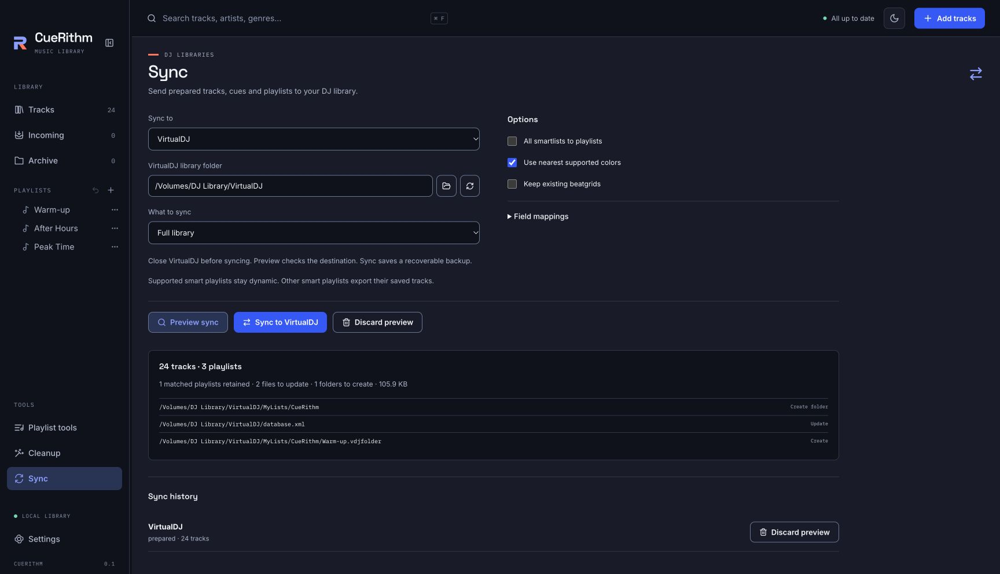

# Send your library to DJ software

Sync copies your prepared tracks, cues, beatgrids and playlists into rekordbox, a Pioneer USB stick, VirtualDJ, Engine DJ, djay Pro, Serato DJ Pro or Mixxx. Every sync starts with a preview and keeps a backup you can restore. A first rekordbox sync takes about fifteen minutes; later ones take a few clicks.

<!-- figure:existing-85-sync-preview-index -->
<figure markdown>
{ .screen loading=lazy }
<figcaption>Choose a destination, set the options, then preview.</figcaption>
</figure>
<!-- /figure -->

## Start here

Follow [Sync to rekordbox 6 or 7](rekordbox-direct.md). It is the longest path through Sync, and it teaches every control you meet in the other destinations: choosing a library, choosing what to send, previewing, applying and restoring. If you use Mixxx, its guide, [Sync to Mixxx](mixxx.md), is also written as a walk-through.

## Which software do you use? { #which-software }

Choose the destination in the **Sync to** menu at the top of the Sync view. The menu lists seven entries, in this order, and remembers your last choice.

| You use | Choose in **Sync to** | Guide | CueRithm needs | What was checked in the DJ program |
|---|---|---|---|---|
| rekordbox 6 or 7 on this computer | **rekordbox 6 / 7** | [Sync to rekordbox 6 or 7](rekordbox-direct.md) | The installed library, found from rekordbox's own settings | Opened and played in rekordbox 6.8.7.0303 and 7.2.19.0342 on macOS |
| VirtualDJ 8.5 | **VirtualDJ** | [Sync to VirtualDJ](virtualdj.md) | The VirtualDJ library folder | File formats only |
| Engine DJ | **Engine DJ** | [Sync to Engine DJ](engine-dj.md) | The Engine Library folder or an Engine drive | File formats only |
| djay Pro | **djay Pro** | [Sync to djay Pro](djay-pro.md) | The djay Media Library folder | File formats only |
| Serato DJ Pro 4 | **Serato DJ Pro 4** | [Sync to Serato DJ Pro](serato-dj-pro.md) | The Serato Library folder | File formats only |
| A CDJ or XDJ player, loaded from a USB stick | **Pioneer USB** | [Prepare a Pioneer USB stick](pioneer-usb.md) | The mounted USB drive | File formats only; no physical player |
| Mixxx 2.4 or newer | **Mixxx** | [Sync to Mixxx](mixxx.md) | The Mixxx settings folder, or none yet | Mixxx 2.5.6 on macOS and Debian's Mixxx 2.5.0 on Linux; not tried on Windows |

"File formats only" means CueRithm's output was checked against that program's database and file layouts with authored test libraries. It was not opened in the DJ program, so try a small playlist first. [Check what works with your DJ software](../help/compatibility.md) records exactly what each check covered.

!!! info "Not listed?"
    Traktor, Serato DJ Pro 3 and older, rekordbox 5 and older, and older VirtualDJ and Engine DJ library formats are not supported. CueRithm does not read or write rekordbox XML; rekordbox sync is direct only. Sync also works in one direction, from CueRithm to your DJ software. Importing an existing DJ library into CueRithm is in development and not available yet ([What CueRithm does not do yet](../help/not-available-yet.md)).

## Your goal, and the page for it { #your-goal }

**Get music into rekordbox**

| Your goal | Page |
|---|---|
| Send playlists, cues and beatgrids to rekordbox for the first time | [Sync to rekordbox 6 or 7](rekordbox-direct.md) |
| Send only the tracks rekordbox does not have yet | [Add only new tracks to rekordbox](rekordbox-new-tracks.md) |
| Decide whose value wins for a track that is in both libraries | [Resolve rekordbox sync conflicts](rekordbox-conflicts.md) |
| Use a rekordbox library that lives in Wine or Proton | [Use a Windows DJ library on Linux](windows-libraries-on-linux.md) |

**Send music to other DJ software**

| Your goal | Page |
|---|---|
| Fill a USB stick for CDJ or XDJ players | [Prepare a Pioneer USB stick](pioneer-usb.md) |
| Update a VirtualDJ library | [Sync to VirtualDJ](virtualdj.md) |
| Update an Engine DJ library or an Engine drive | [Sync to Engine DJ](engine-dj.md) |
| Update a djay Pro library | [Sync to djay Pro](djay-pro.md) |
| Add cues and grids to Serato DJ Pro | [Sync to Serato DJ Pro](serato-dj-pro.md) |
| Start a Mixxx library from CueRithm, or keep one up to date | [Sync to Mixxx](mixxx.md) |

**Choose and configure a sync**

| Your goal | Page |
|---|---|
| Send the whole library, one playlist, or only what changed | [Choose what to sync](choose-what-to-sync.md) |
| Change how colours, keys, grids and fields are written | [Set the sync options](sync-options.md) |
| Stop choosing the same library every time | [Save a destination for next time](saved-destinations.md) |

**Stay safe**

| Your goal | Page |
|---|---|
| Preview a sync, apply it, recover an interrupted one, or undo one | [Preview, apply and restore a sync](preview-apply-restore.md) |
| Find out why rekordbox does not show what you synced | [My sync does not show up in rekordbox](../help/troubleshooting/rekordbox-sync-problems.md) |

## What CueRithm writes to each destination { #what-is-written }

| Destination | Files CueRithm changes | Your music files | Cues and loops | Playlists |
|---|---|---|---|---|
| rekordbox 6 / 7 | The library database, plus new analysis and artwork files | Not changed; optional WAV copies for formats rekordbox cannot play | Hot and memory cues, loops, active loop | Folders, playlists, My Tags |
| VirtualDJ | `database.xml` and CueRithm's own playlist folder | Not changed | Cues and loops, active loop | Native or ordinary |
| Engine DJ | `Database2/m.db` | Not changed; optional copies to an Engine drive | Eight cues, eight loops, active loops | Native or ordinary |
| djay Pro | `MediaLibrary.db` | Not changed | Eight cue or loop slots | Native or ordinary |
| Serato DJ Pro 4 | `root.sqlite` and the aggregate database | **Cues and grid are written into the audio files' tags** | Eight hot cues, eight saved loops | Crates, native or ordinary |
| Pioneer USB | The export library and analysis files on the stick | Copied onto the stick | Hot cues, memory cues or both | Ordinary playlists only |
| Mixxx | `mixxxdb.sqlite` (and Mixxx's folder list when it is empty) | Not changed | Hot cues in slots 1 to 36, saved loops; no active-loop flag | Playlists or crates; folders become `Folder / Playlist` names |

Sync sends tracks that are in **Tracks** and prepared. It does not send Incoming or archived tracks, and it never sends CueRithm's energy rating. Tracks that exist only in the destination are left alone (a USB stick with **Clean up unused files** switched on is the one exception, and its page explains it). The per-destination pages list every field.

## What to check before you rely on a sync { #limits }

- **rekordbox builds.** Compatible rekordbox 6 and 7 builds can be written to on macOS, Windows and Wine or Proton; CueRithm decides from the database and asset formats it finds, and an unrecognised format stays **Read only**. Opened and played in rekordbox itself: macOS 6.8.7.0303 and 7.2.19.0342. See [which builds can be written to](rekordbox-direct.md#builds).
- **Close the DJ program first.** CueRithm checks the running processes and refuses to preview or apply while the program is open. For rekordbox that includes rekordbox Agent.
- **One change at a time.** Changing the destination, the scope, an option or anything in your library discards the preview; you preview again before applying.
- **Backups are kept, not pruned.** Each applied sync keeps its restore data in CueRithm's data folder until you remove it. See [where CueRithm keeps your data](../files/library/where-data-lives.md).

## Not what you wanted?

- To build the playlists you want to send, see [Build playlists and sets](../playlists/create-a-playlist.md).
- To move or rename files before the first sync, see [Rename and sort files into folders](../rename/organize-files.md). Do it first for rekordbox: Organize files blocks a track that is already linked to a rekordbox track, because CueRithm cannot yet repair the path stored inside rekordbox's database.
- To protect CueRithm's own library, see [Back up your library](../files/library/back-up-library.md).

## Related

- [Preview, apply and restore a sync](preview-apply-restore.md)
- [Choose what to sync](choose-what-to-sync.md)
- [Coming from Mixed In Key, Lexicon or rekordbox](../get-started/coming-from-other-tools.md)
- [My sync does not show up in rekordbox](../help/troubleshooting/rekordbox-sync-problems.md)

<!-- verified: apps/desktop/src/views/Sync.tsx; views/RekordboxSync.tsx; sync-types.ts (seven syncTargets, defaults); crates/cuerithm-dj-sync/src/sync.rs, discovery.rs, mixxx/*.rs, serato4/media.rs, pioneer_usb.rs; crates/cuerithm-library/src/dj_sync.rs (ready and not archived), rekordbox_sync_service/*; crates/cuerithm-library/src/organization_references.rs (native rekordbox links block Organize files); docs/research/rekordbox-direct-contract.md; docs/research/mixxx-sync-contract.md; legacy guides/sync.md, guides/sync-mixxx.md, about/roadmap.md re-checked -->
