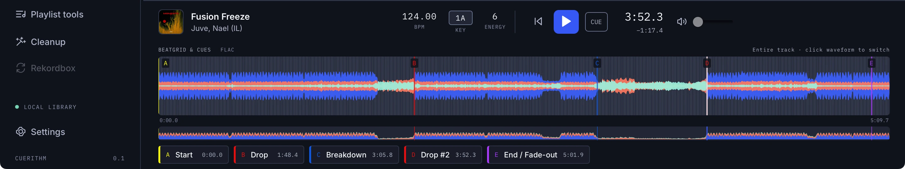

# Waveforms

The waveform in the table and the player is computed once per track from the same decoded PCM the analyser uses, then cached.

<figure markdown>
  { .crop loading=lazy }
</figure>

## What is computed

For up to 16,384 bins across the track:

- the minimum and maximum sample and the RMS in each bin (this sets bar height, scaled per track),
- three frequency band levels,
- an RGB triple for the colour.

The row previews use 240 bins; the player uses 16,384.

## The three bands

A 4,096-point Hann-windowed FFT at 44.1 kHz, using at most 4,096 analysis points per bin, splits the sound into:

| Band | Range | Role |
| --- | --- | --- |
| **Bass** | 0 to 150 Hz (weight 1.2) | The kick and sub |
| **Mids** | 150 to 1,500 Hz | Body, vocals, synth lines |
| **Highs** | 1,500 to 6,000 Hz | Hats and air |

The strongest band is scaled to 255. For the stacked "Layers" styles, nested levels use 60 to 120 Hz, 120 to 500 Hz and 900 to 1,500 Hz.

## Colour

The interface blends the band weights into a palette in a perceptual colour space (OKLab). Every palette steps from dark to light in the order bass, mids, highs, so the bands remain distinguishable by lightness alone, which keeps them readable for colour-blind users. The default pairing of cobalt and coral is a blue-orange axis that survives red-green colour blindness.

Styles: CueRithm, Dusk, Lagoon, Tonal (one blue), Layers, and Layers tonal. See [Choose a theme and waveform style](../learn/appearance.md).

CueRithm stores the display style on your computer, outside the library. Switching styles does not recompute waveform data.

## Caching

Waveform data is cached on disk under the library's data folder, keyed by the source file's hash, the decoder identity and the bin count. Changing the file or the decoder produces a fresh waveform.

!!! note "A small display difference"
    The Settings preview multiplies the high band for legibility. The engine's own weight for highs is 1.0.
